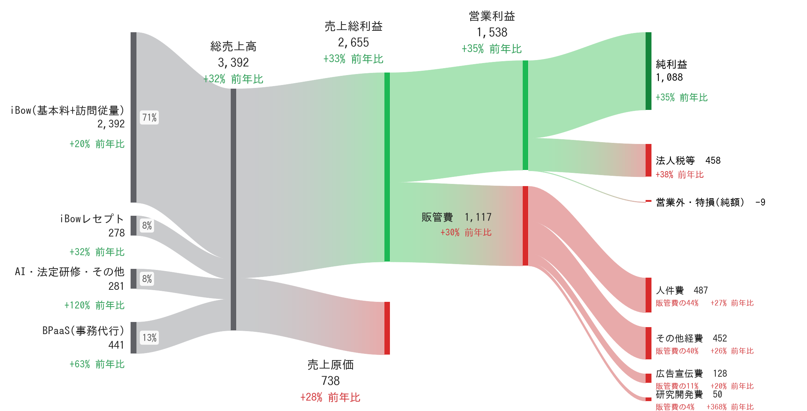
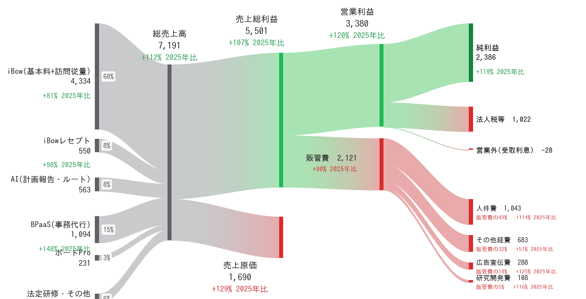

# eWeLL(5038) 投資判断報告書  作成日: 2026-11-16

基準: 2026年12月期 第3四半期(2026-11-13発表)。株価 2,297円(2026-11-16 終値)。単位は特記なき限り百万円、日本基準・単体。

## 1. エグゼクティブサマリ — 質の高い従量課金SaaSだが、株価はその質を十分に払っている。見送り(1,468円以下で分割)

**一文**: 市場は株価2,297円で、この会社に資本コスト約7.5%(β約0.8の低リスクの複利株)を置き、12か月先PER約23倍を払う。当方の見立ては、業界の新規開設が3年横ばいで契約数の伸びは13.5%→約9%に機械的に減速し、iBow本体の1ST単価も横ばいのため、基準のEPS成長は年16%(会社計画比−4〜5%)。資本コスト8.9%での理論株価 1657.5円(株価比−640円。うち倍率の差455円、EPSの見立ての差185円)。基準のEPSでも倍率が17〜20倍に収れんすれば年率リターンは6〜11%と資本コスト並みで、安全余裕が無い。差は2027年2月12日頃の通期決算(新規獲得・中計のローリング)、5月の1Q(値上げ後の単価と解約)、7月の業界調査で試される。新規獲得が720件以上かつ1Qの単価が101千円以上、または業界の新規開設が増加に転じれば撤回する。

| 市場の前提と当方の見立て | 単位 | 市場 | 当方 | 試される時期 |
|---|---|---|---|---|
| 資本コスト(株価が前提にする割引率) | % | 約7.5(計算機の逆算。会社計画の経路では約7.4) | 8.9(10年国債2.87%+β1.0×6.0%) | 2027-02-12頃 中計のローリング |
| 3年のEPS成長(2026→2029年) | %/年 | 約19〜21(会社計画) | 16.4(事業エンジン) | 2027-02-12頃 |
| 顧客単価(2028年) | 千円/月 | 110.3(会社の中計) | 102.5 | 2027-05-14頃 1Qの単価 |
| 年間の新規獲得 | 件 | 約660(中計の契約数と整合) | 約660(加速の兆候なし) | 2027-02-12頃 |

- **価値の橋**: 株価2,297円 → 今の利益が続くだけの価値1,124円(−1,173円)→ 成長と変化の上乗せ+534円 → 理論株価 1657.5円。株価との差640円の71%は倍率=資本コストの差、29%がEPSの見立ての差。本質は「成長が鈍るとき、市場が今の低い割引率を保つか」。
- **事業で最も価値を動かす変数**: 契約数(新規獲得の件数と解約率)。強気側で+147.5円/株。判別KPIは年間の新規獲得件数。続行の線 2026年通期で680件以下、見直しの線 720件以上または2027年1Qで190件以上(680〜720件は判断保留)。
- **撤回の線**: ①2026年の新規獲得720件以上 → 獲得率の節点を0.40→0.7に上げて再計算、②2027年1Qの顧客単価101千円以上かつMRRチャーン月0.20%以下 → 値上げの定着を確認し再計算、③2027年7月頃の業界調査で新規開設2,700件超 → 永続成長4%で置き直す(DCF約2,680円)、④2027年1QのMRRチャーン月0.25%超または他社切替30件超 → 分割圏でも買わない。
- **判断**: 見送り(計算機の出力)。エントリー圏は分割 1278.2円超〜1467.8円以下、即時エントリー ≤ 1278.2円。52週安値1,695円でも判断は監視。
- **優位の種類**: 分析の優位(iBow本体単価の横ばいとアップセルへの分解、業界の新規開設×獲得率の流量モデル)。

## 1-2. 市場との差分と優位の種類 — 市場は低い割引率で長い成長を買っている。成長の分母が横ばいであることは値段に入っていない

市場の仮説: 株価は12か月先EPS約100円の約23倍。今の利益が続くだけの価値は1,124円(100円÷資本コスト8.9%)で、株価の51%(1,173円)が成長の値段。計算機で逆算すると、株価は資本コスト約7.5%を前提にする(会社計画の経路でも約7.4%)。コンセンサスは会社予想とほぼ同じ(2026年 営業利益1,925 vs 会社1,927、目標株価2,680円・アナリスト1人)。売上のコンセンサス4,188は会社予想4,277を下回り、売上の未達はすでに織り込まれている。

構造上の見方: 解約・粗利・FCFの質は高く、低い割引率には根拠がある。しかし成長は「契約数」と「アップセル」の2本だけで、契約数は業界の新規開設(3年横ばい)に縛られる。成長率が24%→約11%(2029〜30年の売上)に下がる過程で、市場が今の倍率を保つ根拠は弱い。優位の種類は**分析の優位**(開示の製品別売上を稼働STで割る分解と、業界統計を使った流量モデル)。時間軸の優位は小さい(値上げ前にサーバー費が先に出る粗利率の一時的な低下は、クラウド単体で1Q 76.7%→3Q 79.0%とすでに戻り始めている)。

## 2. 事業本体 — 訪問看護の公定価格に乗った「1訪問136円」の通行料。2.7倍高くても流出は小口の廃業だけ

**お金の流れ(型1)**: 全国約2万の訪問看護ステーションに、記録・計画書・レセプトを一体で処理するクラウド電子カルテiBowを、基本料18,000円/月+100円/訪問(500訪問の事業所で月68,000円=訪問売上の約1.6%)で売る。2014年以来値上げなし、2027年1月に基本料だけ+10%。変動費はサーバー(売上比7%、ドル建て)とBPaaSの事務人員で、営業利益の限界利益率は50%。獲得費は新規1件約61万円で約16か月で回収、解約は年5.3%(約半数は顧客の廃業)で、売上ベースの解約は年1〜2%。粗利の約9割は売上の87%のクラウドにたまる。

- **製品群の地図**(売上の100%を説明): iBow 2,392(70.5%)、iBowレセプト 278(8.2%)、AI計画報告・法定研修ほか 261(7.7%)、BPaaS(事務代行)441(13.0%)、その他 21(0.6%)。戦略テーマはAI計画報告(iBow稼働の47%が利用)、AIルート(2026年7月課金、281件)、ボードPro(2027年1月課金、目標200件)、BPaaS(325件、粗利率64%)。
- **バリューチェーン**: クラウド基盤(ドル建て)→ 当社(直販のみ)→ 訪問看護ステーション(平均月約500訪問・1訪問約8,500円、事業所の収支差率10.3%=厚労省 令和6年度決算)→ 在宅療養者(医療約48万人・介護約74万人)と保険者。利益は記録と請求を握るソフトの側に厚くたまる。
- **なぜ奪われないか(型6)**: 乗り換えには全職員の再教育と請求停止のリスク(月の売上が止まる)が伴う。定額25,000円のカイポケ(7,000事業所超)より500訪問のSTで2.7倍高いのに、他社切替の解約率は3.3%(2025年)→2.6%(2026年、年率)に下がり、売上ベースの解約は件数ベースの半分以下=流出は廃業する小規模STで、大口(複数STの法人、NRR114.7%)は残る。新規でも業界の開設の約27%を取り、保有シェア19.2%を上回る。利用料は事業所売上の1.6%で、価格は選択の決め手になっていない。**12年据え置きの1訪問100円は未行使の価格決定力**。
- **成長を止めるもの**: 業界の新規開設(2,437→2,487→2,428件で3年横ばい)。廃止は701→960件に増え、稼働数の伸びは10.4%→8.2%→6.9%。営業人員を増やしても獲得は増えておらず(全社の従業員107→131名、獲得は年633→670→665件)、制約は分母の側にある。外れる日付は無く、上振れの契機は2026年6月の包括型訪問看護療養費の「記録は電子的方法によって記録すること」(告示74号)の要件化。

## 3. 現状の収益構造 — 増収の97%は数量。ただしiBow本体の1ST単価は横ばいで、単価の伸びの約9割はアップセル

- **損益の流れ(FY2025)**: 売上3,392(+32%)→ 粗利2,655(78.3%)→ 販管費1,117(32.9%)→ 営業利益1,538(45.3%)→ 純利益1,088(32.1%)。営業利益の増減は売上の量の効果+637、粗利率の変化+20、販管費の増加−256。

- **事業エンジンの式**: 売上 = 平均稼働ST × 顧客単価 × 12 + 非リカーリング。FY2025は 3,137 × 86.75千円 × 12 + 170 = 3,436(実績比+1.3%、±5%で再現)。
- **分解で見えたこと**: iBow本体の1稼働STあたり月額は65.4千円(2025年3Q)→65.5千円(2026年3Q)で横ばい、推定訪問件数は約475件で変わらない。顧客単価の伸び+6.0千円のうち、AIが+2.5千円、BPaaSが+2.7千円。既存法人のNRR108%を、新規の小規模ST(初期単価 約45〜54千円)が打ち消している。「訪問件数の従量課金が業界の成長を自動で取り込む」はST単位では働いていない。
- **費用構造の変化**: サーバー費は81(2023年)→227百万円(2026年9月まで)で約3.7倍ペース。2026年1-9月は外注費+71%、全社の粗利率79.0%→76.3%。会社の説明は「利用量の増加と円安」で、AI推論費の内訳は非開示。2027年1月の基本料+10%で戻るのは年約80百万円で、増分の約6割。
- **営業利益率の天井**: 限界利益率は50%(5期回帰R²0.99)、販売費を除けば57%。中計は3年間45%台に固定し、増収の約半分を再投資する設計。減速すれば利益率を約+10pt上げる余地が残る。
- **ROE**: 純利益率は28.5%→32.1%に上がったが、現預金の積み上げ(総資産の67%)で総資産回転率1.12→0.79、レバレッジ2.10→1.27となり、ROEは67%→32%に半減。

## 4. 経営陣のシナリオ — 2028年売上61億円・営業利益率45%、2040年シェア50%。契約数の計画は加速を含まない

- 骨格: 「iBowを軸に在宅医療のプラットフォーマーへ」(2026年8月QA)。中計(2026-28年)は売上4,277/5,199/6,149、営業利益1,927/2,350/2,784、契約数3,954/4,418/4,882件、顧客単価98.9/105.7/110.3千円、解約率0.15/0.14/0.13%。
- ピース(事業エンジンの変数への翻訳と進捗):
  | ピース | 変数 | 進捗 | 評価 |
  |---|---|---|---|
  | 新規開設の刈り取り(Web広告) | 新規獲得 | 2026年1〜3Q 499件(前年同期511件) | − 分母が横ばい |
  | AI計画報告・AIルート | 単価 | 付帯47%・AIルート281件(期末目標約400件) | + 単価の伸びの主役 |
  | BPaaS | 単価・粗利率 | 稼働325件(+28%)、粗利率64% | +/− 単価は上げ粗利率は下げる |
  | 基本料+10%(2027年1月) | 単価・粗利率 | 決定済み。500訪問で+2.6% | + 最初の価格決定力の試験 |
  | ボードPro(2027年1月課金、30,000→50,000円) | 単価 | 無償期間中、目標200件 | + 中計に未算入(上振れ要因) |
  | カエドキ・けあログっと | 将来の収益線 | 無料、課金の計画なし | 0 オプション |
  | 資本配分(M&A・機動的な自己株取得) | 株数・ROE | 2026年に初の自己株取得300百万円 | 未決 |
- 会社の中計の契約数は、年660件の獲得と解約5.3%の流量でほぼ再現できる(差±1%)。計画の上振れ余地は単価の側にあるが、2026年の単価計画(98.9千円)は3Q 94.1千円で未達(会社も「想定を若干下回る」)。

## 5. シナリオの採点 — 総合はB(平均2.92)。契約数の計画は妥当、単価の計画は約7%楽観

- 契約数(計画妥当、確度高): 流量の式で再現。ただし2026年1〜3Qの獲得が前年割れで、計画の契約数も下振れ方向。
- 単価(計画楽観): 計画2028年110.3千円に対し基準102.5千円(本体横ばい+値上げ+1.8+AI+3.4+BPaaS+2.7+ボードPro+3.7、ただし2030年までの積み上げ)。差額は2028年売上で約−420百万円、営業利益で約−120百万円。
- 粗利率(計画並み): 会社の2026年計画75.6%に対し基準76.2%。クラウド単体は戻りつつある。
- 総合: 計画のEPS 2028年128.3円に対し基準122.8円(−4%)。差は小さいが、2029年以降の減速(契約数の伸び8〜9%)が計画に書かれていない点が株価との差になる。

## 6. シナリオのフェーズごとの事業構造の変遷 — 現在は③スケール後期で、2027〜28年に④成熟への移行

- ①立ち上げ(2014〜2018年: iBow提供開始、自社STで運用ノウハウ)→ ②急成長(〜2022年: 上場、売上+34%)→ **③スケール(2023〜2026年: 売上+24〜32%、営業利益率44〜47%、獲得が新規開設の約27%に達する)** → ④成熟への移行(2027〜28年: 契約数+9〜11%、単価+4〜7%、アップセルと値上げで刈り取り)。
- 次の段差: 2027年1月(基本料+10%・ボードPro課金)。段差の大きさは年約80百万円+最大約100百万円(ボードPro 200件×30〜50千円×12)で、売上の約4%。
- 移行の判定: 2027年の売上成長が+20%を割り、獲得が年650件前後で続けば④に入ったとみなす。

## 7. シナリオの実行可能性と成立条件 — 成立条件は「値上げ後も流出が増えないこと」と「AIの付帯が7割に届くこと」

- 成立条件1: 2027年1QのMRRチャーンが月0.20%以下(直近8四半期で6回達成)。
- 成立条件2: AI計画報告の付帯がiBow稼働の47%→70%(2030年)。
- 成立条件3: 包括型の電子化要件で、高齢者住まい併設STの獲得が上乗せされる(後ろ向き検証では、2024年のオンライン請求の開始で獲得が511→633件に加速した。基準はこれを入れていない)。
- 実行の担い手: 創業者の中野社長(39.0%保有、2012年設立)。取締役4名のうち社外1名、CFOは執行役員。後継の計画は未開示。

## 8. 13条件による構造評価 — 分布A3・B7・C2・D1、平均2.92でB。成長は30%に届かず条件6はD

| # | 条件 | 現在 | 将来 | 決め手 |
|---|---|---|---|---|
| 1 | 価格決定力・競争優位・成長性 | B | A(40%) | 2.7倍高くても流出は低下。成長の分母は横ばい |
| 2 | コア事業の潤沢なCF | A | A | FCF 1,191(売上の35%)、LTV/CAC 8.6倍 |
| 3 | コア資産の転用 | B | A(50%) | 単価の伸びの約9割がAI・BPaaS |
| 4 | 日本株 | A | A | 東証グロース |
| 5 | CEO | B | B | 事業を自ら築いた創業者。資本配分と統治に留保 |
| 6 | EPS CAGR 30%・PEG<1 | D | C(30%) | 3年CAGR 16.4〜19.3%、PEG1.2〜1.4 |
| 7 | 安い理由がリスクの過大評価 | C | B(45%) | 減速は正しいリスク、競合と粗利率は過大評価の可能性 |
| 8 | コモディティでない | B | B | 機能の束で差別化、定額の競合が多数 |
| 9 | AIの停めない運用 | C | B(40%) | AIは付加価値で中核ではない |
| 10 | 無形資産の陳腐化 | B | B | 資産計上は180百万円。優位の陳腐化を監視 |
| 11 | 模倣困難・代替不可能 | B | B | 乗り換えの痛み。代替は存在 |
| 12 | 従量課金型 | A | A | 売上の約95%がリカーリング、1訪問100円 |
| 13 | アーキタイプ | B | B | ORCL型の小型版。価値は持続性と値上げ余地 |

条件6のDは、利用者の方針(東邦化学工業の分析で決定)に従い、基準(30%)として残しつつ拒否権は適用しない。

## 9. 妥当なPEGの導出 — 等級B・帯の中の位置0.42で、許容PEG 1.127(2026年)→0.977(2029年)

- 許容PEG 1.127(2026年)、1.077、1.027、0.977。α 22.9%。資本コスト8.90%(10年国債2.87%+β1.0×ERP6.0%)。
- 事業エンジンの5年のEPS成長は15%を下回るため、計算機は成熟の理論式(PER=(1−g/ROE)÷(資本コスト−g)、永続成長3.5%・定常ROE50%で約17.2倍)を使う。PEG×gで計算しても約18倍で、方法による差は小さい。

## 10. 年度別バリュエーションと最終判断 — 理論株価 1657.5円、判断は見送り

| 年度 | EPS(エンジン) | 3年のg | 妥当PER | 適正株価 | 今日の価値 |
|---|---|---|---|---|---|
| 2026 | 89.11 | 16.4% | 17.2 | 1,534.7 | 1,534.7 |
| 2027 | 105.34 | 14.1% | 17.2 | — | — |
| 2028 | 122.77 | — | 17.2 | — | — |
| 2029 | 140.43 | — | 17.2 | — | — |

- 経路別の理論株価: 事業エンジン 1657.5円(採用)、会社計画 1842.5円、コンセンサス(会社計画で代用)1842.5円。
- シナリオ: 強気 2,336.8円(11.0%)、基準 1,667.3円、弱気 1,557.5円(13.5%)。期待値 1726.1円。
- 感応度(1株あたり): 契約数 強気+147.5円/弱気−26.1円、単価 強気+145.3円/弱気−37.1円、粗利率 弱気−59.5円/強気+32.6円、EPS±10%で±165.7円。上振れが大きいのは、成長が15%を超えると妥当PERの式が切り替わるため。
- 交差確認(平均に入れない): 資本コスト8.0%で2,006.8円、8.4%で1,835.7円、9.5%で1,483.0円。余剰現金 約150円/株。最も甘い前提(資本コスト8.0%+余剰現金)でも約2,157円で株価2,297円に届かない。2段階DCF(2030年まで基準・以後4%)は約2,680円で、差は永続成長の置き方による。同業の会社予想PERの中央値は約20倍。
- 判断: **見送り**。分割エントリー 1278.2円超〜1467.8円以下、即時エントリー ≤ 1278.2円。
- 期待リターンの検算(2029年末に2030年EPS156.5円で評価、配当約76円込み): PER17.2倍(計算機の成熟の倍率)で年率6.2%、PER20倍(同業中央値)で年率11.4%。資本コスト8.9%を挟む幅で、今の株価に安全余裕は無い。1,468円で買えばPER17.2倍でも年率22.7%。
- 株価が前提にする資本コスト: 事業エンジンの経路で資本コスト7.5%なら2,269.0円、7.3%なら2,393.3円。会社計画の経路では7.5%で2,254.8円。差640円の内訳は、倍率(資本コスト)の差455円、EPSの見立ての差185円。

## 11. 乖離を埋めるカタリスト — 2027年2月12日頃の通期決算と中計のローリング、5月の1Q

| 日付 | 何が出るか | 見立てが正しければ | 撤回するなら |
|---|---|---|---|
| 2027-02-12頃 | 2026年通期(新規獲得・4Q売上)、中計の2029年までのローリング | 新規獲得680件以下、売上4,277未達(P1 80%)・営業利益1,900以上(P2 75%) | 新規獲得720件以上 |
| 2027-05-14頃 | 2027年1Q(値上げ後の単価・MRRチャーン・クラウド粗利率) | 単価99千円前後、MRRチャーン月0.20%以下(P5 65%) | 単価101千円以上かつチャーン0.20%以下 |
| 2027年7月頃 | 全国訪問看護事業協会の2027年調査(新規開設・廃止) | 新規開設2,400件前後で横ばい | 新規開設が2,700件超 |

## 12. リスクと投資アクション — 上振れのリスクは「値上げの余地」、下振れのリスクは「改定での事業所の淘汰」

- 弱気の反論と判定(付録I): 8件。獲得の加速は「一部」(1〜3Q計は前年割れだが2Q・3Qは前年超えで、加速も減速も示さない。節点N1 0.45→0.40)、単価の加速は「一部」(節点N2 0.45→0.55)、現預金の未加算・定常ROE・永続成長は「正しい」(前提を直し、事業エンジンの価値は約1,702円から1,657.5円へ)、資本コストは「一部」(8.0〜9.5%で感応度)、営業利益の下振れは「逆」、廃止の急増と報酬抑制は「未決」(2027年1Qで決着)。
- 上振れリスク(見送りが誤りになる筋): 1訪問100円の改定(+10円で売上+7%前後)、包括型の電子化要件による獲得の加速、ボードProとAIスコアリングの付帯、M&A。
- 下振れリスク: 2027年度介護報酬改定・2028年度診療報酬改定での同一建物の適正化の強化、AIで記録作成の差が縮むこと、円安によるサーバー費、キーパーソン(創業者)。
- 投資アクション: いまは見送り。1,467.8円以下で分割買い(1,278.2円以下は即時)。2027年2月の通期決算で獲得が720件以上なら再評価。流動性は1日の売買代金約85百万円で、3千万円の建玉に約1.8日。

## 既知の制約

- サーバー費の内訳(AI推論費・円安・無償機能)は非開示で、粗利率の仮説(H1・H1b)は一部の判定にとどまる。
- 新規獲得のうち新規開設と他社からの切替の内訳は非開示(会社は「切替の流入が解約より圧倒的に多い」とだけ説明)。
- コンセンサスEPS(2027〜2028年)は取得できず、会社計画で代用した。アナリストは1人。
- 業界統計(4月〜翌3月)と当社の獲得(暦年)は期間が3か月ずれる。
- 計算機は余剰現金を理論株価に含めないため、約150円/株を併記した。
- 有報のPDFはフォント欠落のため PyMuPDF でテキスト化した。

## Appendix B: 計算前提

- 資本コスト8.90%(rf 2.9%=10年国債2.87%、β1.0、ERP 6.0%)。生存確率1.0(無借金)。定常ROE50%(現預金を除く事業の資本)、永続成長3.5%。
- EPSの経路(円): 事業エンジン 2025年71.6・2026年89.11・2027年105.34・2028年122.77・2029年140.43・2030年156.52。会社計画 87.18・108.40・128.30(営業利益を税率30.5%・株数1,513万株で換算)。
- 節点: N1 契約数(獲得率の上昇)p=0.40、N2 単価(値上げの定着とAI・ボードPro)p=0.55、N3 粗利率 p=0.5。節点の確率は事前登録(2026-11-16 17:20)の後、反論R1・R2で修正した。
- 拒否権の対象外: 条件6(利用者の方針)。
- 事業エンジン(engine.py): 契約ST = 前年末 + 獲得 − 解約率 × 前年末。基準は獲得660件・解約5.3%・単価 2027年98.0→2030年110.3千円・粗利率76.2〜76.5%・販管費率30.4→29.5%。後ろ向き検証(2023年末の情報で2025年を予測): 売上−5.5%・営業利益−8.2%の誤差。外し方は制度変更による獲得の加速の見落としで、基準は下振れ方向に偏る可能性がある。

## Appendix G: 変化の評価表

change_map.json の15項目(需要・製品構成・価格決定力・バリューチェーン・単位採算・費用構造・能力と制約・投資と回収・FCF・貸借対照表・ROE・競争優位・景気感応度・経営・市場の見方)を、FY2022 | 2026年3Q | 2030年(基準)で対比した。悪化は需要(業界の伸びの鈍化)・費用構造(サーバー費)・能力と制約(獲得の分母)・ROE(現金の積み上げ)、改善は製品構成・価格決定力・バリューチェーン上の取り分・FCF・競争優位。市場の見方は「済」(株価は強気シナリオとほぼ等しい)。

## Appendix H: 仮説台帳

| id | 仮説 | 判定 | 立て直し |
|---|---|---|---|
| H1 | 粗利率の低下はAI推論費の構造変化 | 一部 | H1b: 無償機能とAIの計算量。有償化でクラウド粗利率80%へ(2027年1Qで79.5%が判別線) |
| H2 | 獲得は業界の新規開設に連動 | 一部 | 開設の約27%。約3割は他社からの切替と推定 |
| H3 | 競合のAIで他社切替の流出が上昇 | 棄却 | H3b: 大口から流出 → 棄却(売上の解約は件数の半分以下) |
| H4 | 単価の伸びの約半分がアップセル | 一部 | 約9割がアップセル、本体は横ばい |
| H5 | 売上は未達、営業利益は予想並み | 未決 | 2027-02-12に判定 |
| H6 | 利益率45%台は再投資の裁量 | 一部 | サーバー費の上昇は裁量でない |
| H7 | 現金はM&Aと新規事業に温存 | 支持 | — |

## Appendix I: 弱気の反論と判定

| id | 反論 | 決着させたデータ | 判定 | 評価への反映 |
|---|---|---|---|---|
| R1 | 獲得は加速する | 1〜3Qの獲得 499件 vs 前年同期511件、2Q・3Qは前年超え | 一部 | N1 0.45→0.40 |
| R2 | 単価は加速し計画に追いつく | 単価の前年比 +5.0%・+5.0%・+6.8% | 一部 | N2 0.45→0.55 |
| R3 | 粗利率は早く戻る | クラウド1Q 76.7%→3Q 79.0%、全社3Q 76.8% | 一部 | N3 据え置き、判別線79.5% |
| R4 | 現預金を加えていない | 余剰現金 約150円/株 | 正しい | 併記、定常ROEを事業の資本で50% |
| R5 | 妥当PERが低い | 資本コスト8.0〜9.5%の再計算 | 一部 | 感応度に記録、判断は不変 |
| R6 | 永続成長4%・ROE30%の置き方 | 現預金を除くROE | 正しい | 3.5%・50%に修正 |
| R7 | 2026年の営業利益が下振れ | 4Qに要る営業利益473 vs 前年4Q 341.5 | 逆 | 変更なし |
| R8 | 廃止の急増と報酬抑制で解約増 | 2027年1Qのチャーン・介護報酬改定 | 未決 | 撤回の線に追加 |

示唆の種(lenses.md の旗): L01・L02・L05・L07・L08・L18・L19 は仮説・示唆に使用。L12(株数の増加)はIPOとストックオプションによるもので残りの希薄化0.23%のため不採用。

## 品質ゲート結果

gate.py facts・map・change・lenses・hypotheses・conditions・valuation・thesis・report を通過(結果は作業フォルダの記録を参照)。
