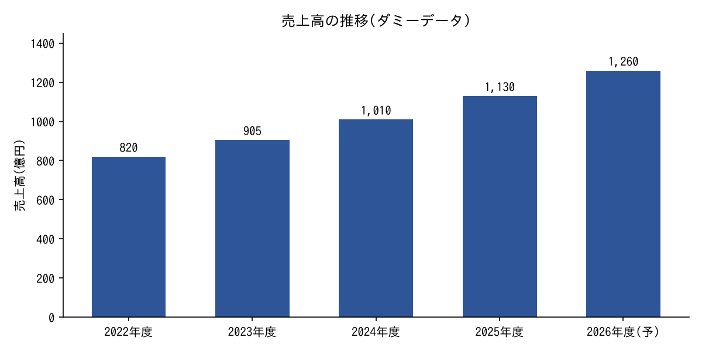

% サンプル株式会社(ダミー) 長期保有13条件による投資分析報告書
% 事業エンジンと価値感度から見た割安優良株の審査(全データは変換器検証用のダミー)
% 2026年10月11日

# 1. エグゼクティブサマリー

本報告書は、**サンプル株式会社**(以下、同社)について、長期保有の可否を審査した結果をまとめたものである。数値はすべて *変換器の検証用ダミー* であり、実在の企業・株価とは無関係である。詳細な根拠は [会社IR資料](https://example.com/ir/2026) および https://example.com/data を参照。

> **差分宣言**: 市場は同社の営業利益率を 9% で定常化すると見ているが、本報告書は事業エンジンの変数 `解約率` と `継続課金比率` から 12% 前後まで改善余地があると判断する。この差分が投資判断の芯である。

---

## 1.1 結論

結論として、現在の株価水準は **割安圏にある** と評価する。ただし、以下の前提が崩れた場合は判断を見直す。

### 1.1.1 判断の前提

- 継続課金比率が 70% を下回らないこと
  - 直近 4 四半期の平均は 74.2%
  - 下限シナリオでも 68% を維持
- 解約率(月次)が 1.5% 以内に収まること
- 競争優位期間が 10 年以上続くこと
  - 切替コストの源泉は *データの蓄積*
  - 参入障壁の源泉は **ブランドと規模**

#### 補足(4 段目の見出し)

見出し 4 の本文。ここでは `PEG` を 3 経路で導出し、**妥当 PEG** を 1.0 倍前後と置く。改行を含む行は
そのまま 1 つの段落として連結される。

### 1.1.2 次のアクション

1. 四半期決算ごとに継続課金比率を確認する
2. 解約率の分布を顧客セグメント別に追跡する
   1. 大口顧客(上位 20 社)
   2. 中小顧客
3. エントリー価格帯に入った時点で分割投資を開始する

# 2. 事業の理解

## 2.1 主要指標の一覧

以下の表は 8 列 × 10 行のサンプルである。セル内に ` ` を含む行と **太字** を含む行がある。

| 項目 | 2022年度 | 2023年度 | 2024年度 | 2025年度 | 前年比 | 備考 | 評価 |
|:---|---:|---:|---:|---:|---:|:---|:---:|
| 売上高(億円) | 820 | 905 | 1,010 | 1,130 | +11.9% | 継続課金が牽引 | **A** |
| 営業利益(億円) | 74 | 88 | 103 | 124 | +20.4% | 固定費の希薄化 (人件費比率が低下) | A |
| 営業利益率 | 9.0% | 9.7% | 10.2% | 11.0% | +0.8pt | 広告費の効率改善 | B |
| 継続課金比率 | 66.1% | 69.0% | 72.5% | 74.2% | +1.7pt | 年額プランへの移行 が進展 | **A** |
| 解約率(月次) | 1.9% | 1.8% | 1.6% | 1.5% | -0.1pt | 低下傾向 | A |
| 顧客数(千) | 412 | 455 | 508 | 566 | +11.4% | 中小顧客が増加 | B |
| ARPU(円) | 1,660 | 1,690 | 1,720 | 1,760 | +2.3% | 上位プランの比率上昇 | B |
| 設備投資(億円) | 38 | 41 | 47 | 55 | +17.0% | データセンター増強 と**開発拠点**の新設 | C |
| 自己資本比率 | 52.0% | 54.5% | 57.1% | 59.8% | +2.7pt | 有利子負債なし | A |
| フリーCF(億円) | 51 | 62 | 74 | 90 | +21.6% | 運転資本は安定 | **A** |

## 2.2 リスクの整理

リスクは効果測定が可能な形で記述する。*斜体* や `コード` のほか、~~取り消し~~ も使える。

<!-- この行は HTML コメントなので出力されない -->

<!-- pagebreak -->

# 3. 付録

## 3.1 長い表(ヘッダ行の繰り返し確認)

| No. | 四半期 | 売上高(億円) | 営業利益(億円) | 継続課金比率 | 解約率 | 顧客数(千) | コメント |
|---|---|---:|---:|---:|---:|---:|---|
| 1 | 2022Q1 | 196 | 17 | 65.8% | 1.9% | 405 | 期初は新規獲得を優先 |
| 2 | 2022Q2 | 202 | 18 | 66.0% | 1.9% | 410 | |
| 3 | 2022Q3 | 207 | 19 | 66.2% | 1.9% | 414 | |
| 4 | 2022Q4 | 215 | 20 | 66.4% | 1.8% | 419 | 年末商戦で上振れ |
| 5 | 2023Q1 | 220 | 21 | 68.0% | 1.8% | 428 | |
| 6 | 2023Q2 | 224 | 21 | 68.7% | 1.8% | 437 | |
| 7 | 2023Q3 | 228 | 22 | 69.3% | 1.8% | 447 | |
| 8 | 2023Q4 | 233 | 24 | 70.0% | 1.7% | 455 | 年額プラン開始 |
| 9 | 2024Q1 | 241 | 24 | 71.2% | 1.7% | 466 | |
| 10 | 2024Q2 | 246 | 25 | 72.0% | 1.6% | 480 | |
| 11 | 2024Q3 | 253 | 26 | 72.9% | 1.6% | 494 | |
| 12 | 2024Q4 | 270 | 28 | 73.4% | 1.6% | 508 | 大型の法人契約を獲得 |
| 13 | 2025Q1 | 274 | 29 | 73.6% | 1.5% | 520 | |
| 14 | 2025Q2 | 280 | 30 | 74.0% | 1.5% | 536 | |
| 15 | 2025Q3 | 283 | 31 | 74.1% | 1.5% | 550 | |
| 16 | 2025Q4 | 293 | 34 | 74.2% | 1.5% | 566 | 過去最高益 |
| 17 | 2026Q1 | 299 | 33 | 74.3% | 1.5% | 578 | |
| 18 | 2026Q2 | 305 | 35 | 74.4% | 1.4% | 590 | |
| 19 | 2026Q3(予) | 312 | 36 | 74.5% | 1.4% | 603 | 会社計画 |
| 20 | 2026Q4(予) | 323 | 38 | 74.6% | 1.4% | 618 | 会社計画 |
| 21 | 2027Q1(予) | 328 | 39 | 74.7% | 1.4% | 629 | 本報告書の想定 |
| 22 | 2027Q2(予) | 334 | 40 | 74.8% | 1.4% | 641 | 本報告書の想定 |
| 23 | 2027Q3(予) | 341 | 42 | 74.9% | 1.3% | 654 | 本報告書の想定 |
| 24 | 2027Q4(予) | 352 | 44 | 75.0% | 1.3% | 668 | 本報告書の想定 |
| 25 | 2028Q1(予) | 357 | 45 | 75.0% | 1.3% | 679 | 下限シナリオでは横ばい |
| 26 | 2028Q2(予) | 363 | 46 | 75.1% | 1.3% | 691 | |
| 27 | 2028Q3(予) | 370 | 48 | 75.1% | 1.3% | 703 | |
| 28 | 2028Q4(予) | 382 | 50 | 75.2% | 1.2% | 716 | |
| 29 | 2029Q1(予) | 387 | 51 | 75.2% | 1.2% | 726 | |
| 30 | 2029Q2(予) | 393 | 52 | 75.3% | 1.2% | 737 | |
| 31 | 2029Q3(予) | 398 | 52 | 75.5% | 1.2% | 748 | |
| 32 | 2029Q4(予) | 402 | 54 | 75.5% | 1.2% | 760 | |
| 33 | 2030Q1(予) | 409 | 56 | 75.5% | 1.2% | 770 | |
| 34 | 2030Q2(予) | 413 | 58 | 75.5% | 1.2% | 779 | |
| 35 | 2030Q3(予) | 420 | 60 | 75.5% | 1.2% | 792 | |
| 36 | 2030Q4(予) | 424 | 62 | 75.6% | 1.2% | 803 | |
| 37 | 2031Q1(予) | 429 | 62 | 75.6% | 1.2% | 814 | |
| 38 | 2031Q2(予) | 433 | 62 | 75.6% | 1.2% | 823 | |
| 39 | 2031Q3(予) | 441 | 62 | 75.6% | 1.2% | 835 | |
| 40 | 2031Q4(予) | 446 | 64 | 75.6% | 1.2% | 849 | |
| 41 | 2032Q1(予) | 450 | 65 | 75.6% | 1.2% | 861 | |
| 42 | 2032Q2(予) | 457 | 66 | 75.6% | 1.2% | 872 | |
| 43 | 2032Q3(予) | 462 | 67 | 75.6% | 1.2% | 884 | |
| 44 | 2032Q4(予) | 468 | 67 | 75.6% | 1.2% | 896 | |
| 45 | 2033Q1(予) | 476 | 67 | 75.6% | 1.2% | 906 | |
| 46 | 2033Q2(予) | 482 | 67 | 75.6% | 1.2% | 920 | |
| 47 | 2033Q3(予) | 488 | 69 | 75.6% | 1.2% | 933 | |
| 48 | 2033Q4(予) | 493 | 70 | 75.7% | 1.2% | 944 | |
| 49 | 2034Q1(予) | 501 | 72 | 75.7% | 1.2% | 957 | |
| 50 | 2034Q2(予) | 508 | 72 | 75.7% | 1.2% | 969 | |
| 51 | 2034Q3(予) | 513 | 74 | 75.7% | 1.2% | 981 | |
| 52 | 2034Q4(予) | 518 | 75 | 75.7% | 1.2% | 994 | |
| 53 | 2035Q1(予) | 524 | 75 | 75.7% | 1.2% | 1006 | |
| 54 | 2035Q2(予) | 532 | 75 | 75.7% | 1.2% | 1016 | |
| 55 | 2035Q3(予) | 540 | 77 | 75.7% | 1.2% | 1027 | |
| 56 | 2035Q4(予) | 547 | 77 | 75.7% | 1.2% | 1039 | |
| 57 | 2036Q1(予) | 551 | 78 | 75.7% | 1.2% | 1053 | |
| 58 | 2036Q2(予) | 559 | 80 | 75.7% | 1.2% | 1067 | |
| 59 | 2036Q3(予) | 564 | 81 | 75.7% | 1.2% | 1080 | |
| 60 | 2036Q4(予) | 569 | 81 | 75.8% | 1.2% | 1090 | |
| 61 | 2037Q1(予) | 577 | 82 | 75.8% | 1.2% | 1102 | |
| 62 | 2037Q2(予) | 585 | 83 | 75.8% | 1.2% | 1115 | |
| 63 | 2037Q3(予) | 591 | 85 | 75.8% | 1.2% | 1126 | |
| 64 | 2037Q4(予) | 599 | 85 | 75.8% | 1.2% | 1138 | |
| 65 | 2038Q1(予) | 607 | 86 | 75.8% | 1.2% | 1151 | |
| 66 | 2038Q2(予) | 615 | 87 | 75.8% | 1.2% | 1163 | |
| 67 | 2038Q3(予) | 619 | 89 | 75.8% | 1.2% | 1174 | |
| 68 | 2038Q4(予) | 627 | 90 | 75.8% | 1.2% | 1187 | |
| 69 | 2039Q1(予) | 634 | 92 | 75.8% | 1.2% | 1198 | |
| 70 | 2039Q2(予) | 641 | 93 | 75.8% | 1.2% | 1207 | |

---

以上。
