# Oracle(ORCL)投資判断報告書 — 株価はAI容量の利益率30%を既に織り込み、事業本体の評価とほぼ一致する

作成日: 2026-10-11 / 株価基準日: 2026-10-09(終値 $141.40)/ 対象: Oracle Corporation(NYSE: ORCL、決算期末 5月31日)

**免責:** 本報告書は情報整理を目的とし、投資助言ではない。数値は Web 検索の要約経由で取得したものが多く、原典(SEC 提出書類・決算説明会の全文)を直接読めていない(「既知の制約」参照)。

**本報告書の読み方:** 1章に結論を置き、2章以降はその根拠を「事業本体 → 収益構造 → 経営陣のシナリオ → 採点 → 変遷 → 実現性 → 13条件 → PEG → 価格 → カタリスト → リスクと行動」の順に積み上げる。各章の見出しはその章の主張であり、見出しだけを順に読めば判断までの論理がつながるように書いた。

**主な用語(初出時の定義):**

| 略語 | 意味 |
|---|---|
| OCI | Oracle Cloud Infrastructure。Oracle のクラウド基盤(IaaS=計算・保存・ネットワークを時間・容量で貸す事業)。AI 向け GPU 容量の貸出と、データベース等の一般向けクラウド基盤を含む |
| SaaS | Software as a Service。Fusion(基幹業務)・NetSuite(中堅企業向け)・Oracle Health 等のクラウドアプリ |
| RPO | 残存履行義務(Remaining Performance Obligations)。契約済みで未計上の売上(受注残) |
| GW / MW | データセンターの電力容量(1GW=1,000MW)。本報告書では AI 容量の原子単位として使う |
| BYOH | Bring Your Own Hardware。顧客が GPU を自ら購入して Oracle に持ち込む契約形態。顧客が GPU 代金を前払いする形態と合わせて「前払い・持込」と呼ぶ |
| 事業実態EPS | 会社の非GAAP EPS から株式報酬(SBC)の税引後額を控除した1株当たり利益。本報告書の基準EPS |
| PEG | PER ÷ EPS 成長率(%)。1未満は成長に対して倍率が低い状態 |
| SOTP | Sum of the Parts。事業別に価値を出して合計する評価法 |
| CDS | クレジット・デフォルト・スワップ。社債の倒産保険料で、信用不安の温度計(bp=0.01%) |
| ATM | At-the-market 増資。市場で少しずつ新株を売る資金調達 |
| WACC / CoE | 加重平均資本コスト / 株主資本コスト |
| EPS / PER | 1株当たり利益 / 株価収益率(株価 ÷ EPS) |
| GPU | AI の計算に使う演算装置(NVIDIA 製が中心)。A100・H100 は旧世代、B200・GB200・GB300 は新世代 |
| FCF / FOCF | フリーキャッシュフロー(営業CF − 設備投資)。FOCF は S&P が使う営業 FCF |
| capex | 設備投資 |
| EBIT / EBITDA / NOPAT | 営業利益 / 償却前営業利益 / 税引後営業利益 |
| ROIC / ROE / IRR / NPV / DCF | 投下資本利益率 / 自己資本利益率 / 内部収益率 / 正味現在価値 / 割引キャッシュフロー法 |
| CAGR / QoQ / YoY / TTM | 年平均成長率 / 前四半期比 / 前年同期比 / 直近12か月 |
| KPI | 重要業績評価指標 |
| DB | データベース |
| NRR | 既存顧客の売上継続率(拡張・解約を含む) |
| S&M / R&D / G&A | 販売・マーケティング費 / 研究開発費 / 一般管理費 |
| RDMA | サーバー間で高速にデータを直接やりとりするネットワーク技術 |
| FERC | 米連邦エネルギー規制委員会(ガス管・送電を所管) |
| DEF 14A / PSO | 米国の委任状説明書(役員報酬を開示)/ 業績連動型ストックオプション |
| MU 型 / VRT 型 / AVGO 型 / ORCL 型 | 本報告書の13条件で使う企業の型(MU=シクリカルな陳腐化投資を自社が負う、VRT=売り切り・供給過多、AVGO=コモディティ化、ORCL=従量課金で陳腐化リスクを顧客に移す)|
| EPS / PER | 1株当たり利益 / 株価収益率(株価 ÷ EPS) |
| GPU | AI の計算に使う演算装置(NVIDIA 製が中心)。A100・H100 は旧世代、B200・GB200・GB300 は新世代 |
| FCF / FOCF | フリーキャッシュフロー(営業CF − 設備投資)。FOCF は S&P が使う営業 FCF |
| capex | 設備投資 |
| EBIT / EBITDA / NOPAT | 営業利益 / 償却前営業利益 / 税引後営業利益 |
| ROIC / ROE / IRR / NPV / DCF | 投下資本利益率 / 自己資本利益率 / 内部収益率 / 正味現在価値 / 割引キャッシュフロー法 |
| CAGR / QoQ / YoY / TTM | 年平均成長率 / 前四半期比 / 前年同期比 / 直近12か月 |
| KPI | 重要業績評価指標 |
| DB | データベース |
| NRR | 既存顧客の売上継続率(拡張・解約を含む) |
| S&M / R&D / G&A | 販売・マーケティング費 / 研究開発費 / 一般管理費 |
| RDMA | サーバー間で高速にデータを直接やりとりするネットワーク技術 |
| FERC | 米連邦エネルギー規制委員会(ガス管・送電を所管) |
| DEF 14A / PSO | 米国の委任状説明書(役員報酬を開示)/ 業績連動型ストックオプション |
| MU 型 / VRT 型 / AVGO 型 / ORCL 型 | 本報告書の13条件で使う企業の型(MU=シクリカルな陳腐化投資を自社が負う、VRT=売り切り・供給過多、AVGO=コモディティ化、ORCL=従量課金で陳腐化リスクを顧客に移す)|

<!-- pagebreak -->

## 見出しだけで読む判断の論理

1. 株価はAI容量の利益率30%を既に織り込み、事業本体の評価とほぼ一致するため「監視」とする(エッジなし)
2. Oracle はデータベースの利益を土台に、他人の建物と顧客の資金で AI 容量を建てて貸す事業へ重心を移しており、価値は「契約後に貸し直せる単価」と「OpenAI の支払能力」で決まる
3. 増収の8割強は新設した AI 容量から生まれ、営業利益の9割弱はデータベース保守・SaaS・一般クラウドが稼ぐ二層構造である(FY27 推定)(FY27 推定)
4. 「FY30 売上$2,250億・EPS$21」は、需要と資金の外部化が作動する一方、電力と資本が容量の立ち上がりを律速している
5. 需要・更新・前払いの3ピースは数字で作動し、電力・OpenAI・資金の3ピースが判定を「条件付きのプラス」にとどめる
6. 現在地は「建設・立上げ期」の中盤(契約済み容量の約25%が稼働)で、FCF が均衡する「稼働・回収期」への移行は FY29 と見込む
7. 成立には5つの条件が必要で、最も弱いリンクは OpenAI の資金調達と電力の解放である
8. 構造評価は B で、PEG・過大評価の検証・コモディティ性の3条件が C にとどまる
9. FY27 の許容 PEG は 0.80〜0.95 と置き、資本集約度と顧客集中が、ピア(1.2〜1.6)より低い倍率を正当化する
10. 採用する事業エンジン経路の目標株価は $134(−5%)で、SOTP の $140 と整合し、2軸マトリクスは「監視」を示す
11. 判断を動かす最初のカタリストは、2026年12月の Q2 FY27 決算で開示される AI 容量の粗利率・納入 MW・更新データである
12. 残るリスクの核心は OpenAI と電力であり、$119 以下で分割エントリー、撤退は OpenAI の契約変更か格付けのジャンク転落とする

<!-- pagebreak -->

## 1. エグゼクティブサマリ — 株価はAI容量の利益率30%を既に織り込み、事業本体の評価とほぼ一致するため「監視」とする(エッジなし)

> **最終判断: 監視** / 構造評価: **B** / 許容PEG(FY27): **0.80〜0.95** / 市場との差分: **エッジなし**(上方の差分「経済的寿命」と下方の差分「電力による納期」が相殺)/ 優位の種類: 分析(更新データの読み)と情報(FERC 提出書類・不可抗力通知)だが、いずれも株価の織り込みとの差は小さい

| 項目 | 結論 |
|---|---|
| 芯(価値感度の上位) | ①AI 容量の経済的寿命×更新単価(振れ幅 $35/株)②受注残の上位顧客 OpenAI の支払能力(不払い時 −$16〜−25/株)③AI 容量の利益率(振れ幅 $20/株)。コア事業の資本コスト(振れ幅 $35/株)も大きいが、市場全体の変数であり見積り優位を持てない |
| 株価が織り込む前提(逆算) | コアを資本コスト 8.0% で評価すると、現株価は「AI 容量の EBIT 利益率 30%」(会社が示す粗利率 30〜35% と同水準)と「契約後に当初単価の約5割で3年貸せる」を織り込む |
| 成長の値段 | 定常状態価値 $101/株(成長投資を止めた場合の稼ぐ力 $292億 ÷ 株主資本コスト 9.5%)。成長の値段は $41/株(時価総額の 29%)。価値の 82% は3年より先に生じる |
| 非対称性 | 弱気 $84(−40%)/ 強気 $192(+36%)。確率加重の期待値 $132(−7%)。下値が限定された凸性はない |
| 目標株価(採用: 事業エンジン経路) | **$134**(現在値 $141.40、乖離 **−5%**)。SOTP 交差確認 $140(弱気 $84 / 強気 $168) |
| 他経路の目標株価 | コンセンサス経路 $157(+11%)/ 会社シナリオ経路 $192(+36%)/ 弱気パス $84(−40%) |
| 軸シナリオ宣言 | 経営陣シナリオ(FY30 売上 $2,250億・EPS $21)のうち需要・更新・前払い構造は作動しているが、電力と資本の制約で容量の立ち上がりが約1年遅れる「遅延付き実現」を軸に置く(FY30 事業実態EPS $15.5、会社目標の約8割) |
| エントリー価格帯 | 現在株価は **見送り圏**(分割エントリー圏の上限 Z2=$119 を上回る。「見送り圏」はエントリー価格帯の区分名で、最終判断の「見送り」とは別)。エッジがないため即エントリー圏は設けない(参考値 Z1=$94) |
| 投資アクション | **買付条件:** ①株価 $119 以下で3回に分けて買う、または ②判別KPI の K1(AI 容量の粗利率 ≥30%)と K3(GPU 更新プレミアム ≥+10% かつ更新率 ≥90%)が2四半期続けて強気側を満たしたら、経路をコンセンサス寄りに更新して再判定する(K2 の納入 ≥1GW/四半期が加われば、さらにコンセンサス経路へ寄せる)。**監視KPI:** 7章 F4 の6指標。**売却・撤退トリガー(7-2 で事前登録):** R3(OpenAI の資金調達失敗・支払遅延・契約の縮小や条件変更)、R5(投資不適格への転落、または $120 未満での大型増資)、あるいは R1(AI 容量の粗利率 25% 未満)と R4(更新プレミアムがマイナス、または更新率 70% 未満)の同時発生 |

**なぜ「監視」か(原因を2層たどる):**

- **観測:** 株価は 2025年9月の高値 $345.72 から約 −59% 下がり、非GAAP EPS の 17.5 倍(FY27 ガイダンス $8.10)にある。一見すると成長株として割安に見える。
- **なぜ1(なぜ安く見えるか):** EPS の伸びの大半は AI 容量から生まれるが、AI 容量は 1GW あたり約 $250億の GPU 投資を要する。EPS が伸びるほど資本も要る、資本集約型の成長である。PER や PEG は、この資本の量を映さない。
- **なぜ2(資本を映すと何が見えるか):** 1GW の案件は、Q3 FY26 の実績に近い粗利率(約32%、営業費控除後の EBIT 29%)で回ると税引後 IRR 約17%、資本コスト10%で正味現在価値(NPV)は 1GW あたり約 $59億にとどまる(会社例示の粗利率 35% なら IRR 約18%・NPV 約 $70億)。契約済みの約 10GW を足しても AI の価値は $1,370億。データベース保守を中心とするコア事業の $3,913億と合わせ、有利子負債等を引くと1株 $140 になる。これは現在株価とほぼ同じである。
- **含意:** 市場は弱気な物語(「GPU は2〜3年で陳腐化」「AI の粗利率は14%」)を語っている。それでも株価そのものは会社の利益率の枠組み(30%)を織り込んでいる。物語と価格のずれは、すでに価格に表れていない。

**判断を変えるトリガー:** 上方には、AI 容量の粗利率が 30% 以上で開示され、かつ更新プレミアムが続く場合がある。この場合、残存価格比を 0.9 に上げると1株価値は $155〜160 になり、「買い検討」へ移る。下方には、OpenAI の資金調達難と契約変更の報道がある。この場合、1株価値は $115〜123 に下がり、「見送り」に移る。

<!-- pagebreak -->

## 2. 事業本体 — Oracle はデータベースの利益を土台に、他人の建物と顧客の資金で AI 容量を建てて貸す事業へ重心を移しており、価値は「契約後に貸し直せる単価」と「OpenAI の支払能力」で決まる

### 2-1 事業の本質と市場との差分

**事業の本質(3文):**
Oracle は、40年分のデータベース顧客基盤が生む年約 $210億(税引後、株式報酬控除後)の保守・SaaS・一般クラウドの利益を土台にしている。その上で、AI 研究所向けの GPU 容量を「開発業者が建てた建物の 15〜19年リース」と「顧客の前払い・持込 GPU($750億)」で建て、5〜6年契約で貸す容量賃貸業へと、FY26〜FY29 の4年間で事業の重心を移している。1株価値を決めるのは次の2点である。

- 契約が終わった容量をいくらで貸し直せるか(経済的寿命×更新単価)
- 受注残の約45%を占める OpenAI が資金を集め続けられるか

一方、電力の解放時期が動かすのは1株価値ではなく EPS の時間軸である。

(固有性テスト: 社名を CoreWeave に置き換えると「データベース顧客基盤が営業利益の9割弱を稼ぐ」が成り立たない。Microsoft に置き換えると「受注残の約半分が1社」「投資不適格の一段上の格付けで借入」が成り立たない。)

**市場との差分の宣言(「市場は X を見て Y と考えている。構造上は Z であり、時期に KPI が閾値を示せば確認できる」の書式):**

| 候補 | 市場の仮説(出典) | 構造上の見方 | 確認 KPI・閾値・時期 | 差が解消したときの1株価値 | 株価との差分 |
|---|---|---|---|---|---|
| A(上方): 経済的寿命 | GPU は2〜3年で陳腐化し、6年償却は利益を過大にする(Michael Burry、2025-11。2028年までに Oracle の利益は 26.9% 過大と試算) | 更新時期を迎えた GPU(過半が購入から4年超)の全量が、従来契約比 +20% で更新または再販された(Q1 FY27。+20% は更新と再販の合算)。GPU 稼働率は 97.9%、H100 の貸出単価指数は 2025年12月比で約 +40%。現在の需給では経済的寿命は会計耐用年数(6年)以上である | GPU 更新プレミアム ≥0% かつ更新率 ≥85%(毎四半期、次回 2026年12月の Q2 FY27) | 残存価格比 0.9・3年で $155(ベース $140) | **小さい:** 株価の逆算は残存価格比 0.54(3年)を既に織り込み、ベース前提(0.6・2年)と差がない |
| B(下方): 電力と納期 | コンセンサス売上 FY29 $1,832億(TickFlow 17名)。四半期 1GW 前後の納入が続く前提 | 律速は電力である。Q1 の納入 850MW は会社見込み(約1GW)を下回った。ニューメキシコ拠点では不可抗力通知が出され、ガス管の稼働は 2027-02 に延期された。事業エンジン経路では FY29 売上を $1,665億(−9%)と置く | 四半期納入 ≥1GW、ガス管(Green Chile)の 2027-02-01 稼働 | 1株価値(DCF)への影響は −$3 と小さいが、FY29 EPS は 13.9 対 15.0、目標株価は $134 対 $157 になる | **小さい:** 株価はコンセンサス経路の価値($157)を織り込んでいない |

**結論:** 2つの差分は方向が逆で、株価に対しては相殺する。したがって、優位の種類を伴う差分は「なし(エッジなし)」と宣言する。
- 差分 A の優位は分析(更新データを経済的寿命の証拠として読む)にある。
- 差分 B の優位は情報(FERC への提出書類、不可抗力通知、ガスのトラック輸送の報道)にある。

いずれも、株価の逆算値との差が小さい。

**成長の値段:** 定常状態価値は $101/株、成長の値段は $41/株(時価総額 $4,313億の 29%)である。市場は成長を「ほぼ無料」で売っているわけではなく、AI 容量の契約分を中心に妥当な値段を付けている(10章)。

### 2-1b 芯: 価値感度分析と予測可能性×感度マトリクス

SOTP(コア事業の DCF+AI 容量の GW 別 NPV)をベース($139.6/株)とし、各変数を現実的な幅で動かした結果が参考図1である。

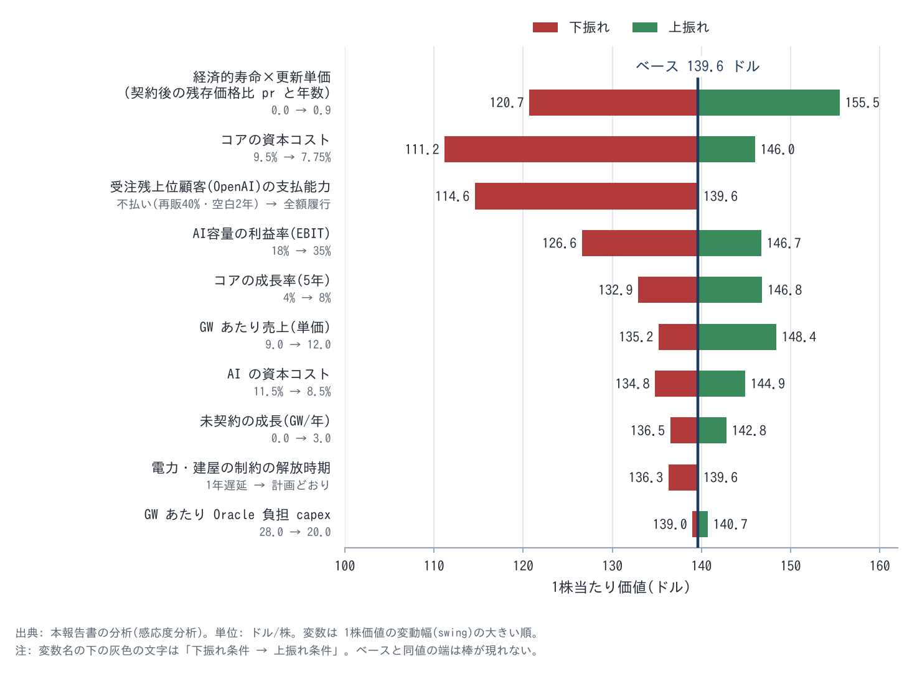{width=92}

| 順位 | 変数 | 動かした幅 | 1株価値 | 振れ幅 | 予測可能性 | マトリクス上の位置 |
|---|---|---|---|---|---|---|
| 1 | 経済的寿命×更新単価(契約後の残存価格比と年数) | 0(残存なし・空室費あり)〜0.9(3年) | $121〜156 | $35 | 低〜中(現在の需給では証拠あり、2031年以降は不明) | **芯**(感度高×予測可能性中)。先行指標で早く知る |
| 2 | コア事業の資本コスト | 9.5%〜7.75% | $111〜146 | $35 | 低(市場全体の金利・リスク選好) | 感度高×予測可能性低。見積り優位を持てないため、ポジションの大きさで管理する |
| 3 | 受注残上位顧客(OpenAI)の支払能力 | 不払い(40%で再販・空白2年)〜全額履行 | $115〜140 | $25 | 低〜中(資金調達に依存) | **芯**(感度高×予測可能性低)。シナリオ確率で扱う |
| 4 | AI 容量の EBIT 利益率 | 18%〜35% | $127〜147 | $20 | 中(会社開示 32%、報道 14%) | **芯**(感度中×予測可能性中) |
| 5 | コア事業の成長率(5年) | 4%〜8% | $133〜147 | $14 | 高 | 確認のみ |
| 6 | GW あたり売上(単価) | $9B〜$12B/GW・年 | $135〜148 | $13 | 中 | 確認のみ |
| 7 | AI の資本コスト | 11.5%〜8.5% | $135〜145 | $10 | 低 | 深追いしない |
| 8 | 未契約の成長(GW/年) | 0〜3GW | $136〜143 | $6 | 低 | 深追いしない |
| 9 | 電力・建屋の制約の解放時期 | 1年遅延〜計画どおり | $136〜140 | $3 | 中 | DCF 感度は小。EPS の時間軸とカタリストとしては重要 |
| 10 | GW あたり Oracle 負担 capex | $28B〜$20B | $139〜141 | $2 | 中 | 深追いしない |

**芯(上位3変数の確定):** ①経済的寿命×更新単価、②OpenAI の支払能力、③AI 容量の利益率。コア事業の資本コストは感度では2位だが、予測可能性が低く市場より正確に見積もる根拠がない。そのため芯からは外し、ポジション管理で扱う。

**2周目(芯への集中)の結果:**

| 芯 | 現在値 | 市場が暗に置く値(逆算) | 自分の見積り(根拠) | 優位の種類 | 外れたときの影響と先行指標 |
|---|---|---|---|---|---|
| ①経済的寿命×更新単価 | 更新期の GPU(過半が4年超)の全量が従来契約比 +20% で更新・再販(Q1 FY27、更新と再販の合算)。Q4 FY26 は 59顧客・3.5万 GPU のうち、顧客の 49% が GPU の 92% を更新 | 残存価格比 0.54・3年 | 0.6・2年(ベース)〜0.9・3年(強気)。現在の需給(H100 指数 +40%、CoreWeave の全品目 +25% 値上げ)は強気寄りを支持する。一方、中古 GPU の売買価格は下落したまま(H100 $4万 → $1.2〜2.2万)で、レンタル価値が「電力付き容量の希少性」に依存していることを示す | 分析。ただし市場の逆算値とほぼ同じで、差分にならない | 0 なら −$19/株。先行指標は H100・B200 の貸出単価指数(Silicon Data)、四半期の更新プレミアム |
| ②OpenAI の支払能力 | 年換算売上 約$500億(2026-10、FT)、2026〜30年の累計 FCF 約 −$2,780億、調達済み $1,220億は 2028年に枯渇見込み | 株価 −59% のうち相当部分(定量化は不能) | 不払い確率 20%(3年)、条件変更 30%。不払い時は 40〜70% の単価で再販、空白1〜2年 | なし(市場と同じ材料) | −$16〜−25/株。先行指標は OpenAI の資金調達(評価額 $1兆超のラウンド)と支払遅延の報道 |
| ③AI 容量の利益率 | Q3 FY26 の粗利率 32%(会社)、2025年6〜8月 14%(The Information) | EBIT 30% | EBIT 29%(ベース)。立上げ費用が消える FY29 以降は 30% 台前半 | 分析(14% は立上げ初期・小規模の値で、Jカーブ上の点にすぎない) | 18% なら −$13/株。先行指標は全社粗利率の下落幅と、AI 容量の粗利率の開示 |

### 2-2 原子単位とエンジン式(報告売上との照合)

| エンジン | 原子単位 | エンジン式 | FY26 売上 | Q1 FY27 売上(前年比) | ビジネスモデル型 / リンチ分類 |
|---|---|---|---|---|---|
| E1 ソフトウェア(DB・アプリのライセンスと保守) | 導入済みライセンス(インストールベース) | ライセンス残高 × 保守料率 × 更新率 + 新規ライセンス | $245.4億 | $55.5億(−3%) | A(ストック型ソフト)/ 低成長 |
| E2 SaaS | 顧客(事業所) | 顧客数 × ARPU × 継続率 | $159億 | $42億(+10%。Fusion ERP +17%、NetSuite +14%。後2者は単一出典で時点の要確認) | A / 安定成長 |
| E3 一般クラウド基盤(非AI の OCI。DB クラウド・マルチクラウドDB を含む) | 利用量(消費) | 顧客数 × 利用量 × 単価 | 推定 $109億 | 推定 $33億(約 +38%、推定。マルチクラウドDB +353%) | B(従量のインフラ)/ 急成長 |
| E4 AI クラウド基盤(GPU 容量の貸出) | 稼働容量(GW) | 稼働 GW × GW あたり年間売上 | 推定 $72億(平均稼働 約1.1GW × $6.5B) | 推定 $41億(平均稼働 約2.1GW × $7.7B/年) | C(設備型インフラ)/ 急成長(景気循環の要素あり) |
| E5 ハードウェア・サービス | 出荷・案件 | 件数 × 単価 | $88億 | $21.9億(HW +15%、サービス +5%) | G・その他 / 低成長 |

**照合結果:**
- **区分合計:** Q1 FY27 は 5.55+4.2+7.4+0.774+1.414 = 19.34(十億ドル)= **$193.4億** で、報告値 $193.45億と一致した(差 0.0%)。
- **AI エンジンの独立照合:** 会社は OCI 売上の AI/非AI の内訳を開示していないため、「稼働 GW × GW あたり売上」を報告値と独立に照合することはできない。そこで次の2つの独立データから、GW あたり年間売上を逆算した。
  - 報道された FY26 の AI 売上推定(The Information 2025-10 の GPU レンタル $9億/四半期と、その後の成長率)
  - 会社が開示した納入容量(FY26 1.2GW、Q1 FY27 850MW)
  - 結果は FY26 $6.5B → Q1 FY27 $7.7B で、契約の経済性(会社例示 $10B、OpenAI 契約 $13.3B)へ収束していく途中にある。整合的ではあるが、±5% の照合基準は「部分的に達成」にとどまる(既知の制約1)。

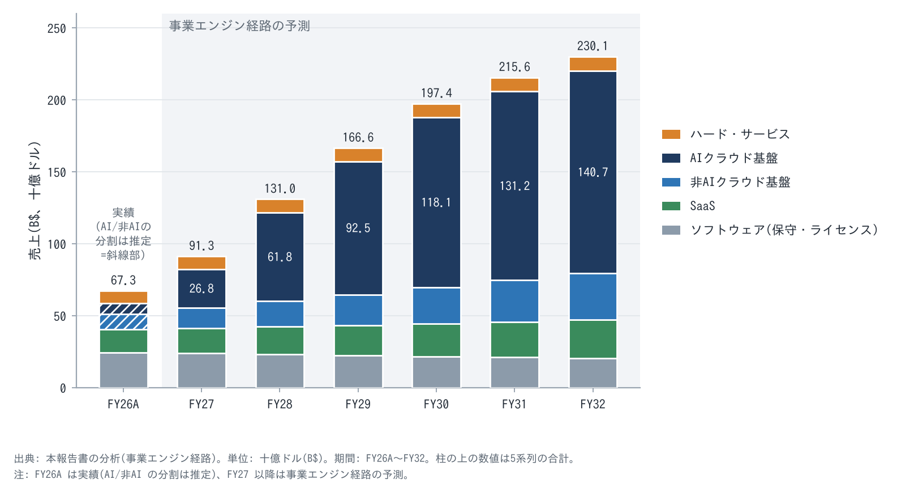{width=92}

### 2-3 価値の起点と未行使の価格決定力(L1)

| エンジン | 顧客が片付けたい仕事 | 代替手段とその費用 | 支出比率×重要度 | 価格決定力の状態 | 下振れ機構 |
|---|---|---|---|---|---|
| E1 データベース保守 | 銀行・通信・政府の基幹取引を止めずに動かし続ける | PostgreSQL・Aurora 等への移行。数年がかりの書き換えと停止リスクを伴う | 顧客の IT 予算に占める比率は小さく、重要度は最高 | 強い。保守料はライセンス額の約22%/年と一般に言われる水準(本調査では未確認)で、更新率は高いとみられる。ただし数値開示はない(既知の制約) | クラウド移行による侵食(−3%/年)。生成 AI でコード移行が安くなると侵食が加速しうる |
| E2 SaaS | 会計・人事・調達を1つの基盤で回す | SAP・Workday 等への乗り換え。2〜3年の導入プロジェクト | 中×高 | 中。成長率は +10% で横ばい | 「AI が SaaS を代替する」懸念(JPMorgan の Mark Murphy の質問、2026-03) |
| E3 一般クラウド基盤 | 既存の Oracle DB を自社のクラウド、または AWS・Azure・Google の中で動かす | 他社クラウドへの移行(DB の書き換えが必要) | 中×高 | 中〜強。マルチクラウドで、顧客がどのクラウドを選んでも Oracle DB が残る | 他社 DB への移行 |
| E4 AI 容量 | 大規模な GPU クラスタを、電力ごと、すぐに確保する(学習と推論) | ハイパースケーラー(Azure・AWS・Google)、ネオクラウド(CoreWeave 等)、自社建設(Stargate)。電力の確保に2〜4年かかる | 顧客(AI 研究所)の最大の費目で、重要度は最高 | 現在は強い(需給が逼迫)。更新 +20%、CoreWeave は全品目 +25% 値上げ(2026-07)。顧客価値と価格の差は大きいが、資金を外部調達に頼る顧客の支払能力が上限になる | 供給が追いつく局面(2028年以降の可能性)での価格下落。GPU 計算の商品化(ICE・CME が GPU 計算の先物を準備)。顧客の自社建設 |

**未行使の価格決定力の定量化:** E1 で保守料を年 +2% 上げると、ソフトウェア売上 $245億 × 2% = 年 $4.9億、1株 +$0.13 になる。会社は値上げの実績を開示していないため、機構台帳 M15 には含めず、保留とした。E4 の更新プレミアム +20% は、契約が終わる容量にのみ効く(2031年以降が本番)。

### 2-4 ユニットエコノミクスと増収の源泉分解(L2)

**AI 容量 1GW の経済性(会社例示「6年・1GW・$600億・粗利率約35%」から再構成):**

| 項目 | ベース | 強気 | 弱気 | 根拠 |
|---|---|---|---|---|
| 年間売上 | $100億 | $100億 | $100億 | 会社例示 $600億÷6年 |
| EBIT 利益率(営業費3%控除後) | 29% | 33% | 18% | 会社 30〜40%(粗利)、Q3 FY26 32%、報道 14% |
| GPU・ネットワーク投資(Oracle 負担) | $250億 | $250億 | $250億 | 例示のコスト構成(計算 65%・施設 35%)から逆算 |
| 年間の現金(税引後 EBIT+償却) | $64.9億 | $68.1億 | $56.1億 | 6年償却 |
| 契約後の残存(当初単価比×年数) | 0.6×2年 | 0.8×3年 | なし+建屋の空室費 | 更新データ(1-1 節)・リース期間 15〜19年 |
| 税引後 IRR | **17.0%** | 20.9% | 9.2% | |
| NPV(資本コスト 10%) | **+$59億** | +$113億 | −$44億 | |

**増収の源泉分解(FY26 → FY27 事業エンジン経路、+$239億):**

| 源泉 | 増収額 | 構成比 | 内容 |
|---|---|---|---|
| ①新規の原子単位(新設 AI 容量の稼働) | +$196億 | 82% | 平均稼働 1.1GW → 3.35GW |
| ②既存の原子単位の拡張 | +$49億 | 20% | 一般クラウド基盤 +$33億(既存 DB 顧客のクラウド移行・マルチクラウド)、SaaS +$16億、GPU 更新プレミアム(含む) |
| ③離脱・侵食 | −$7億 | −3% | ソフトウェア −3%(オンプレからクラウドへの移行) |
| その他(ハード・サービス) | +$2億 | 1% | |

②は追加の販促費がほとんどかからない。非GAAP 営業利益率が Q1 FY27 に 42.5% で前年並みを保った一方、全社粗利率は低下した。これは営業費の対売上比が大きく下がったことを意味し、「増分の S&M ÷ 増分の粗利が低下」と整合する。ただし S&M の金額は取得できていない(既知の制約)。

**収益の多重性(1つの資産・接点から何本の収益線を引くか):**
- **データベース顧客という1つの接点から:** ①保守 ②Exadata・Cloud@Customer ③OCI 上の DB ④AWS・Azure・Google の中の Oracle DB(マルチクラウド)⑤自社データ上の AI 推論(AI Database)⑥業務アプリ、の6本が引ける。④〜⑤の追加コストは小さい。
- **電力付き建屋という1つの資産から:** 建屋のリース期間 15〜19年に対し、GPU の会計上の寿命は6年である。そのため1つの建屋で2〜3世代の GPU を貸せる。これは期間ミスマッチの上振れ側でもある(M11)。

### 2-5 自己強化ループと制約(L3)

**図F15 事業エンジン図(構造記述。資本の流れは 2-7 の図F15b):**

| 要素 | 内容 | 定量証拠 | 状態 |
|---|---|---|---|
| 原子単位 | 稼働 GW(AI)、ライセンス残高(DB) | 稼働 約2.55GW(2026-08、推定)、契約済み 約10.2GW(AI の RPO 推定 $5,600億 ÷ $550億/GW。稼働 2.55GW = FY25 末 約0.5GW〔推定〕+ FY26 納入 1.2GW + Q1 FY27 納入 0.85GW) | — |
| エンジン式 | 売上 = Σ(稼働 GW × GW あたり売上)+ コア(保守+SaaS+一般クラウド) | 区分合計の照合は差 0.0%、AI 単体は推定 | 部分達成 |
| ループ R1(成長) | DB 顧客基盤 → OCI の規模 → 電力確保・供給優先 → AI 研究所の契約(RPO)→ 前払い・持込で資金化 → 容量増 → 規模 → 単位コスト低下・顧客増 | RPO $6,640億(前年比 +$2,090億)、前払い・持込 $750億、前受収益 $154億 → $308億(1四半期)、納入 850MW(Q4 の約3倍)、GPU 稼働率 97.9% | 作動中。「供給優先(NVIDIA の割当)」のリンクは証拠がなく仮説 |
| ループ B1(均衡・再帰。因果の一部は本報告書の推論) | capex → 借入・リース増 → 格付け低下(BBB-)・CDS 200bp → 株価下落 → 低株価での増資(希薄化)→ 新規契約に前払いを要求(推論)→ RPO 純増の鈍化 | S&P 格下げ(2026-07-09)、ATM $200億(平均発行価格は推定 約$141)、RPO 純増 +$850億 → +$260億、新規契約の大半が前払い・持込(会社説明) | **現在は B1 が優勢と判断(推論)** |
| 現在の制約(律速段階) | ①電力・建屋の納入(物理)②資本(格付けの閾値:S&P はレバレッジ 4.5倍超で再格下げを示唆)。需要は制約ではない(稼働率 97.9%、更新 +20%) | 納入 850MW < 見込み約1GW、ニューメキシコ拠点の不可抗力通知、ガス管延期、ガスのトラック輸送(Bloomberg 2026-10-08) | — |
| 制約の解放時期 | 電力: 2027年前半(ガス管)〜2028年(Shackelford・ニューメキシコ)。資本: FY29(S&P は 2029年の FOCF 黒字化を想定) | Transwestern の FERC 提出書類(2027-02-01)、S&P | 変曲点の最有力候補は FY28後半〜FY29 |

**収穫逓増・逓減の判定:**
- **規模の経済:** 営業費の分散は証拠あり(Q1 FY27 の営業利益率 42.5% を、AI の構成比上昇の中で維持)。
- **範囲の経済:** DB×クラウド×AI の組み合わせ。マルチクラウド DB +353% が証拠。
- **調達力:** 証拠なし。
- **逓減(規模の不経済)の要素:** 電力単価の上昇(ウィスコンシンで $3億を住民に転嫁しないと表明)、部材高(メモリ)。経営陣は部材高を顧客に転嫁できる契約だと説明している。

### 2-6 需要の連鎖と受注残の質(L4)

**派生需要の連鎖:** Oracle の AI 容量 ← AI 研究所(OpenAI・Meta・xAI ほか 700社超)← 研究所の資金源(OpenAI は売上 約$500億/年+外部調達。2026-03 に評価額 $8,520億で $1,220億を調達し、FT によれば評価額 $1.2兆での追加調達を協議中)← 最終需要(企業・消費者の AI 利用)。**受注残の約45%の最終的な資金源は、OpenAI に資金を出し続ける資本市場の意思である。**

**需要の層:**
- **契約済み:** RPO $6,640億。うち約半分が今後36か月で売上化(CFO)。
- **習慣的:** 保守・SaaS の更新。年 約$400億。
- **裁量的:** ライセンス・ハード・サービス。年 約$90〜100億。

FY27 売上の約8割は、契約済みか習慣的な需要から来る。

**受注残の質(両面):**

| 観点 | 上振れの証拠 | 下振れの証拠 |
|---|---|---|
| 量 | RPO $6,640億(前年比 +$2,090億)、Q1 新規の AI 契約 $300億超 | 四半期の純増は +$3,170億 → +$680億 → +$300億 → +$850億 → +$260億と不安定 |
| 需要の強さ | 前払い・持込 $750億。顧客が自ら資本を負担してでも欲しがっている。前受収益は1四半期で倍増 | 新規契約の大半が前払い・持込であるのは、Oracle の資本制約の裏返しでもある(推論) |
| 集中 | 非 OpenAI の RPO は前年比2倍超(経営陣)、AI 顧客 700社超 | OpenAI 約$3,000億(WSJ 報道。Oracle は金額を確認していない)。RPO の 45〜50%(S&P・BofA の推定) |
| 確率×影響−代替需要 | 代替需要: ハイパースケーラーの受注残(AWS $4,960億、Azure $6,780億、Google $5,140億)、貸出単価の上昇 | AI 全体の逆回転と同時に起きれば代替需要も消える(相関) |

**サイクルの位置:** ハイパースケーラーの capex は 2026年に AWS 約$2,200億、Google $1,950〜2,050億、Microsoft 約$1,750億と加速している。貸出単価は上昇し、更新単価も上がり、供給は電力で律速されている。拡大局面の後半と判断する。ただし AI 容量の利益率はピークではなく立上げ途中(Jカーブ)にあるため、利益の正規化は「上方」に働く(2-8)。

### 2-7 資本の出し手マップと資産の経済的生産性(L5)

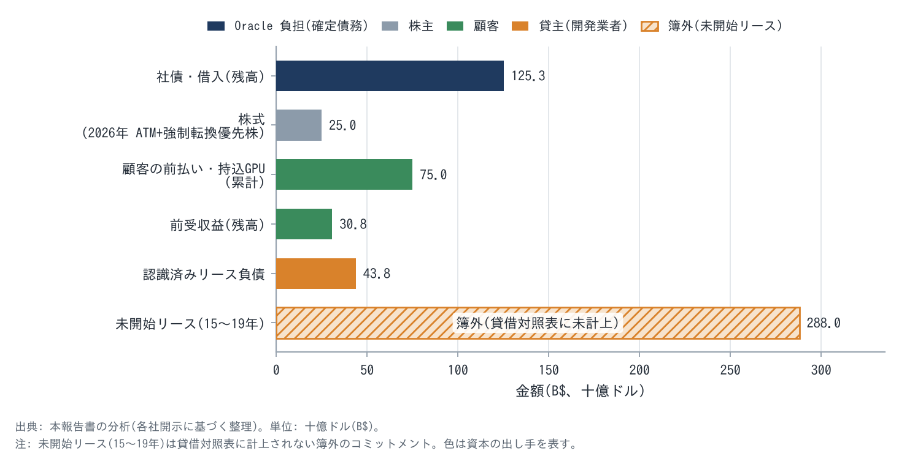{width=88}

| 出し手 | 金額 | コスト | 期間・条件 | 何を取りに行くための資本か(意図) | 1株当たり価値への純効果 |
|---|---|---|---|---|---|
| 社債・借入 | $1,253億(2026-08) | 10年債利回り 約6.5%(2026-07)、CDS 約200bp | 3〜40年。2025-09 に $180億、2026-02 に $250億(8本、応募 4.3倍) | 契約済み容量の GPU・設備 | 契約裏付け率 4.0倍(下記)。IRR 17% > 借入コスト 6.5% なら価値を増やす |
| 株主(ATM 普通株) | $200億(Q1 FY27 に完了、約1.41億株〔T3〕。平均発行価格は逆算で約$141〔推定〕) | 希薄化 4.8% | — | 投資適格格付けの維持 | 反実仮想(同額を借入): EPS への影響は −4.6%(増資)対 −4.2%(借入)でほぼ同じ。借入なら S&P の閾値 4.5倍を超え、ジャンク転落の確率が上がる。→ 純効果はわずかにプラス(格付けの崖を回避) |
| 株主(強制転換優先株) | $50億(2026-02、配当 6.5%) | 2029年に普通株 2,500〜3,100万株へ転換 | — | 同上 | 希薄化 約1% |
| 顧客(前払い・持込 GPU) | 累計 $750億。うち重要な金融要素を含む前払い $114億(10-Q) | 暗黙の利率(非開示) | 契約期間 | GPU の資本と陳腐化リスクを顧客に移す | 純現金 capex を総額 $900〜950億 → $700億以下に圧縮。前払いは不払い時の担保にもなる |
| 顧客(前受収益) | $308億(2026-08、前期末 $154億) | — | 1年超の部分 $161億 | — | 需要の強さの証拠。将来の売上は現金を伴わない(両面) |
| 開発業者・貸主(リース) | 認識済み $438億 + 未開始 $2,880億(15〜19年、FY27 Q2〜FY29 に開始) | 賃料(非開示)| ニューメキシコ拠点のリースは解約不能(Reuters 関係者)。他拠点の条項は非開示 | 建屋と電力を他人の資本で建てる(資本の外部化) | 建屋の陳腐化は遅く、電力が希少な間は価値を保つ。契約(5〜6年)との期間差 9〜14年が残る |
| 電力パートナー | 確保済み 10GW 超のうち 90% 超がパートナー資金(Q3 FY26) | — | — | 電力の確保 | 制約の解放を他人の資本で行う |

**契約裏付け率:**
- **分子:** 受注残の年間転換額 $1,107億(RPO の半分が36か月で売上化)
- **分母:** 元利払い等 $279億(支払利息 約$60億 + リース支払 約$219億。現行分 約$50億 + 未開始 $2,880億 ÷ 17年)
- **結果:** 4.0倍。借入とリースは「契約済み需要を取り込むためのレバレッジ」と評価できる。ただし分子の約45%は OpenAI である。

**資産の外部化と ROE:** 建屋(リース)・GPU の一部(持込)・電力(パートナー)を外に出したことで、Oracle の株主資本 $668億に対して RPO は $6,640億ある。残った義務(未開始リース $2,880億、保証 $33億〔10-K 時点、満期 2026-09。10-Q での残存は不明〕)を同じ表に並べると、外部化は「資本効率の工夫」であると同時に「長期の固定費の引受け」である。純効果は、契約後の容量を貸し直せるかどうか(芯①)で決まる。

**経済的耐用年数と会計耐用年数の差(両方向):**

| 方向 | 証拠 | 1株当たり利益への効果 |
|---|---|---|
| 上方(経済的寿命 > 6年) | 更新期の GPU(過半が4年超)の全量が従来契約比 +20% で更新・再販(Q1 FY27、更新と再販の合算)、Q4 FY26 は顧客の 49% が GPU の 92% を更新、稼働率 97.9%、H100 指数 +40%(2025-12 → 2026-08)、SemiAnalysis「H100 の契約は当初単価のまま更新、一部は 2028年まで延長」 | 償却済み GPU が稼ぐ「会計に出ない利益」。2031年以降に効く |
| 下方(経済的寿命 < 6年) | 中古 H100 の売買価格は $4万 → $1.2〜2.2万に下落。次世代 GPU(2026〜27年)で旧世代の単価が崩れる可能性 | 耐用年数を4年にすると FY27 EPS −$1.71(IT 機器の総額 $778億 ÷ 4年 − ÷6年、税引後) |
| 履歴 | FY25 に5年 → 6年へ延長(FY25 の営業費用 −$7.33億、EPS +$0.20)。FY26 は変更なし | 延長は、更新データが示す使用実績と整合する。操作の兆候とは読まない |

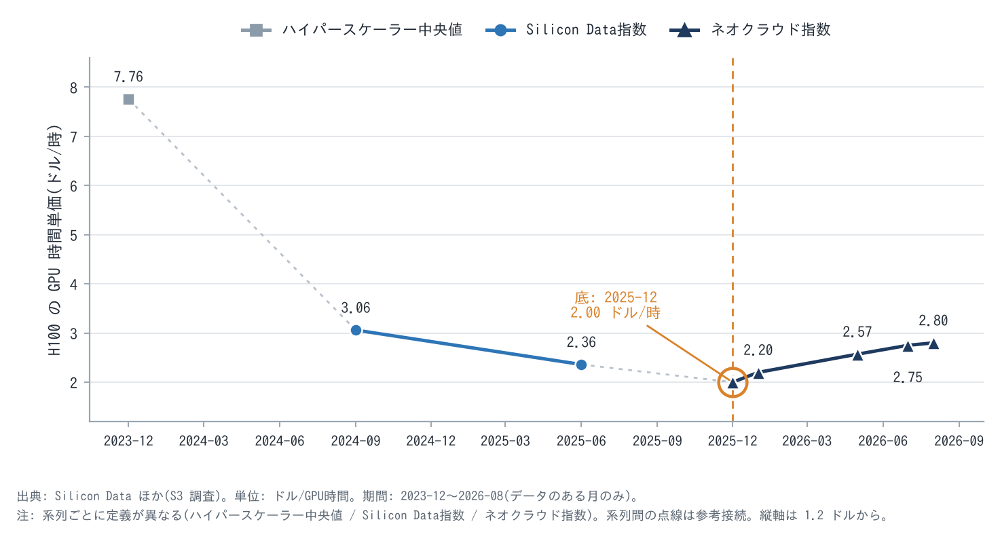{width=85}

**エンジン別の増分 ROIC:** コアは資本軽量で、推定 ROIC 35%以上。AI は案件 IRR 17%(ベース)。会社は「定常状態の案件レベル ROIC は 20%台後半」と説明する(Maxson、単一出典)。前払い・持込で Oracle の正味資本が減る分、会社の値は IRR より高く出る。**増分 ROIC は資本コスト(AI 10%)を上回るが、その差は大きくない(価値創造は 1GW あたり $59億、投資 $250億の約24%)。**

**株価と資本コストの再帰性(原則15):** 株価が $308(共同CEO のオプション行使価格)から $141 に下がったことで、株式は高価な資本になった。$200億の増資は 4.8% の希薄化を要した。CDS 200bp は借入コストを押し上げ、Oracle に新規契約の前払い・持込を要求させている。この再帰は下方にも上方にも働く。株価が戻れば、増資は1株価値を増やす手段に変わる。

### 2-8 時間構造と定常状態利益(L6)

- **フロー → ストック:** AI 容量は一度納入されると5〜6年のストック収益になる(RPO)。保守と SaaS も年次更新のストックである。FY27 売上の約8割はストック性の収益になる。
- **Jカーブ:** 新しい容量は、リースの開始と GPU の償却が売上の立ち上がりより先に来る。全社粗利率は FY26 に約5pt 低下し、FY27 も低下する見込みである(CFO)。FY27 の立上げ費用を定常状態の利益率(EBIT 28〜29%。ここでは保守的に 28%)に戻すと、1株 +$0.85 の上振れになる(定常状態 EPS の補正、Appendix B)。
- **定常状態利益(成長投資を止めた場合):** 次の合計で $292億になる。株主資本コスト 9.5% で割ると **$3,076億(1株 $101)**。

| 項目 | 金額 | 内訳 |
|---|---|---|
| コア NOPAT | $211億 | |
| 成長目的の営業費削減分 | +$15億 | |
| FY27 末までに稼働する AI 容量 5.0GW の定常 NOPAT | +$116億 | 5.0GW × $100億 × 29% × (1−20%) |
| 税引後の支払利息 | −$50億 | |
| 定常状態利益 | **$292億** | |
- **S字カーブ上の位置:** E4(AI)は急成長期の入口、E3 は急成長期、E2 は成熟期の手前、E1 は成熟期である。
- **受注 → 売上の時間差:** RPO の約半分が36か月以内に売上化する。
- **契約期間と義務期間:**
  - **下振れ:** 5〜6年の契約に対し、リースは 15〜19年続く。契約後に貸し直せなければ固定費が残る。
  - **上振れ:** 電力付き建屋を長期で確保していることになる。電力不足が続けば、世代交代のたびに貸し直せる。

### 2-9 持続性と競争優位期間(L7)・成長余地(L8)

**7 Powers(Hamilton Helmer の7つの持続的競争優位):**

| Power | エンジン | 有無・強さ | 証拠 | 推移 |
|---|---|---|---|---|
| スイッチングコスト | E1・E2・E3 | 強 | 基幹 DB の移行は数年がかり。マルチクラウドで、他社クラウドを選んでも Oracle DB が残る | 維持 |
| プロセスパワー | E1・E4 | 中 | DB の技術蓄積。Exadata 由来の RDMA ネットワークで大規模 GPU クラスタを構築 | 維持 |
| 規模の経済 | E4 | 弱〜中 | AI の規模は MSFT・AWS・Google より小さい | 拡大中 |
| 独占的資源 | E4 | 中(一時的) | 確保済み電力 10GW 超。電力が希少な間だけ効く | 2028年以降に減衰の可能性 |
| カウンターポジショニング | E3 | 弱〜中 | 自社 DB を競合クラウドの中で売る戦略。ハイパースケーラーは自社 DB と競合するため模倣しにくい | 強化 |
| ネットワーク効果・ブランド | — | 弱 | — | — |

**再現コストテスト:** 十分な資金を持つ競合(ハイパースケーラー、ネオクラウド)が同等の AI 容量を作るには、電力の確保に2〜4年、資本に 1GW あたり約 $250億(GPU)と建屋が要る。再現は可能で、実際に起きている。データベース顧客基盤の再現は事実上不可能である。

**競争優位期間(CAP):** E1〜E3 は 10〜15年、E4 は3〜6年(契約期間と電力優位の残存期間)。価値の加重で 7〜9年と推計する。

**敵対的検証(赤チーム):**

| 立場 | Oracle の利益を奪う最も安い方法 | Oracle の耐性 |
|---|---|---|
| 競合 CEO(ハイパースケーラー・CoreWeave) | OpenAI の次期分の容量を、より強いバランスシートと低い資本コストで提示する | 弱〜中。すでに建てて電力付きの容量と、署名済みの契約が防壁になる。次の契約では不利 |
| 顧客 CFO(OpenAI) | 単価・時期の再交渉、自社建設(SoftBank の SB Energy と Stargate)への移管、契約の一部延期 | 中。Abilene の拡張は「他の拠点へ振り向けた」(OpenAI 幹部)。前払い分は担保になる。契約条項(take-or-pay=使わなくても支払う義務)は非開示 |
| サプライヤ(NVIDIA・メモリ) | GPU・メモリの値上げ、割当の削減 | 中。部材高を顧客に転嫁できる契約だと説明。固定価格は、コストが確定している場合に限る |
| 規制当局・地域 | 電力料金の住民転嫁の禁止、ガス管経路の不承認(ニューメキシコ州土地局が2度却下)、住民訴訟 | 弱〜中。電力の解放が遅れる。ウィスコンシンで $3億の電力コストを住民に転嫁しないと表明 |

**二次の効果:** 会社シナリオ(FY30 OCI $1,660億)が成功した場合、次の反応が予想される。
- ハイパースケーラーは AI 容量の単価で対抗する。
- NVIDIA は Oracle 向けの価格を上げる。
- 電力会社は大口料金を引き上げる。
- OpenAI は更新時に単価の引下げを求める。

これらの反応は AI の利益率を 2〜4pt 削りうる。機構台帳 M4 の確率を 25% と置いたのはこのためである。

**成長余地(L8):**
- 稼働 GW は 2.55GW(2026-08)から 13.8GW(FY32、事業エンジン経路)へ広がる。会社目標は FY30 に OCI $1,660億(AI 約 14〜15GW 相当)である。
- 天井を上げる仕掛けは3つある。推論需要、自社データ上の AI(AI Database)、マルチクラウド DB。
- 単価の天井は、顧客(AI 研究所)の資金調達能力で決まる。

### 2-10 根幹 KPI の加速度表(L10)

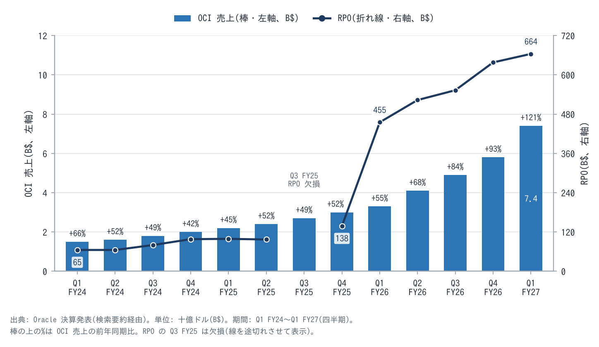{width=92}

**図F18 根幹 KPI 加速度表(Q1 FY26 〜 Q1 FY27):**

| KPI | Q1 FY26 | Q2 FY26 | Q3 FY26 | Q4 FY26 | Q1 FY27 | QoQ 年率(最新) | TTM 前年比(最新) | 2階差分(前年比の変化、最新) | コンセンサスの修正状況 |
|---|---|---|---|---|---|---|---|---|---|
| OCI 売上(B$)/ 前年比 | 3.3 / +55% | 4.1 / +68% | 4.9 / +84% | 5.8 / +93% | 7.4 / +121% | +165% | +95% | **+28pt(加速)** | FY27 OCI の会社見通しは未更新(旧 $320億)。売上 $900億の達成には約 $400億が必要で、旧見通しを上回る |
| 総売上 前年比 | +12% | +14% | +22% | +21% | +30% | 季節性で不適 | +22% | **+9pt(加速)** | FY27 コンセンサス $905億、ガイダンス「$900億以上」 |
| RPO(B$)/ 四半期純増 | 455 / +317 | 523 / +68 | 553 / +30 | 638 / +85 | 664 / +26 | — | +46% | 純増は減速(不安定) | — |
| SaaS 前年比 | +11% | +11% | +13% | 約+10% | +10% | — | — | 横ばい | — |
| ソフトウェア 前年比 | −1% | −3% | +3% | — | −3% | — | — | 横ばい(侵食) | — |
| 非GAAP 営業利益率 | 41.6% | 41.6% | 43.0% | 44.8% | 42.5% | — | — | 横ばい | — |
| 四半期 capex(B$) | 8.5 | 12.0 | 18.6 | 16.5 | 28.5 | — | TTM 75.7 | 加速 | FY27 総額 $900〜950億 |
| 前受収益(B$) | 12.1(短期) | 9.9(短期) | 11.2 | 15.4 | 30.8 | — | — | **倍増(1四半期)** | — |
| 納入容量 | — | — | 400MW | (FY26 計 1.2GW) | 850MW | — | — | 加速(会社見込み約1GWには未達) | — |
| GPU 稼働率 / 更新 | — | — | — | 97.5% / 92%(GPU 基準) | 97.9% / 全量 +20% | — | — | 改善 | — |
| 非GAAP EPS(一時益除く) | 1.47 | 1.54 | 1.79 | 2.03 | 1.92 | — | — | +30%(Q1) | FY27 $8.05(コンセンサス)〜$8.10(会社)、FY28 $10.78 |

**変曲点の判定:** OCI 売上は2階差分 +28pt で加速している。一方、コンセンサスは FY28 EPS $10.78 にとどまり、会社の FY30 目標の補間値($11.13)をわずかに下回る。加速がコンセンサスに未反映である可能性はある。ただし、加速の源泉は容量の納入、すなわち電力の解放である。Q1 の納入は見込みを下回った(850MW < 約1GW)。そのため、上方修正の余地は「納入 MW が四半期 1GW を超えるかどうか」に依存する(判別KPI K2)。

**仮説更新ループ(次の決算で確度を動かす値):** 7章 F4 に一覧化した。

<!-- pagebreak -->

## 3. 現状の収益構造 — 増収の8割強は新設した AI 容量から生まれ、営業利益の9割弱はデータベース保守・SaaS・一般クラウドが稼ぐ二層構造である(FY27 推定)

### 3-1 収益・費用フロー解剖(F10)

分析の中心は規模で決める。FY26 の売上の 36% を占める最大のエンジンはソフトウェア(E1、$245億)で、利益貢献でも最大である。FY27 にはクラウド基盤(E3+E4、推定 $410億)がこれを抜く。

**図F10 収益ライン × 費用ライン(FY26 実績、FY27 は事業エンジン経路):**

| 収益ライン | 誰に / 何のために / 何を / 代替手段 | 課金単位(顧客の成長に乗るか) | FY26 売上 → FY27E | 増収の源泉(新規 / 既存拡張 / 離脱) | フロー / ストック | 粗利率(推定)・限界利益率 | 拘束資本 |
|---|---|---|---|---|---|---|---|
| E1 DB・ミドルウェア・アプリの保守とライセンス | 大企業・政府 / 基幹取引を止めない / DB と保守・更新 / 他社 DB への移行(数年) | ライセンス残高に連動(乗らない) | $245億 → $238億 | 新規ライセンス小 / 保守料の改定 / クラウド移行で −3% | ストック(保守)+ フロー(ライセンス) | 約90%(非開示・推定)/ 限界利益率は高い | ほぼなし |
| E2 SaaS(Fusion・NetSuite・業種別・Health) | 大中堅企業 / 業務の一元化 / クラウド業務アプリ / SAP・Workday | 利用者・モジュール数(乗る) | $159億 → $175億 | 新規顧客と既存のモジュール追加(内訳非開示) | ストック | 約70%(推定)/ 中 | 小 |
| E3 一般クラウド基盤(DB クラウド・マルチクラウド DB・企業向け IaaS) | 既存 DB 顧客 / DB をクラウドで動かす / OCI・他社クラウド内の Oracle DB / 他社 DB | 利用量(乗る) | 推定 $109億 → $142億 | 既存 DB 顧客の移行が中心(マルチクラウド DB +353%、顧客数 +180%) | ストック(従量) | 65〜80%(会社: 非AI の粗利率)/ 高 | 中(一部の設備) |
| E4 AI クラウド基盤(GPU 容量) | AI 研究所(OpenAI・Meta・xAI ほか 700社超)/ 学習・推論の計算能力を電力ごと確保 / GPU クラスタの容量貸し / ハイパースケーラー・ネオクラウド・自社建設 | 容量(GW)の確約契約5〜6年(顧客の成長に乗るが、上限は契約容量) | 推定 $72億 → $268億 | **新規の原子単位(新設容量)が約9割**。更新は +20%(拡張) | ストック(契約期間)。契約後は更新・再販 | 30〜35%(会社。Q3 FY26 32%、立上げ中は低い)/ 立上げ費用を除けば平均並み | **重い**(1GW あたり GPU $250億 + 建屋はリース) |
| E5 ハードウェア・サービス | DB 顧客 / Exadata 等の機器・導入支援 | 件数(乗らない) | $88億 → $90億 | 横ばい | フロー | 低〜中 | 小 |

**費用ラインの解剖:**
- **クラウドの売上原価:** GPU・サーバーの償却(FY26 $76億 → 四半期 $32億)、データセンターのリース、電力、人員。
- **営業費(S&M・R&D・G&A):** 人員削減(2025〜2026年)で対売上比が低下している。
- **営業外費用:** 支払利息(四半期 約$10億、Q1 FY27 の非GAAP 営業利益と税引前利益の差から逆算)。

ライン別の費用は開示されていない(既知の制約)。

**低迷・急伸しているラインの要素分解:**

| ライン | 動き | 数量 × 単価 × ミックス | 離脱・客層・代替・需要量 | なぜ(2層) |
|---|---|---|---|---|
| E4 AI(急伸) | +約355%(Q1 FY27 推定) | **数量:** 平均稼働 GW が約2倍。**単価:** GW あたり $7.7B(FY26 $6.5B)。**ミックス:** 新世代 GPU と大型契約 | 離脱は少ない(Q4 FY26: 顧客の 49% が GPU の 92% を更新)。客層は大型の AI 研究所へ移る | なぜ伸びるか → 需要が供給を上回り(稼働率 97.9%)、契約済み容量の納入が進んでいるから → なぜ納入できるか → 他人の資本(リース・前払い)で建屋と GPU を調達しているから |
| E1 ソフトウェア(低迷) | −3% | 数量(ライセンス残高)が微減。単価は不明 | 代替: オンプレから自社クラウド(OCI・マルチクラウド)への移行(共食い)。他社 DB への離脱は未開示 | なぜ減るか → 顧客が DB をクラウドで動かすから → その移行先の多くは Oracle 自身のクラウド(E3)で、価値は失われず E3 に移っている(E1 −$7億に対し E3 +$33億) |

### 3-2 収益ミックスの時系列変化と営業レバレッジの分解

| 年度 | 売上 | ソフトウェア比率 | クラウド(IaaS+SaaS)比率 | 非GAAP 営業利益 | 非GAAP 営業利益率 | 増収に対する増益(限界利益率) |
|---|---|---|---|---|---|---|
| FY24 | $530億 | 47% | 37% | $231億 | 43.6% | — |
| FY25 | $574億 | 43% | 43% | $250億 | 43.6% | 43%(+$44億 → +$19億) |
| FY26 | $674億 | 36% | 50% | $289億 | 42.9% | 39%(+$100億 → +$39億) |
| Q1 FY27(前年同期比) | $193億 | 29% | 60% | $82億 | 42.5% | **45%**(+$44.5億 → +$20億) |
| FY27E(事業エンジン) | $913億 | 26% | 64% | $352億 | 38.6% | 約27%(+$239億 → +$63億) |

**読み方(原因を2層):**
- **観測:** FY27 の限界利益率は約27%に下がる見込みである(事業エンジン経路)。
- **なぜ1:** 増収の82%が AI 容量で、その EBIT 利益率は立上げ期に 16% と低い。
- **なぜ2:** リースの開始と GPU の償却が、売上の立ち上がりより先に来る(Jカーブ)。
- **示唆:** Q1 FY27 の限界利益率 45% は、営業費の削減が AI のミックス悪化を上回った結果である。営業費の削減は一度きりの効果なので、FY27 後半の限界利益率は、AI 容量の利益率がどれだけ早く 30% に近づくかで決まる(判別KPI K1)。

### 3-3 鳥の目事業構造マップ(現在)(F1)

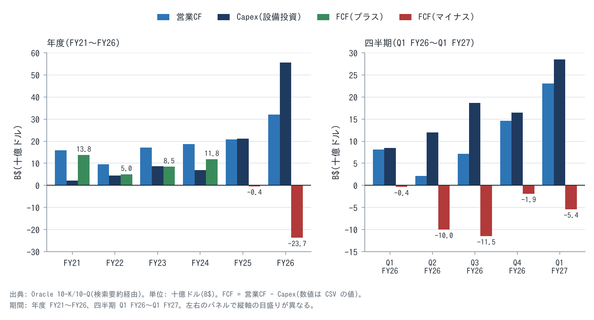{width=92}

**図F1 業界バリューチェーンと Oracle の位置(現在):**

| 段階 | 主なアクター | 利益プール(段階別の利益率 × 規模) | Oracle の位置 | カネの流れ | モノ・情報 | リスクの所在(誰が負うか / 意図 / 純効果) |
|---|---|---|---|---|---|---|
| ①チップ | NVIDIA・AMD | **最大**(推定。本調査では NVIDIA の粗利率を出典で確認していない) | 調達側(NVIDIA・AMD は顧客でもある) | Oracle → NVIDIA(GPU 代金)。持込契約では顧客 → NVIDIA | GPU | 世代交代の陳腐化 → 持込分は顧客が負う |
| ②電力・建屋 | Vantage・Crusoe・Related・STACK(Blue Owl)、ガス・燃料電池(Bloom) | 中(リース利回り。非開示) | **借り手**(未開始リース $2,880億、15〜19年) | Oracle → 貸主(賃料)。貸主 → 銀行(プロジェクトローン。例: ニューメキシコ $180億、額面の89〜91%で取引) | 電力付き建屋 | 建屋の空室リスクは Oracle が負う(ニューメキシコ拠点は解約不能と報道、他は非開示)。意図は資本の外部化。純効果は芯①しだい |
| ③クラウド運営 | **Oracle**・MSFT・AWS・Google・CoreWeave | AI は中(粗利 30〜35%)/ 非AI は高(65〜80%) | **運営者** | 顧客 → Oracle(従量・確約・前払い) | 計算能力、データベース | 稼働率・価格のリスクは Oracle |
| ④AI 研究所 | OpenAI・Meta・xAI ほか | マイナス〜小(OpenAI の FCF は大幅な赤字) | 顧客 | 投資家 → 研究所 → Oracle | モデル | 研究所の資金繰りリスクは、結果として Oracle が負う(受注残の約45%) |
| ⑤企業・消費者 | 企業(DB 顧客)・消費者 | — | DB・アプリの提供者(最高プール: 保守の粗利率 約90%) | 企業 → Oracle(保守・SaaS) | 企業データ(Oracle DB の中にある) | — |

**利益プールの判定:** AI では、Oracle は中間の利益プール(運営者)にいて、上流(NVIDIA の価格決定力)と下流(資金調達に頼る AI 研究所)に挟まれている。一方、データベースでは最高のプール(⑤)を押さえている。**Oracle の戦略は、最高プール(DB)の利益と信用で中間プール(AI 運営)の規模を取りに行くことである。** 自己強化ループ R1 と律速段階(電力・資本)は 2-5 に示した。

<!-- pagebreak -->

## 4. 経営陣のシナリオ — 「FY30 売上$2,250億・EPS$21」は、需要と資金の外部化が作動する一方、電力と資本が容量の立ち上がりを律速している

### 4-1 シナリオの骨格(経営陣の言葉、一次出所)

| 日付 | 話者・場 | 発言(和訳。原文は要所のみ) | 事業エンジンの言葉への翻訳 |
|---|---|---|---|
| 2025-10-16 | Clay Magouyrk(共同CEO)、Financial Analyst Meeting | AI データセンター事業は、最終的に粗利率 30〜40% を生む("eventually ... 30% to 40%")。契約期間を通じて概ね安定 | AI 容量の利益率(芯③)= 粗利 30〜40% |
| 2025-10-16 | 同 | 前四半期中の30日間で $650億の新規コミットを獲得、うち Meta が $200億 | 原子単位(GW)の受注。顧客の分散 |
| 2026-06-10 | 決算プレスリリース | Q3・Q4 の RPO 増加の大半は大型 AI 契約で、顧客が GPU の購入代金を前払いするか、顧客が GPU を購入して Oracle に提供する形。その部分は合計 $750億("prepaid ... or ... bought and supplied the GPUs") | 拘束資本の外部化(資本の出し手=顧客) |
| 2026-06-10 | Magouyrk、Q4 FY26 決算説明会 | 前払い・持込の契約は、他の契約と比べて利益率の劣化がない("no degradation in margin")。capex の増加は部品価格ではなく主にタイミングによる | 外部化しても単価・利益率は維持 |
| 2026-09-10 | Q1 FY27 決算説明会 | 更新時期を迎えた GPU の全量が、従来契約比 20% のプレミアムで更新または再販された。その過半は4年以上前の GPU("renewed or resold at a 20% premium to prior contracts") | 経済的寿命×更新単価(芯①)は上方 |
| 2026-09-10 | 決算プレスリリース | 企業顧客のほぼ全員が、自社のプライベートデータで AI に推論させたいと考えている("reason on their private data") | 天井を上げる仕掛け(AI Database・マルチクラウド) |
| 2026-09-10 | Hilary Maxson(CFO) | 粗利率の低下は想定どおりで、要因はデータセンターの立上げと AI インフラ売上の加速。各案件は立ち上がれば強い FCF を生む設計 | Jカーブ。定常状態の利益率は報告値より高い |

### 4-2 数値目標と事業エンジン変数への翻訳

| 目標(時点) | 数値 | 事業エンジン変数への翻訳(本報告書の逆算) | 達成に必要な条件 |
|---|---|---|---|
| FY27 売上(2026-09) | $900億以上(+34%) | AI 売上 約$270億 = 平均稼働 3.35GW × $8.0B | Q2〜Q4 で前年比 約+35%(Q1 は +30%) |
| FY27 非GAAP EPS(2026-09) | $8.10(一時益除く FY26 比 +18.6%、報告値比 +6.1%) | 純利益 約$245億 | 粗利率の低下を営業費の削減で吸収 |
| FY27 capex(2026-06) | 総額 $900〜950億、純現金 $700億以下 | 1GW あたり Oracle 負担 約$250億 × 新設 3.3GW + 建屋の一部 | 顧客前払い $200〜250億 |
| FY30 売上(2025-10) | $2,250億(5年 CAGR 31%) | コア 約$800億 + AI 約$1,450億 = 稼働 14〜15GW × $10B | 電力 14〜15GW の解放(確保済みは 10GW 超) |
| FY30 非GAAP EPS(2025-10) | $21(CAGR 28%) | AI の EBIT 利益率 約35%(会社レンジの上端) | 粗利 38% 以上 |
| FY30 OCI 売上 | $1,660億 | OCI の売上構成比は 38% → 74% | — |
| 共同CEO の PSO(業績連動オプション)(DEF 14A) | FY28 の非GAAP 総売上: 閾値 $1,000億(80%)、目標 $1,250億(100%)、最大 $2,500億(200%) | FY28 稼働 約6.5〜8GW | **総額指標**で、1株当たり指標ではない |

### 4-3 シナリオを構成するピース(シナリオ台帳。採点は5章 F11)

| # | ピース | 目的(意図の解読) | 動かすエンジン変数 / ループ / 制約 | 現状 |
|---|---|---|---|---|
| P1 | OpenAI(Stargate、約$3,000億・5年・4.5GW、2027年開始。金額は WSJ 報道で Oracle は未確認) | 需要の錨。容量を建てる正当性と、サプライヤ・電力の優先を得る | 原子単位(GW)、GW あたり単価($13.3B)、集中度 | Abilene の最初の2棟は稼働。拡張の中止報道(2026-03、会社は否定)。ニューメキシコで不可抗力通知(2026-09) |
| P2 | 非 OpenAI の AI 顧客(Meta $200億 ほか 700社超) | 集中を下げ、資本コストを下げる | 集中度、ループ R1 | 非 OpenAI の RPO は前年比2倍超。Q1 の新規 $300億超 |
| P3 | 前払い・持込(BYOH)の契約構造($750億) | GPU の資本と陳腐化リスクを顧客に移す | 拘束資本、陳腐化リスクの所在 | 前受収益は1四半期で倍増。純現金 capex を新たに開示 |
| P4 | 開発業者とのリース(未開始 $2,880億・15〜19年) | 建屋を他人の資本で建てる | 拘束資本の外部化、期間ミスマッチ | 未開始リースは1年で 2.9倍 |
| P5 | 電力の確保(10GW 超、燃料電池最大 2.8GW、ガスのマイクログリッド) | 律速段階(電力)の解放 | 制約の解放時期 | 稼働は Abilene ほか一部。ガス管の延期とトラック輸送 |
| P6 | 資金調達(社債 $430億、優先株 $50億、ATM $200億) | 投資適格格付けを保ったまま capex を賄う | 資本コスト、希薄化、ループ B1 | S&P BBB-(2026-07)、Moody's は見通しネガティブ |
| P7 | マルチクラウド DB(AWS 20リージョン、Google 15リージョン ほか) | DB の利益プールを他社クラウドへ延ばす | 収益の多重性、E3 の成長 | 売上 +353%、顧客 +180%(絶対額は非開示) |
| P8 | AI Database・自社データ上の AI | 企業 AI 推論を DB に取り込む | 天井を上げる仕掛け | 売上は非開示(保留) |
| P9 | アプリ(Fusion・NetSuite・Health) | 安定収益 | E2 | SaaS +10%、Fusion ERP +17% |
| P10 | GPU の更新・再販 | 契約後の容量の価値を示す | 芯①(経済的寿命×更新単価) | 全量が +20% で更新・再販(Q1 FY27) |
| P11 | 営業費の効率化(人員削減) | AI のミックス悪化を吸収する | コアの利益率 | 非GAAP 営業利益率 42.5% を維持 |
| P12 | Ampere(半導体子会社)の売却 | 非中核の整理と資金化 | 一時益($27億、税引前) | 完了(Q2 FY26) |

**まだ数字に出ていないオプション価値(規模僅少でも評価対象):** P8(AI Database)には、規模僅少のまま、成功時の規模を見積もるための材料がない(売上・顧客数が非開示)。そのため保留とし、必要な調査(AI Database の顧客数・課金額の開示)を記す。機構台帳では M14(マルチクラウド DB)に含めて扱う。

<!-- pagebreak -->

## 5. シナリオの採点 — 需要・更新・前払いの3ピースは数字で作動し、電力・OpenAI・資金の3ピースが判定を「条件付きのプラス」にとどめる

### 5-1 ピース採点表(F11)

| # | ピース | 評価(+/−) | 程度 | 進捗(数字で作動しているか) | 根拠(出所) | 規模の重み |
|---|---|---|---|---|---|---|
| P1 | OpenAI | **+ / −(両面)** | 大 | 部分作動。Abilene の一部が稼働、他は遅延 | WSJ・S&P・Bloomberg・Reuters | 25% |
| P2 | 非 OpenAI の AI 顧客 | + | 中〜大 | 作動(非 OpenAI の RPO が2倍超、新規 $300億超) | 会社説明(24/7 Wall St 要約)、決算プレス | 15% |
| P3 | 前払い・持込 | + | 大 | **作動**(前受収益 $154億 → $308億、10-Q の前払い $114億) | 10-Q・プレス | 15% |
| P4 | リース | ±(両面) | 大 | 作動(未開始 $2,880億)。価値は芯①しだい | 10-Q | 10% |
| P5 | 電力の確保 | + だが遅延 | 大 | **遅延**(納入 850MW < 約1GW、不可抗力通知、ガス管延期) | FERC 提出書類・Bloomberg・Reuters | 10% |
| P6 | 資金調達 | −(コスト)/ +(格付け維持) | 中 | 作動(ATM 完了)。格付けは BBB- へ低下 | S&P・Moody's・プレス | 10% |
| P7 | マルチクラウド DB | + | 小〜中 | 作動(+353%) | Quartr(単一出典) | 4% |
| P8 | AI Database | 保留 | 不明 | 数字なし | プレス | 1% |
| P9 | アプリ | + | 中 | 作動(+10%、横ばい) | プレス | 5% |
| P10 | GPU の更新・再販 | + | 中 | **作動**(Q1 FY27 は全量が +20% で更新・再販。Q4 FY26 は顧客の 49% が GPU の 92% を更新) | 決算説明会(Constellation・Longbridge の引用) | 3% |
| P11 | 営業費の効率化 | + | 中 | 作動(営業利益率 42.5%) | プレス | 2% |
| P12 | Ampere 売却 | 0 | 小 | 完了(一時益) | プレス | 0% |

**規模で加重した総合判定:** 作動している「+」(P2・P3・P7・P9・P10・P11)が重みの44%、両面・遅延・コスト(P1・P4・P5・P6)が55%を占める。後者は「失敗」ではなく「遅れと条件」であるため、**総合判定は「条件付きのプラス」**とする。

**軸シナリオの宣言:** 需要・更新・前払いは作動しているが、電力と資本の制約で容量の立ち上がりが約1年遅れる「遅延付き実現」を軸に置く(事業エンジン経路。FY30 の事業実態EPS は $15.5 で、会社目標 $19.6 の 79%)。

### 5-2 クラックス(判断の軸)の因果分解(二層)

**クラックス C1: 「AI 容量は契約後も稼ぐ(経済的寿命 ≥ 会計耐用年数 6年)」**(ループ R1 の最も弱いリンク=契約後の価値)

| 層 | 仮説 | データ | 判定 |
|---|---|---|---|
| 層1: 中小の顧客・旧世代 GPU(A100・H100) | 需給が逼迫している間は、旧世代でも当初単価以上で更新される | Q4 FY26: 59顧客・3.5万 GPU(1顧客あたり平均 約590基)のうち、顧客の 49% が GPU の 92% を更新。Q1 FY27: 更新期の全量が従来契約比 +20% で更新・再販(更新と再販の合算)、過半は4年超 | **支持**(需給逼迫下) |
| 層2: 大型契約・新世代 GPU(GB200・GB300、2031年以降に更新期) | 次世代 GPU(Rubin 等)の登場後も、旧世代が当初単価の6割以上で貸せる | 大型契約の更新事例はまだない。中古 GPU の売買価格は下落したまま(H100 $4万 → $1.2〜2.2万) | **未検証**(2029〜2031年まで分からない) |

→ 結論: C1 は層1では支持され、層2では未検証である。価値の大半は層2にかかっている(OpenAI・Meta の大型契約)。そのため、ベースでは「残存価格比 0.6・2年」を置き、強気(0.9・3年)を採らない。

**クラックス C2: 「受注残の上位顧客が支払い続ける」**(現在の最大の集中リスク)

| 層 | 仮説 | データ | 判定 |
|---|---|---|---|
| 層1: OpenAI(RPO の 45〜50%) | 外部調達を続けられる限り支払う | 調達済み $1,220億(評価額 $8,520億、2026-03)。年換算売上 約$500億(FT、2026-10。従来報道の $680〜700億を訂正)。2026〜30年の累計 FCF −$2,780億、資金は 2028年に枯渇見込み。評価額 $1.2兆での追加調達を協議中 | **条件付き**(2027〜28年の資金調達が分岐点) |
| 層2: 非 OpenAI(Meta、xAI ほか 700社超。スタートアップから投資適格の大企業まで) | 支払能力に大きな問題はない | 非 OpenAI の RPO は前年比2倍超(支払能力の証拠ではない)。顧客の信用力の内訳は非開示。Meta の $200億は「獲得」(Reuters 要約)と「協議」(DCD)で出典が食い違う | **弱い支持(未検証)** |

→ 結論: C2 は層2では弱い支持(未検証)、層1では条件付きである。層1の失敗は −$16〜−25/株(Appendix E の M5)。

**クラックス C3: 「電力が予定どおり解放される」**(現在の律速段階)

| 層 | 仮説 | データ | 判定 |
|---|---|---|---|
| 層1: 系統接続・既存インフラのある拠点(Abilene 等) | 予定どおり稼働 | Abilene の最初の2棟は稼働、2026-05 時点で 42% 納入 | **支持** |
| 層2: 系統なし・新規ガス・燃料電池の拠点(Shackelford・ニューメキシコ) | 2027〜2028年に解放 | ガス管(Green Chile)が 2026-08-15 → 2027-02-01 に延期、州土地局が経路を2度却下、Oracle が不可抗力通知(2026-09)、ガスのトラック輸送(Bloomberg 2026-10-08) | **遅延**(約1年) |

→ 結論: C3 は層2で遅延している。これが事業エンジン経路をコンセンサスより遅く置く根拠である(FY29 売上 −9%)。

<!-- pagebreak -->

## 6. シナリオのフェーズごとの事業構造の変遷 — 現在地は「建設・立上げ期」の中盤(契約済み容量の約25%が稼働)で、FCF が均衡する「稼働・回収期」への移行は FY29 と見込む

### 6-1 移行ステージの定義と現在地(F9)

| ステージ | 構造イベント(移行の軸) | 定量的な判定基準 | 収益構造の特性 | 所要時間(見積り) | PEG の含意 |
|---|---|---|---|---|---|
| S1 契約獲得期 | 大型 AI 契約の締結 | RPO が $4,000億を超える | 受注残が売上を大きく上回る | FY26 Q1(完了) | 期待で倍率が上がる(2025-09 に株価 +36%) |
| **S2 建設・立上げ期(現在)** | 電力・建屋の解放、GPU の納入 | capex ÷ 売上 > 80%、全社粗利率が低下、FCF(純)< 0、四半期納入 0.8〜1GW | 立上げ費用が先行(Jカーブ)。資本は外部化(リース・前払い) | **FY26〜FY28(約2.5年)** | 信用の目で見られる(PEG < 1)。格付けと CDS が株価を動かす |
| S3 稼働・回収期 | 契約済み容量の大半が課金開始 | 稼働 ≥ 8GW、AI 容量の粗利率 ≥ 30%、FCF(純)≥ 0、capex ÷ 売上 < 40% | 限界利益率が平均を上回る。ストック比率が最大 | FY29〜FY31 | **PEG の再評価トリガー**(FCF の黒字化) |
| S4 更新・再契約期 | 最初の大型契約の更新(2031〜2033年) | 大型契約の更新率 ≥ 85%、更新単価 ≥ 当初の60% | 償却済み資産が稼ぐ(会計に出ない利益)。または空室費が出る | FY32 以降 | 芯①が確定し、倍率が上下どちらかに振れる |

**現在地の宣言:**
- **ステージ:** S2(建設・立上げ期)の中盤。
- **実測値:** 稼働は約2.55GW(推定)で、契約済み約10.2GW の 25%。Q1 FY27 の capex ÷ 売上は 147%、FCF は −$54億(6四半期連続のマイナス)。
- **S3 への移行条件:** 判別KPI の K1(AI 容量の粗利率)、K2(納入 MW)、K5(純現金 capex と FCF)と共有する。

S2 の残り時間は、電力の解放(C3 層2)次第で、約1.5〜2.5年と見積もる。

### 6-2 将来構造(F2): 利益プールの移動

| 段階 | 現在(F1) | 将来(FY29〜FY31) | 変化ドライバー | Oracle への含意 |
|---|---|---|---|---|
| ①チップ | 最大のプール(NVIDIA 約75%) | 縮小方向。AMD・自社チップとの競争、GPU 計算の商品化(先物) | 技術・供給 | 調達単価の低下は Oracle にとって上振れ(capex/GW の低下) |
| ②電力・建屋 | 中 | **拡大**(電力が律速である限り、電力付き建屋の希少性が上がる) | 規制・供給 | 長期リースの価値が上がる(M11)。ただし賃料の更新は貸主に有利 |
| ③クラウド運営(AI) | 中(粗利 30〜35%) | 横ばい〜縮小(供給が追いつけば価格競争) | 供給 | AI の利益率に下押し(M4) |
| ④AI 研究所 | マイナス | 収益化が進めば改善、失敗すれば淘汰 | 需要 | C2(OpenAI)の結果が Oracle に直結する |
| ⑤企業 AI・DB | 最高(保守 約90%) | 維持〜拡大(自社データ上の AI 推論) | 需要・技術 | E1・E3 が守られ、AI Database がオプションになる |

利益プールは、①チップから②電力と⑤企業データの両端へ移ると見る。Oracle は②の借り手であり、⑤の所有者である。両端に足場を持つ構造は上振れに働く。一方で、③(AI 運営)の利益率が圧縮されるリスクは残る。この見方は Phase 2 の波及マップ(Appendix E の機構台帳)と整合する。

<!-- pagebreak -->

## 7. シナリオの実行可能性と成立条件 — 成立には5つの条件が必要で、最も弱いリンクは OpenAI の資金調達と電力の解放である

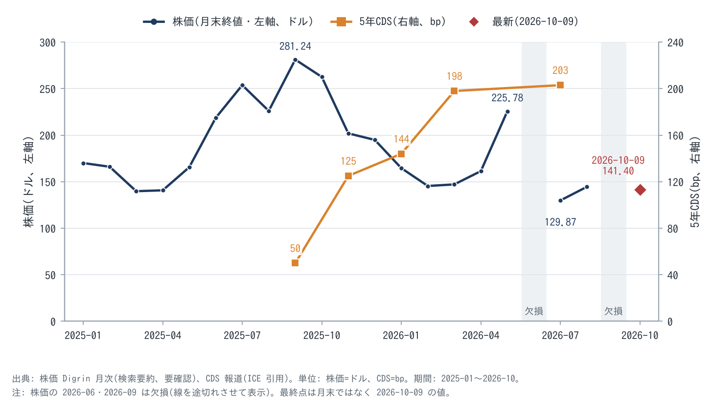{width=90}

### 7-1 強気派 vs 弱気派(F3。経営陣シナリオへの賛否として)

中心論点はクラックス C1〜C3 に置く。

| 論点 | 強気派(実在の論者、出典) | 弱気派(実在の論者、出典) | 同じ粒度の数値化(本報告書) |
|---|---|---|---|
| 総論 | Guggenheim の John DiFucci: Buy・$400(2026-09-11 維持)。「12か月で3倍」(7月の見出し)。Mizuho の Siti Panigrahi: Outperform・$320(OCI が成長の触媒) | Rothschild & Redburn の Alex Haissl: Sell・$175(2025-09-25 に調査開始)。「単一テナント・大規模展開では、クラウド事業者というより金融業者に近い」 | 強気(会社シナリオ経路)$192 / 弱気パス $84 |
| C2 資金・集中 | JPMorgan: Overweight・$200。Q1 の新規 $300億超は前払い・持込で、Oracle に追加の現金は不要。Barclays の Raimo Lenschow: $252。ATM 完了で借入だけに頼らず投資できる | S&P: BBB- に格下げ(2026-07-09)。FY27 の営業 FCF −約$420億、OpenAI は契約債務の「ほぼ半分」。Moody's: 見通しネガティブ、レバレッジは一時的に EBITDA の約5倍。Morgan Stanley: Equal-Weight・$210、FCF は予想期間を通じて制約 | OpenAI 不払い: −$16〜−25/株(確率20%)。前払い・持込の担保効果: +$3〜5/株 |
| C1 経済的寿命 | 会社: 更新期の GPU(過半が4年超)の全量が +20% で更新・再販(更新と再販の合算)。SemiAnalysis: H100 の契約は当初単価のまま更新 | Michael Burry: GPU の耐用年数延長は利益の水増しで、2028年までに Oracle の利益は 26.9% 過大 | 残存 0 → −$19/株、0.9・3年 → +$16/株 |
| C3 電力・納期 | 会社: 「契約上必要な拠点に遅延はない」「追加 4.5GW のリース手配は完了」 | Bloomberg: 一部拠点が 2027 → 2028年に延期。ニューメキシコで不可抗力通知・ガス管延期。Paul Kedrosky: Blue Owl の撤退は「警鐘」 | 1年遅延: −$3/株(DCF)、FY29 EPS −$1.2 |
| AI の利益率 | Stifel の Brad Reback: Buy・$200。短期の粗利率は下がるが、OCI の加速と営業費の効率化で相殺できる | The Information: GPU レンタルの粗利率 14%(2025年6〜8月)、減価償却を全額反映するとさらに約7pt 低い | EBIT 18% → −$13/株、35% → +$7/株 |

**対称プレモーテム(3年後に株価が半分 / 2倍になった理由、同数):**

| 3年後に株価が半分になった理由 | 確率・兆候 | 3年後に株価が2倍になった理由 | 確率・兆候 |
|---|---|---|---|
| ①OpenAI が 2028年に資金調達に失敗し、契約を縮小した | 15%。兆候: ダウンラウンド、支払遅延 | ①稼働 12GW 超、AI の粗利率が 35% を超えた | 10%。兆候: 四半期納入 1GW 超が続く |
| ②次世代 GPU で旧世代の単価が崩れ、更新率が 70% を下回った | 10%。兆候: H100 指数 $2 割れ | ②更新単価が当初以上で続き、残存価値が市場に認識された | 10%。兆候: 大型契約の更新事例 |
| ③ジャンク転落と低株価での大型増資(2つが同時に起きる複合事象。M17 単独の 15% より低い) | 10%。兆候: レバレッジ 4.5倍超、追加の ATM | ③FCF の黒字化(FY29)で信用の目から成長の目へ倍率が戻った | 15%。兆候: 純現金 capex の減少 |

**参照クラス:** 受注残の急増で「容量賃貸業」へ転じた企業の参照例として、2000年前後の光ファイバー網事業者(長期の IRU 契約=回線使用権の契約と借入による建設)がある。需要の前倒しで失速した下振れ側の例である。一方、ハイパースケーラーの AWS・Azure は、2010年代に容量の先行投資を長期にわたって回収し続けた上振れ側の例である(一般論)。Oracle は両者の中間にいる。顧客が資本を出す(前払い・持込)点では AWS 型に近く、顧客の集中度では光ファイバー型に近い。

### 7-2 成立条件(何が真でなければならないか)と逆側

| # | 投資が成立するために真でなければならない条件 | 現在の証拠 | 確認 KPI・閾値 | 確認時期 |
|---|---|---|---|---|
| W1 | AI 容量の粗利率が規模を伴って 30% 以上 | Q3 FY26 32%(1点のみ) | 開示される AI 容量の粗利率 ≥30%(稼働 ≥4GW で) | Q2〜Q4 FY27(2026-12〜2027-06) |
| W2 | 四半期の納入が 0.8〜1GW 以上で続く(電力の解放) | Q1 FY27 850MW | 納入 MW ≥800/四半期、ガス管 2027-02 の稼働 | 毎四半期 |
| W3 | OpenAI が外部資金を調達し続け、支払いが滞らない | $1,220億を調達(2026-03)、年換算売上 約$500億 | 評価額 $1兆以上のラウンドの完了、支払遅延・契約変更の報道がない | 2027年半ばまで |
| W4 | 契約後の容量が当初単価以上で更新される | Q1 FY27 +20%、Q4 FY26 92% | 更新プレミアム ≥0%、更新率 ≥85% | 毎四半期 |
| W5 | 投資適格を維持し、希薄化は年3%以内 | S&P BBB-(安定)、Moody's ネガティブ。ATM $200億は完了 | 格付けの維持、追加増資 ≤$100億/年 | FY27〜FY28 |

**逆側(何が真なら株価は過大か):** R1 AI 容量の粗利率が規模を伴っても 25% 未満。R2 納入が 600MW/四半期未満で2四半期続く。R3 OpenAI の資金調達失敗・支払遅延・契約の縮小や条件変更。R4 更新プレミアムがマイナス、または更新率 70% 未満。R5 投資不適格への転落、または $120 未満での大型増資。

**撤退条件(事前登録):** R3 または R5 のいずれか。あるいは R1 と R4 の同時発生。

### 7-3 判別 KPI 計器盤(F4)

| KPI(根幹KPIから) | 強気側の閾値 | 弱気側の閾値 | 合格ラインのパス | 次の決算(Q2 FY27、2026年12月)での確度の更新 | 頻度 | 出所 |
|---|---|---|---|---|---|---|
| K1 AI 容量の粗利率 | ≥30%(2四半期連続で買付条件) | ≤25% | Q2 FY27 ≥28%(開示があれば)→ Q4 FY27 ≥30% → FY28 ≥31% | ≥30% なら事業エンジン → コンセンサス経路の確率 +10pt。<25% なら弱気 +15pt | 四半期(開示しだい) | 決算説明会 |
| K2 四半期の納入容量 | ≥1,000MW | ≤600MW | Q2 ≥800 → Q3 ≥900 → Q4 ≥1,000 → FY28 計 ≥3GW | ≥1GW なら FY29 売上をコンセンサス($1,832億)へ +5%。<600 なら弱気 +10pt | 四半期 | 同上 |
| K3 GPU の更新プレミアム・更新率 | ≥+10% かつ ≥90% | <0% または <70% | 毎四半期 ≥0%・≥85% | 強気側なら残存価格比を 0.6 → 0.75(+$8/株)。弱気側なら 0.6 → 0.3(−$8/株) | 四半期 | 同上 |
| K4 OpenAI の依存度と支払能力 | OpenAI の比率 <40%、評価額 $1兆以上で調達 | 支払遅延・契約変更・ダウンラウンド | 2027年半ばまでに資金調達を完了 | 強気側なら OpenAI 不払いの確率を 20% → 12%。弱気側なら 20% → 40% | 随時 | 報道・プレス |
| K5 純現金 capex と FCF(前払い控除後) | 純現金 capex ≤$700億(FY27)、FY28 に FCF(純)> −$100億 | 総額 capex の見通しが $1,000億超へ上方修正、または $130 未満での追加増資 $100億超 | FY27 純 ≤$700億 → FY28 ≤$600億 → FY29 FCF ≥0 | 強気側なら AI の資本コスト −0.5pt(+$1.8/株)。弱気側なら株数 +3%(−$4/株) | 四半期 | 10-Q |
| K6 RPO の四半期純増 | ≥$400億 | <$100億 | 毎四半期 ≥$200億 | 強気側なら未契約の成長 +1GW/年。弱気側なら 0 | 四半期 | プレス |

**強気派・弱気派の実際の言説(和訳、出典つき):**
- 強気(Barclays、2026-09):「成長は変曲点を越えた」("growth has inflected")。$200億の ATM を完了し、借入だけに頼らず投資する余地ができた。
- 強気(JPMorgan、2026-09-11):Q1 の新規 $300億超は主に前払い・持込で、Oracle に追加の現金を要しない。ただし顧客集中、資金調達へのアクセス、容量の納入を下振れリスクとして挙げた。
- 弱気(S&P、2026-07-09):AI インフラの収益性は「不透明」。OpenAI がつまずけば容量が遊休化するリスクがある。レバレッジが 4.5倍を超え続ければ、再格下げもありうる。
- 弱気(Rothschild & Redburn、2025-09-25):市場は、契約済みクラウド収益の価値を「大きく過大評価」している。

<!-- pagebreak -->

## 8. 13条件による構造評価 — 構造評価は B で、PEG・過大評価の検証・コモディティ性の3条件が C にとどまる

**条件9(AI の停めない運用)の適用:** Oracle は AI 向けの計算基盤とデータベースを供給する企業であるため、条件9を適用する(Phase 0)。

**評価分布(詳細は Appendix D):**

| 評価 | 条件 | 件数 |
|---|---|---|
| S | 4(米国株) | 1 |
| A | 3(コア技術の AI 転用)、12(従量・確約型の収益) | 2 |
| B | 1(価格決定力・競争優位)、2(コアのキャッシュフロー)、5(経営者)、9(停めない運用)、10(無形資産の陳腐化)、11(模倣困難性)、13(アーキタイプ) | 7 |
| C | 6(PEG<1 かつ EPS CAGR 30%以上)、7(PEG が低い理由がリスクの過大評価か)、8(コモディティではない) | 3 |
| D 以下 | なし | 0 |
| 対象外(N/A) | なし | 0 |

**ルールの適用(発動・非発動を含む導出過程):**

1. **致命条件の拒否権(E 以下が1つでもあれば上限):** 非発動(E 以下なし)。
2. **条件6・7の対評価:** 条件6は C で S ではないため、「安い理由の構造が悪ければ6の S を無効にする」規則は対象外。条件7は C とした。安い理由の一部(経済的寿命の懸念)は市場の見落とし(片側の物語)で説明できるが、主因(OpenAI への集中と資金調達)は市場が正しく見ているリスクであり、見落としではない。
3. **C が4条件以上なら総合は B 以上にしない:** 非発動(C は3条件)。ただし条件5(経営者)は B と C の境界にある(capex の約束が FY26 に 59% 超過、報酬 KPI は総額指標)。C に落ちれば規則が発動し、総合の上限が B になるが、結論(B)は変わらない。
4. **最頻値と分布:** B が7件で最頻、A が2件、C が3件。拒否権・上限規則は非発動のため、**構造評価は B** とする。

**構造評価を決めた要因:**

| 押し上げ要因 | 条件 | 構造記述(Phase 4) | 機構台帳 |
|---|---|---|---|
| データベース顧客基盤がクラウド(マルチクラウド)と AI へ転用され、増収の主因になった | 3 | 顧客 → OCI・他社クラウド内の Oracle DB → AI 推論。追加コストが小さい | M14 |
| 収益の大半が確約・従量・保守のストックで、AI の陳腐化リスクの一部を顧客が負う(前払い・持込 $750億) | 12・7 | リスクの所在: GPU の陳腐化は持込分を顧客が負う。意図は資本と陳腐化の移転。純効果はプラス | M8 |
| 契約後の容量が当初単価以上で更新されている(経済的寿命 ≥ 会計耐用年数) | 1・10 | 更新期の GPU(過半が4年超)が全量 +20% で更新・再販。時間: 契約5〜6年、リース15〜19年 | M1 |

| 押し下げ要因 | 条件 | 構造記述 | 機構台帳 |
|---|---|---|---|
| EPS の成長が資本集約的で、受注残の約45%が資金調達に頼る1社 | 6・7 | アクター: OpenAI ← 投資家。リスクの所在: 不払いは Oracle(固定費のリース)。意図は需要の錨 | M5・M6 |
| AI 容量は計算の商品化が進む市場(先物の上場準備)で、差別化は電力と速さ | 8 | AI 運営は中間の利益プール。上流(NVIDIA)と下流(研究所)に挟まれる | M4 |
| リース(15〜19年)と顧客契約(5〜6年)の期間差 | 7・11 | 時間: 期間差 9〜14年。上振れ(電力付き建屋の希少性)と下振れ(空室費)の両面 | M10・M11 |

**アーキタイプ照合(条件13):** ORCL 型(従量課金・陳腐化リスクの顧客への移転・代替不可能な運用基盤)を原型としつつ、AI 容量の急拡大で MU 型(シクリカルな陳腐化 capex を自社が負う)へ部分的に寄っている。持込分(BYOH)と保守・SaaS は ORCL 型、Oracle が自ら GPU を買う大型 AI 契約は MU 型の要素を持つ。ビジネスモデル型(business-core-method §8)は、E1・E2 が A(ストック型ソフト)、E3 が B(従量のインフラ)、E4 が C(設備型インフラ)、E5 が G に近い。

<!-- pagebreak -->

## 9. 妥当な PEG の導出 — FY27 の許容 PEG は 0.80〜0.95 と置き、資本集約度と顧客集中が、ピア(1.2〜1.6)より低い倍率を正当化する

PEG は事業実態EPS(SBC 控除後)の5年 CAGR で計る(条件6の定義)。現在株価の PEG は次のとおりである。

| 経路 | 5年 CAGR(FY27 → FY32) | PEG |
|---|---|---|
| 事業エンジン | 22.1% | **0.92** |
| コンセンサス(FY29 以降は延長) | 26.2% | 0.79 |
| 会社シナリオ | 31.8% | 0.65 |

各経路の FY27 事業実態EPS に対する PER(20.4〜20.7倍)で計算した。

### 9-1 経路 a: ピアの実勢(EPS の定義・成長率の基準は出典ごとに異なり、SBC 控除前の可能性がある)

| ピア | PEG(5年予想ベース) | 出典・取得日 | 採否 |
|---|---|---|---|
| Microsoft | 1.60 | Yahoo key statistics(掲載日不明、2026-10-11 取得) | 採用 |
| SAP | 1.55 | 同上 | 採用 |
| Meta | 1.24 | Stockopedia(掲載日不明) | 採用 |
| Alphabet | 0.58 | FullRatio(2026-06。成長率の基準が他と不整合) | 不採用 |
| IBM | 2.42 | GuruFocus(5年 EBITDA 成長ベースで EPS ではない) | 不採用 |
| CoreWeave・Nebius | 算出不能(赤字) | Seeking Alpha | — |

採用3社のレンジは 1.24〜1.60 で、資本軽量型のプラットフォームの実勢を示す。Oracle の価値の 74% はコア事業(SOTP)で、ここにはこの倍率がよく当てはまる。一方、EPS の伸びの大半(FY27 → FY32 の営業増益の約4分の3)は、同じ倍率の当てはまらない AI 容量から生まれる。AI 容量の同業(ネオクラウド)は赤字で PEG を持たない。**経路 a は上限として 1.0〜1.3 を与える。**

### 9-2 経路 b: グロース慣行上の位置

PEG=1 を「成長と倍率が見合う」水準とする慣行(ピーター・リンチ)から出発する。解釈のアンカーは、1未満=市場評価が著しく低い、1〜1.5=一般・レガシー並み、1.5超=高評価(持続年数と質への信認が必要)である。Oracle の EPS 成長は、借入とリースで梃子を効かせた資本集約型の成長である。持続年数(CAP)も、コアは長いが AI は契約期間程度である。したがって高評価(1.5超)の根拠はなく、**経路 b は 0.9〜1.0**(一般水準の下端)を与える。

### 9-3 経路 c: 質とシナリオの因果

構造評価 B の出発点 1.0〜1.3 から、事業本体の質で調整する。

| 調整要因 | 方向 | 大きさ | 根拠 |
|---|---|---|---|
| 競争優位期間(CAP) | − | −0.10 | コアは 10〜15年、AI は 3〜6年。加重 7〜9年で、純粋なソフトより短い |
| 自己強化ループの強さ | − | −0.05 | R1(成長)は作動しているが、現在は B1(資本・格付けの均衡ループ)が支配的 |
| ストック収益比率 | + | +0.05 | FY27 売上の約8割が契約済み・習慣的 |
| 定常状態の利益率 > 報告値 | + | +0.05 | 立上げ費用で FY27 EPS が約 $0.85 押し下げられている(Jカーブ) |
| 非対称性(凸性) | − | −0.10 | 弱気 −40% 対 強気 +36%。レバレッジにより下値が限定されない |
| 下振れ機構(集中・期間差) | − | −0.10 | OpenAI 不払いで −$16〜−25/株、リースの期間差 9〜14年 |
| 資本集約度 | − | −0.15 | 1GW あたり $250億、FY27 の純現金 capex は $700億。増益に資本が要る |
| **合計** | | **−0.40** | → **0.60〜0.90** |

### 9-4 収束と採用値

| 経路 | レンジ | 位置づけ |
|---|---|---|
| a ピア実勢 | 1.0〜1.3 | 資本軽量型のバイアスを含む上限 |
| b 慣行上の位置 | 0.9〜1.0 | 上限の目安 |
| c 質・シナリオの因果 | 0.6〜0.9 | 事業本体(資本集約・集中)と最も整合する |
| **採用(FY27)** | **0.80〜0.95** | c の上半分(0.75〜0.9)と b の下端(0.9)の間に置いた判断。SOTP(資本を明示的に引く評価)の $140 が、事業エンジン経路の PEG 0.92 に相当することとも整合する |

3経路は一点には収束しない。a は資本の量を映さないため、事業本体(資本集約型の AI 容量)と最も整合する c を主にし、b を上限、a を参考上限とした。

**PEG 水準の解釈:** 採用値 0.80〜0.95 は「1未満=市場評価が著しく低い」の帯に入る。ただし本報告書は、これを割安のシグナルとは読まない。資本集約度と顧客集中という構造に見合った倍率と読む。

**年度別 PEG(狭いレンジ、全年度同一値にしない):**

| 年度 | PEG | 根拠 |
|---|---|---|
| FY27 | 0.80〜0.95 | 建設・立上げ期(S2)。資本集約が最大 |
| FY28 | 0.85〜1.00 | OpenAI 契約が開始し、集中は残る |
| FY29 | 0.90〜1.05 | 稼働・回収期(S3)へ移行。FCF が均衡に近づく |
| FY30 | 0.95〜1.10 | capex ÷ 売上が低下し、ストック比率が最大 |
| FY31 | 1.00〜1.15 | 更新・再契約期(S4)の入口 |
| FY32 | 1.00〜1.20 | 芯①の確定で上下に振れる |

5年 CAGR が 15% を下回る年度は PEG が線形性を失う。そのため、成熟したコアと設備型インフラの PER の下限 14倍を床として併用する。

<!-- pagebreak -->

## 10. 年度別バリュエーションと最終判断 — 採用する事業エンジン経路の目標株価は $134(−5%)で、SOTP の $140 と整合し、2軸マトリクスは「監視」を示す

### 10-1 事業実態EPS の導出(基準EPS)

| 段階 | FY26 実績 | FY27 基準 | 内容 |
|---|---|---|---|
| 報告 非GAAP EPS | $7.631 | $8.10(会社ガイダンス) | 定義: 希薄化後・非GAAP(SBC・買収無形資産の償却・リストラ費用を除く) |
| 一時要因の除外 | −$0.80 → $6.83 | — | Ampere 売却益 $27億(税引前、Q2 FY26、約 $0.72)、投資益(Bloom ワラント関連と推定、Q4 FY26、$0.08) |
| SBC の控除(下方補正) | −$1.32 → **$5.51** | −$1.215 → **$6.885** | SBC $48.1億(FY26)、約$46億(FY27E。Q1 $11.27億 × 4 = $45億に増加傾向を加味)× (1−20%) ÷ 株数 |
| 経済的耐用年数(上下両方向) | 0 | 0(中立) | 上方: 更新 +20%(残存価値)。下方: 4年償却なら −$1.71。証拠は上方寄りだが、2031年以降の不確実性で中立とする |
| 立上げ費用(定常状態への補正、上方) | — | 基準には入れず、定常状態 EPS として併記: +$0.85 → $7.73 | AI の EBIT を 16% → 28% に戻す |
| 前払いの金融要素 | 0 | 0 | 売上と支払利息が同額で増え、EPS には中立 |
| **基準EPS(事業実態EPS、会社ガイダンス基準)** | **$5.51** | **$6.885** | 採用経路(事業エンジン)の FY27 事業実態EPS は $6.93 で、差は 0.6%。各経路の目標株価は、それぞれの経路の FY27 EPS を使う |

**EPS 品質フォレンジック(要点。詳細は Appendix B):**

| 期間 | EPS の伸び(対数) | 売上 | 純利益率 | 株数 |
|---|---|---|---|---|
| FY25 → FY26(一時益除く) | +12.5% | +16.1% | −1.9% | −1.7% |
| FY26 → FY27(ガイダンス) | +17.1% | +28.9%(単純成長率 +33.5%) | −8.0% | −3.9% |

- **FY26 → FY27 の純利益率の低下要因:** AI のミックス、支払利息、立上げ費用。
- **税率:** 非GAAP 税率は約 20%(Q1 FY26 実績 20.5%)で、税による押し上げはない。
- **裁量費用:** 営業費の対売上比が低下している。人員削減によるもので、成長投資を削っているのではない(R&D・S&M の内訳は未取得)。

### 10-2 将来 EPS の経路(F13)と年度別適正株価

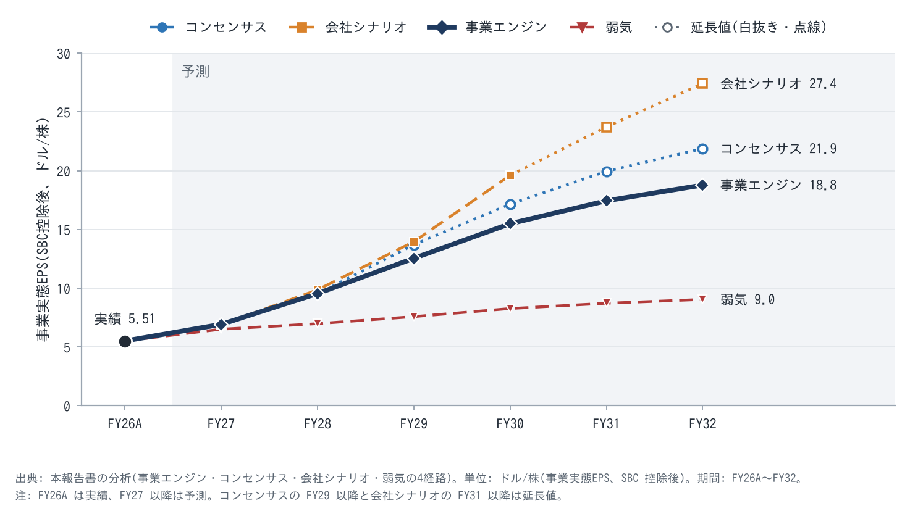{width=92}

**図F13 年度別評価テーブル(事業エンジン経路=採用):**

| 年度 | 事業実態EPS | 5年 CAGR g | PEG | 妥当PER(=PEG×g、下限14倍) | 適正株価(中央値) |
|---|---|---|---|---|---|
| FY27 | $6.93 | 22.1% | 0.80〜0.95 | 17.7〜21.0倍 | **$134**(レンジ $122〜145) |
| FY28 | $9.55 | 16.1% | 0.85〜1.00 | 14.0〜16.1倍 | $143($134〜153) |
| FY29 | $12.54 | 11.2% | 0.90〜1.05 | 14.0倍(下限) | $176 |
| FY30 | $15.49 | 7.6% | 0.95〜1.10 | 14.0倍(下限) | $217 |
| FY31 | $17.44 | 6.1% | 1.00〜1.15 | 14.0倍(下限) | $244 |
| FY32 | $18.78 | 5.4% | 1.00〜1.20 | 14.0倍(下限) | $263 |

**他経路の FY27 適正株価と前提:**

| 経路 | FY27 事業実態EPS | g(5年) | 適正株価(FY27、中央値) | FY29 | FY30 | 前提 |
|---|---|---|---|---|---|---|
| コンセンサス | $6.84 | 26.2% | **$157**($143〜170) | $193 | $240 | FY27 $8.05・FY28 $10.78(非GAAP コンセンサス)。FY29 はコンセンサス売上 $1,832億 × エンジンの利益率で延長 |
| 会社シナリオ | $6.89 | 31.8% | **$192**($175〜208) | $263 | $280 | FY27 $8.10 → FY30 $21(幾何補間) |
| 事業エンジン(採用) | $6.93 | 22.1% | **$134**($122〜145) | $176 | $217 | 稼働 GW 5.0 → 8.0 → 10.5 → 12.0、GW あたり $8 → 10.5B、AI EBIT 16 → 30% |
| 弱気パス | $6.51 | 6.8% | **$84**(SOTP 弱気 $84 と弱気 EPS × 13倍 $85 の平均。FY28 以降は PER 下限 14倍) | $106 | $116 | OpenAI 分の 50% 不払い、AI EBIT 18%、稼働 9.5GW で頭打ち、株数 +10% |

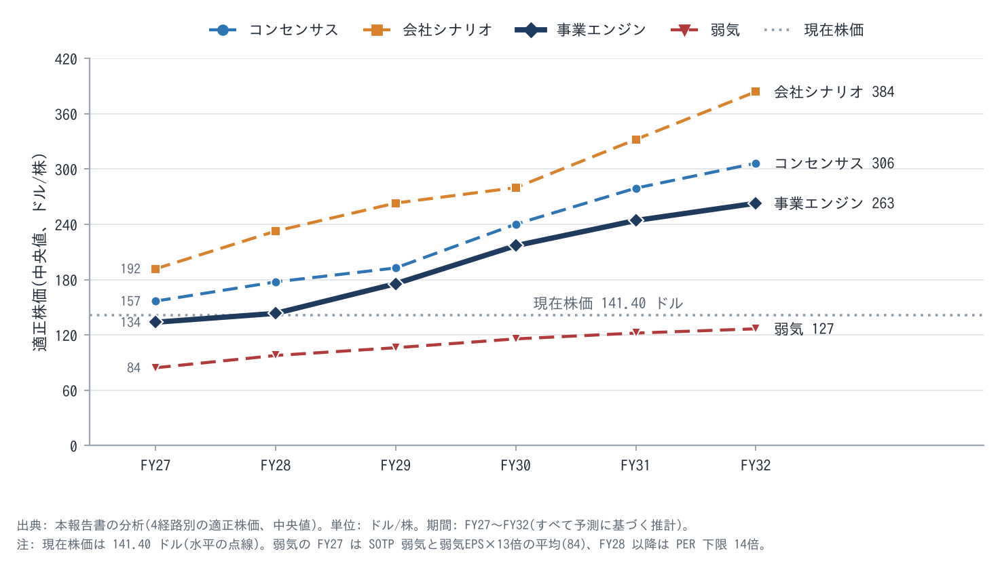{width=92}

**採用経路の判断:** 事業エンジン経路を採用する。FY28 の EPS($10.81)はコンセンサス($10.78)とほぼ同じである。FY29 以降は、電力の律速(クラックス C3 の層2の遅延)と、GW あたり売上の保守的な前提で、コンセンサスの延長を下回る。会社シナリオ経路は、AI の EBIT 利益率約35%(会社レンジの上端)と稼働 14〜15GW を要し、現在の証拠(納入 850MW、Q3 FY26 の粗利率 32%)では採れない。

**PEG 評価を覆すカタリスト(必須):** FY29 に FCF(純)がプラスへ転じれば、PEG は 0.95〜1.10 へ再評価される(11章 F5)。逆に、AI 容量の粗利率が 25% を下回ると、PEG は 0.6〜0.7 へ下がる。

### 10-3 目標株価の計算フロー(F6)

1. **基準EPS:** 採用経路(事業エンジン)の FY27 事業実態EPS = **$6.93**(会社ガイダンス基準の $8.10 − SBC の税引後 $1.215 = $6.885 との差は 0.6%。各経路は自らの FY27 EPS を基準に使う)
2. **成長率:** 事業エンジン経路の事業実態EPS の5年 CAGR(FY27 $6.93 → FY32 $18.78)= **22.1%**
3. **許容PEG:** 3経路の収束で **0.80〜0.95**(中央 0.875)
4. **妥当PER:** 0.875 × 22.1 = **19.3倍**(レンジ 17.7〜21.0倍)
5. **目標株価:** $6.93 × 19.3 = **$134**(レンジ $122〜145。会社ガイダンス基準の $6.885 を使うと $133)
6. **乖離:** ($134 − $141.40) ÷ $141.40 = **−5%**

### 10-4 感応度マトリクス(F12)

**F12a 経路 × PEG(FY27 の事業実態EPS × PEG × 5年 g、1株ドル。PER 下限 14倍は適用しない純粋な PEG 値):**

| 経路 \ PEG | 0.6 | 0.8 | 0.9 | 1.0 | 1.2 | 1.5 |
|---|---|---|---|---|---|---|
| コンセンサス | 107 | 143 | 161 | 179 | 215 | 269 |
| 会社シナリオ | 132 | 175 | 197 | 219 | 263 | 329 |
| **事業エンジン(採用)** | 92 | **122** | **138** | 153 | 183 | 229 |
| 弱気 | 27 | 35 | 40 | 44 | 53 | 66 |

**F12b 芯 × 芯(SOTP の1株価値。行=経済的寿命×更新単価、列=AI 容量の利益率):**

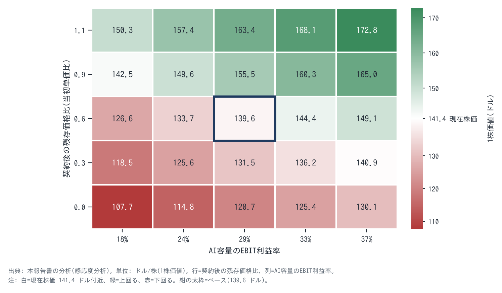{width=88}

マトリクスの入力は機構台帳の大きさ(M1〜M4)である。現在株価($141.40)を上回るには、次のいずれかが要る。

- 残存価格比 0.9 以上(EBIT 18% でも $142.5)
- AI 容量の EBIT 33% 以上かつ残存価格比 0.6 以上($144)

### 10-5 業種別の交差確認(SOTP)と成長の値段

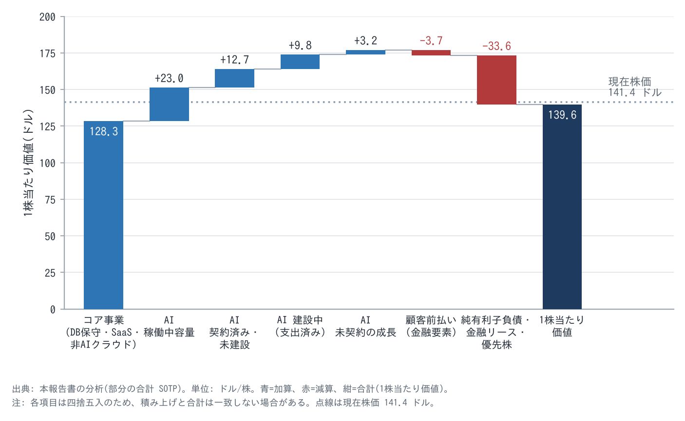{width=92}

| 構成要素 | 価値 | 1株 | 前提 |
|---|---|---|---|
| コア事業(DB 保守・SaaS・一般クラウド) | $3,913億 | $128.3 | NOPAT $211億、5年 +6% → 永続 +2.5%、ROIC 35%、資本コスト 8.0%(保守・SaaS 中心で AI サイクルの影響が小さいため β≈1.0 相当と置いた。株式全体の β 1.6〜1.7 は AI 事業とレバレッジを含む) |
| AI 稼働中容量(約2.55GW) | $703億 | $23.0 | 残り5年の現金 + 残存 |
| AI 契約済み・未建設(約7.65GW) | $387億 | $12.7 | NPV $59億/GW × 建設時期の割引 0.85 |
| AI 建設中(支出済み) | $298億 | $9.8 | 建設仮勘定 $485億のうち AI 分 約$350億(推定)× 0.85 |
| AI 未契約の成長 | $97億 | $3.2 | 1.5GW/年 × 5年 × NPV × 0.7 × 確率 50% × 開始時期の割引 |
| 顧客前払い(金融要素) | −$114億 | −$3.7 | 将来の履行義務 |
| 純有利子負債・金融リース・優先株 | −$1,024億 | −$33.6 | 負債 $1,253億 − 現金 $371億 + 金融リース $92億 + 優先株 $50億 |
| **1株当たり価値** | **$4,259億** | **$139.6** | 弱気 $84 / 強気 $168 |

**交差確認の判断:** PEG 経路(事業エンジン)の $134 と SOTP の $140 の差は 4% で、整合している。一方、セルサイドの平均目標 $252(MarketBeat、47名)は、FY28 の EPS に 23倍前後を掛けた値に近い。この差は資本集約度の扱いの違いによる。本報告書は、AI の EPS には毎年 $600〜700億の純投資が伴うため、PER を素直に当てるより、資本を明示的に引く SOTP の方が事業本体と整合すると判断した。

**成長の値段:** 定常状態価値 $3,076億(1株 $101)に対し、時価総額は $4,313億。成長の値段は **$1,237億(1株 $41、時価総額の 29%)** である。SOTP のベース($139.6)から定常状態価値($101)を引いた成長に帰属する価値は1株 約$39で、ほぼ一致する。市場は成長に妥当な値段を付けている。

**価値の時間分布:** SOTP の価値のうち、3年以内に生じる現金は 18%、それ以降が 82%。遠い価値の比率が高い。遠い価値の確度を事業本体で裏付けられれば時間軸の優位になるが、その確度は芯①(2031年以降の更新単価)に依存し、現時点では裏付けられない。

### 10-6 2軸マトリクスと最終判断

| 経路 | 目標株価 | 乖離 | 構造評価 B での位置(2軸マトリクス) |
|---|---|---|---|
| **事業エンジン(採用)** | **$134** | **−5%** | **−10〜+10% → 監視** |
| コンセンサス | $157 | +11% | +10〜30% → 買い検討 |
| 会社シナリオ | $192 | +36% | +30%以上 → 買い |
| 弱気 | $84 | −40% | −10%未満 → 見送り |

**最終判断: 監視。**
- 採用経路は「B × −5%」で監視を示す。
- 市場との差分がない(エッジなし)ため、他の経路がプラスでも「買い」にしない。
- 期待値($132、−7%)と非対称性(−40% 対 +36%)も、買い判断を支持しない。期待値の算式は 0.25 × $84.4(弱気)+ 0.45 × $133.8(事業エンジン)+ 0.20 × $156.7(コンセンサス)+ 0.10 × $191.8(会社シナリオ)= $131.8。確率配分は、採用経路に最大の重み、7-1 の対称プレモーテム(半減側の合計 35%)を踏まえて弱気に 25%、会社目標の達成に要する AI 利益率 35%・稼働 14〜15GW の証拠の薄さから会社シナリオに 10% を置いた(判断)。

**判断を変えるトリガー:**
- **上方(買い検討へ):** ①株価 ≤$119(Z2)、または ②K1(AI 容量の粗利率 ≥30%)と K3(更新プレミアム ≥+10% かつ更新率 ≥90%)が2四半期続けて強気側を満たす(K2 の納入 ≥1GW/四半期が加われば、さらにコンセンサス経路へ寄せる)。②の場合、採用経路をコンセンサス寄りに更新し、残存価格比を 0.6 → 0.75 に上げる(1株価値 +$8 前後)。
- **下方(見送りへ。7-2 の撤退条件と同じ):** R3(OpenAI の資金調達失敗・支払遅延・契約の縮小や条件変更)、R5(投資不適格への転落、または $120 未満での大型増資)、あるいは R1(K1 < 25%)と R4(K3 の弱気側)の同時発生。

<!-- pagebreak -->

## 11. 乖離を埋めるカタリスト — 判断を動かす最初のカタリストは、2026年12月の Q2 FY27 決算で開示される AI 容量の粗利率・納入 MW・更新データである

### 11-1 カタリスト一覧と検証スケジュール(F5)

| 時期 | カタリスト | 分類 | 影響度の目安(ΔEPS / ΔPEG / Δ1株価値) | 実現可能性 | 合格ライン | 効く収益ライン | 機構 |
|---|---|---|---|---|---|---|---|
| 2026-12 中旬 | Q2 FY27 決算(ガイダンス: 売上 +30〜34%、EPS $1.85〜1.93) | EPS 向き | Q2 EPS ±$0.05 / 開示内容しだいで ΔPEG ±0.05 | 高 | 納入 ≥800MW、AI 粗利率 ≥28%(開示時)、更新 ≥0% | E4 | M1・M3・M9 |
| 2026 年内〜2027 前半 | FY27 の残り資金調達(約$200億、債券か株式か) | その他(希薄化) | 株式なら株数 +3%(−$4/株) | 中 | 追加の普通株 ≤$100億 | — | M13 |
| 2027-02-01 | Green Chile ガス管(ニューメキシコ)の稼働予定日 | EPS 向き(時期) | FY28 EPS ±$0.3 | 中 | 予定どおり稼働 | E4 | M9 |
| 2027 前半 | OpenAI の大型資金調達(評価額 $1.2兆を協議中との報道) | PEG 再評価トリガー | 成功: 不払い確率 20% → 12%(+$2/株)。失敗: 20% → 40%(−$5/株) | 中 | 評価額 $1兆以上でクローズ | E4 | M5 |
| 2027 年中 | OpenAI 契約(約$3,000億)の本格開始 | EPS 向き | FY28 AI 売上 +$100億規模 | 中〜高 | 契約どおりの課金開始 | E4 | M5・M6 |
| 2027-06 中旬 | FY27 決算と FY28 ガイダンス | EPS 向き / PEG | FY28 EPS ガイダンスがコンセンサス $10.78 を上回れば +$5〜10/株 | 中 | FY28 売上 ≥$1,250億(PSO 目標水準) | 全ライン | M3・M9 |
| 随時 | S&P・Moody's の格付け見直し | PEG 再評価トリガー | ジャンク転落: −$8/株 | 低〜中 | BBB- 維持 | — | M17 |
| 2026〜2027 | 次世代 GPU(NVIDIA Rubin 等)の出荷と旧世代の貸出単価 | PEG 再評価トリガー(芯①) | 残存価格比 ±0.3 → ±$8/株 | 中 | H100 指数 ≥$2.0 | E4 | M1・M2 |
| 2028-05 | 共同CEO の PSO 測定(FY28 総売上 $1,000億 / $1,250億) | その他 | 経営陣のインセンティブの確認 | — | ≥$1,000億 | 全ライン | — |
| FY29(2028-06〜) | FCF(純)の黒字化(S&P は 2029年を想定) | **PEG 再評価トリガー** | PEG 0.85 → 1.0(FY27 基準で +$23/株) | 中 | FCF ≥0 | — | M3・M8 |

**現在の PEG 評価を覆すカタリスト(PEG 再評価トリガー):** FCF(純)の黒字化(FY29)、OpenAI の資金調達の成否(2027)、次世代 GPU 出荷後の旧世代の更新単価(2027〜)、格付け。いずれも、資本集約・顧客集中・経済的寿命という PEG を低く置いた理由そのものを動かす。

<!-- pagebreak -->

## 12. リスクと投資アクション — 残るリスクの核心は OpenAI と電力であり、$119 以下で分割エントリー、撤退は OpenAI の契約変更か格付けのジャンク転落とする

### 12-1 機構台帳サマリ(F16。全行は Appendix E)

| # | 機構 | 方向 | Δ1株価値 | 確率 | 時期 | 市場の織り込み |
|---|---|---|---|---|---|---|
| M1 | 経済的寿命 > 会計耐用年数(更新 +20%) | + | +$16 | 40% | FY31〜 | 一部(逆算 0.54) |
| M2 | 次世代 GPU で旧世代の単価が崩れる(残存 0・空室費) | − | −$19 | 25% | FY31〜 | 一部 |
| M3 | AI 容量の粗利率が 30% 台へ(立上げ費用の解消) | + | +$5(EPS +$0.85 定常) | 50% | FY28〜29 | 一部(逆算 m=30%) |
| M4 | AI 容量の利益率の低迷(価格競争・部材高) | − | −$13 | 25% | FY28〜 | 一部 |
| M5 | OpenAI の不払い・契約縮小 | − | −$16〜−25 | 20% | FY29〜31 | 大部分(株価 −59%) |
| M6 | OpenAI の単価再交渉(−20%) | − | −$6.5 | 30% | FY28〜 | 一部 |
| M8 | 前払い・持込による資本と陳腐化リスクの移転 | + | +$3〜5 | 70% | 進行中 | 一部 |
| M9 | 電力の解放遅延 | − | −$3(EPS: FY29 −$1.2) | 50% | FY28〜29 | 一部 |
| M11 | 電力付き建屋の希少性(長期リースの上振れ) | + | +$5〜10 | 30% | FY32〜 | 未 |
| M13 | 低株価での追加増資 | − | −$4〜−12 | 40% | FY27〜28 | 一部 |
| M15 | コアの営業費効率化(利益率 48 → 50%) | + | +$6 | 40% | FY27〜28 | 一部 |
| M16 | ソフトウェア(保守)の侵食加速 | − | −$7 | 25% | FY27〜30 | 一部 |

上振れと下振れを同じ粒度で並べた。Appendix E の全行で集計すると、上振れ7機構(M1・M3・M7・M8・M11・M14・M15)の確率加重は +$20、下振れ8機構(M2・M4・M5・M6・M9・M13・M16・M17)は −$22 で、純額は −$2/株である。期待値 $132(−7%)と同じ方向を示す(機構の一部はベースの前提と重なるため、純額は目安である)。

### 12-2 リスクマトリクス(F14。テールリスクを含む)

**通常のリスク(本体評価に効果として組み込み済み):** M2・M4・M5・M6・M9・M13・M16・M17(機構台帳)。

**テールリスク(低確率・高インパクト。可能性分析のうえ本体評価から分離):**

| # | テールリスク | 発生確率(3年) | 影響度 | 可能性分析 | 顕在化トリガー(兆候) |
|---|---|---|---|---|---|
| T1 | AI 投資の全面的な逆回転(主要 AI 研究所の同時資金難とハイパースケーラーの capex 削減) | 10% | 極大(1株 $50〜70。代替需要も同時に消え、リース $2,880億が固定費化) | OpenAI の FCF −$2,780億(2026〜30年)、評価額依存の資金調達。ただしハイパースケーラーの受注残は拡大中 | OpenAI のダウンラウンド、ハイパースケーラーの capex ガイダンス引下げ、GPU 貸出単価の急落(H100 指数 <$1.5) |
| T2 | 電力・規制ショック(州・連邦によるデータセンター電力の制限) | 5〜10% | 大(納期 2年以上の遅延) | 住民訴訟(ニューメキシコ)、電力料金の転嫁問題(ウィスコンシン) | 州法・FERC の規則変更、送電の優先順位の変更 |
| T3 | キーパーソン(Larry Ellison 会長兼CTO、82歳) | 5% | 中 | 共同CEO 体制(2025-09〜)と新CFO(2026-04)で継承は進行中 | 健康・持株の売却 |
| T4 | 地政学(先端 GPU・メモリの供給途絶) | 5% | 大 | 台湾集中 | 輸出規制、地域紛争 |
| T5 | 会計不正 | 低(兆候なし) | — | 耐用年数の延長(FY25)は更新データと整合。異常検知器のうち発生主義比率は前受金で歪むため参考外 | 監査人の交代、修正再表示 |

テールリスクは「分離」したが「無視」していない。T1 は弱気パス($84)をさらに下回る。そのためポジションの大きさは、T1 の顕在化で −50% になっても許容できる水準に抑える(12-4)。

### 12-3 エントリー価格帯(F7)

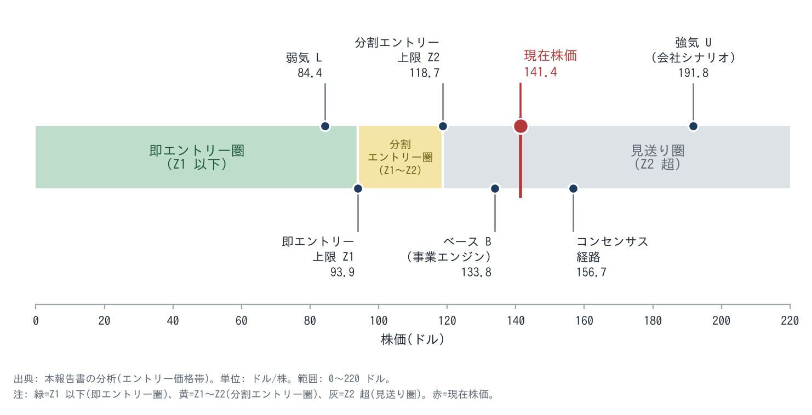{width=92}

| 項目 | 値 | 導出 |
|---|---|---|
| ベース B(事業エンジン経路) | $134 | 10-3 |
| 強気 U(会社シナリオ経路) | $192 | 10-2 |
| 弱気 L | $84 | 10-2 |
| 安全余裕率 α | 22.5% | 構造評価 B(20〜25% の中央) |
| 即エントリー圏の上限 Z1 | min(B×(1−α), L×(1+α/2)) = min($104, **$94**)= $94 | **エッジなしのため即エントリー圏は設けない(参考値)** |
| 分割エントリー圏の上限 Z2 | B × (1−α/2) = **$119** | |
| **現在株価 $141.40 の位置** | **見送り圏**(区分名。最終判断の「見送り」とは別) | Z2 を 19% 上回る |
| 補助条件 | Z1 での (U−株価)÷(株価−L) = 10.3(≥2) | 上値と下値の比は十分 |

### 12-4 時系列投資戦略(4フェーズ、F8)

| フェーズ | 期間の目安 | やること | 確認 KPI(判別KPI と共有) | 撤退条件 |
|---|---|---|---|---|
| 0. 監視期(現在) | 〜株価 ≤$119、または K1(≥30%)・K3(≥+10% かつ ≥90%)の2四半期連続の強気側確認まで | 保有しない。四半期ごとに確度を更新する | K1〜K6 | — |
| 1. エントリー期 | 条件成立から1〜2四半期 | $119 以下で3回に分けて建てる(1回あたり目標ポジションの 1/3)。目標ポジションは、T1 で −50% でも全体の許容損失に収まる大きさ | K2(納入)、K4(OpenAI) | R3 または R5、あるいは R1 と R4 の同時発生(7-2) |
| 2. 検証期 | 2〜4四半期 | 確度を四半期ごとに更新し、差分(経済的寿命・利益率)の進捗を見る | K1 の合格ライン(Q4 FY27 ≥30%)、K3 | 合格ラインを2四半期続けて下回り、一時要因で説明できない |
| 3. 本格保有期 | FCF(純)の改善が数字に表れてから(FY28 後半〜) | 確度に応じて保有を増やす | K5、根幹KPI の加速度(OCI 前年比の2階差分) | ループ R1 の最も弱いリンク(OpenAI の支払)の破綻 |
| 4. 再評価期 | 差分が市場に織り込まれた後(PEG ≥1.0) | 新しい差分があるかを再分析し、なければ縮小する | 成長の値段、コンセンサスとの差 | エッジの消失 |

**一文サマリ(投資アクション込み):** Oracle は、データベースの利益を土台に他人の建物と顧客の資金で AI 容量を建てる事業へ移っている。しかし $141 の株価は、AI 容量の利益率30%と控えめな残存価値をすでに織り込み、事業本体の評価($134〜140)とほぼ一致するため、**監視**とする。

- **買付条件:** $119 以下で3分割、または K1(AI 容量の粗利率 ≥30%)と K3(GPU 更新プレミアム ≥+10% かつ更新率 ≥90%)の2四半期連続の確認。
- **監視KPI:** AI 容量の粗利率、四半期納入 MW、更新データ、OpenAI の資金調達、純現金 capex、RPO 純増。
- **売却トリガー(7-2 で事前登録):** R3(OpenAI の資金調達失敗・支払遅延・契約の縮小や条件変更)、R5(投資不適格への転落、または $120 未満での大型増資)、あるいは R1(AI 容量の粗利率 25% 未満)と R4(更新プレミアムがマイナス、または更新率 70% 未満)の同時発生。

<!-- pagebreak -->

## Appendix A: evidence 台帳(パワポ作成スキル入力用の条件別一覧)

| # | 条件 | 評価 | 根拠一文 | 主要数値(出所、取得日 2026-10-11) | 監視KPI(C以下のみ) |
|---|---|---|---|---|---|
| 1 | 10年の価格決定力・競争優位・成長性 | B | DB はスイッチングコストが強い。AI は更新 +20% と値上げの実績があるが、優位の源泉(電力)は一時的 | 更新 +20%(Q1 FY27 説明会)、Software −3%、CoreWeave の全品目 +25%(2026-07) | — |
| 2 | コア事業の潤沢なキャッシュフロー | B | コア NOPAT 約$211億、契約裏付け率 4.0倍。ただし全社 FCF は6四半期連続のマイナス | 営業CF $320億(FY26)、FCF −$237億(FY26)、Q1 FY27 −$54億(10-Q・プレス) | — |
| 3 | コア技術・データの AI 転用と成果 | A | DB 基盤とネットワーク技術が OCI と AI 容量に転用され、増収の主因になった | OCI +121%(Q1 FY27)、マルチクラウド DB +353% | — |
| 4 | 日本株か米国株 | S(充足) | NYSE 上場の米国企業 | — | — |
| 5 | CEO の信頼性と事業拡大の経歴 | B | Magouyrk は OCI をゼロから構築し、成長の約束は守った。capex の約束は大幅に超過し、報酬 KPI は総額指標 | FY26 capex: 2025-09 時点の見通し 約$350億 → 実績 $557億。PSO の KPI は FY28 総売上(DEF 14A) | — |
| 6 | 5年後 EPS 成長率で PEG<1(CAGR 30%以上) | C | 会社シナリオ経路のみ CAGR 30%超かつ PEG<1。事業エンジン(22.1%)とコンセンサス(26.2%)は CAGR 30% 未満 | 事業実態PER 20.5倍、PEG 0.65〜0.92 | K1・K2(AI 粗利率 ≥30%、納入 ≥1GW/四半期)。CAGR の上方修正のトリガー |
| 7 | PEG が低い理由がリスクの過大評価 | C | 安い理由の一部(経済的寿命)は片側の物語だが、主因(OpenAI 集中・資金)は実在のリスクで、株価の逆算は会社の利益率を織り込む | 逆算 m=30%、残存 0.54。OpenAI は RPO の 45〜50%(S&P・BofA) | K4(OpenAI の資金調達 ≥$1兆評価)、K3(更新率 ≥85%) |
| 8 | コモディティではない | C | DB は非コモディティ。AI 容量は計算の商品化(先物の準備)が進み、差別化は電力・速度・ネットワークに限られる | ICE・CME の GPU 計算先物の準備、H100 指数 $2.80(ネオクラウド)対 $7.19(ハイパースケーラー) | K1(AI 粗利率)。価格競争の兆候は全社粗利率の下落幅 |
| 9 | 顧客の AI 実装の「停めない運用」に不可欠 | B | AI 研究所にとって電力付き容量は最重要の費目で、乗り換えに数か月〜数年を要する。企業 AI は Oracle DB 上のデータに依存 | GPU 稼働率 97.9%、Q4 FY26 の更新 92%(GPU 基準) | — |
| 10 | 無形資産投資の陳腐化リスク | B | DB の技術・顧客関係は長寿命。耐用年数の延長(6年)は更新データと整合 | FY25 に5 → 6年(営業費用 −$7.33億)、更新期の GPU(過半が4年超)が全量 +20% で更新・再販 | — |
| 11 | 模倣困難・代替不可能 | B | DB 顧客基盤とマルチクラウドの配置は再現困難。AI 容量は資本と電力があれば再現可能(2〜4年) | 確保電力 10GW 超、AWS 20・Google 15リージョンで Oracle DB を提供 | — |
| 12 | 従量課金型の収益性格 | A | OCI は従量・確約、保守・SaaS は継続課金。持込契約で陳腐化リスクを顧客に移す | 前払い・持込 $750億、RPO $6,640億 | — |
| 13 | アーキタイプ照合 | B | ORCL 型(原型)だが、自社調達の GPU 部分は MU 型に寄る | capex ÷ 売上 147%(Q1 FY27)、純現金 capex ≤$700億(FY27) | — |

<!-- pagebreak -->

## Appendix B: 計算前提

**B-1 EPS の定義と基準EPS**

| 項目 | 値 | 出所・注記 |
|---|---|---|
| EPS の定義 | 希薄化後・非GAAP(会社定義: SBC、買収無形資産の償却、買収関連・リストラ費用などを除外)。事業実態EPS は、ここから SBC の税引後額を控除 | Oracle 決算プレス |
| FY26 非GAAP EPS | $7.631(GAAP $5.83) | Q4 FY26 プレス(2026-06-10) |
| 一時要因の除外 | Ampere 売却益 $27億(税引前、Q2 FY26、EPS 約 $0.72)+ Q4 の投資益 $0.08(Bloom ワラント関連と推定)= $0.80 → 正規化 $6.83 | プレス・10-K(営業外収益 +$35億、うち Ampere $27億・その他の投資益 $3.8億) |
| SBC | FY26 $48.11億、FY27E 約$46億(Q1 $11.27億 × 4 = $45億に増加傾向を加味)、以後 +6%/年 | 10-K・10-Q |
| 税率(非GAAP) | 20%(Q1 FY26 実績 20.5%) | 決算説明会 |
| 株数(希薄化後) | FY26 29.14億、Q1 FY27 30.0億(平均)、期末換算 30.5億(ATM 1.41億株の期末効果)。FY27 30.3 → FY28 30.8 → FY29 31.2 → FY30 31.3 → FY31 31.4 → FY32 31.5(億株) | プレス・H3・推定 |
| 基準EPS(FY27 事業実態) | $8.10 − $1.215 = **$6.885**(会社ガイダンス基準)。採用経路の FY27 EPS は $6.93(差 0.6%)で、目標株価はこちらを使う | 10-1・10-3 |
| 事業実態EPS の補正内訳(上下両方向) | 下方: SBC −$1.215。上方: 立上げ費用(定常状態 +$0.85、基準には入れず併記)。両方向・中立: 経済的耐用年数(上方 = 残存価値、下方 = 4年償却なら −$1.71)、前払いの金融要素(中立) | 10-1 |

**B-2 EPS 成長の対数分解**

| 期間 | EPS | 売上 | 純利益率 | 株数 | 備考 |
|---|---|---|---|---|---|
| FY25 → FY26(一時益除く) | +12.5% | +16.1% | −1.9% | −1.7% | FY25 非GAAP EPS は $6.03(決算発表、T1)を採用。AI 要約の $6.00 は不採用 |
| FY26 → FY27(ガイダンス) | +17.1% | +28.9% | −8.0% | −3.9% | 純利益率の低下 = AI のミックス、支払利息、立上げ費用 |

**B-3 年度別 EPS の経路(非GAAP / 事業実態)**

| 年度 | コンセンサス | 会社シナリオ | 事業エンジン | 弱気 |
|---|---|---|---|---|
| FY27 | 8.05 / 6.84 | 8.10 / 6.89 | 8.14 / 6.93 | 7.71 / 6.51 |
| FY28 | 10.78 / 9.51 | 11.13 / 9.86 | 10.81 / 9.55 | 8.20 / 6.98 |
| FY29 | 15.03 / 13.70(延長) | 15.29 / 13.96(補間) | 13.87 / 12.54 | 8.84 / 7.58 |
| FY30 | 18.56 / 17.16(延長) | 21.00 / 19.60 | 16.89 / 15.49 | 9.58 / 8.27 |
| FY31 | 21.43 / 19.95(延長) | 25.20 / 23.72(延長) | 18.92 / 17.44 | 10.10 / 8.72 |
| FY32 | 23.44 / 21.88(延長) | 28.98 / 27.42(延長) | 20.34 / 18.78 | 10.51 / 9.05 |

**コンセンサスの出所:** FY27 $8.05(tickerleague、25名、高 $8.15・低 $7.82)、FY28 $10.78(TickFlow、16名、高 $14.05・低 $7.36)、売上は FY27 $905億(Yahoo)・FY28 $1,306億(TickFlow 35名・Yahoo の平均)・FY29 $1,832億(TickFlow 17名)。

**欠損と延長の扱い:** FY29〜FY31 の EPS コンセンサスは取得できなかった。FY29 はコンセンサス売上 × 事業エンジンの利益率で延長し、FY30 以降は売上成長 +20%・+13%・+9% を仮定して延長した(延長部分と明記)。TradingView から直接は取得できなかった(既知の制約3)。

**事業エンジン経路の前提:**

| 項目 | FY27 | FY28 | FY29 | FY30 | FY31 | FY32 |
|---|---|---|---|---|---|---|
| 期末稼働 GW | 5.0 | 8.0 | 10.5 | 12.0 | 13.0 | 13.8 |
| GW あたり売上(B$/年) | 8.0 | 9.5 | 10.0 | 10.5 | 10.5 | 10.5 |
| AI の EBIT 利益率 | 16% | 23% | 27% | 29% | 30% | 30% |
| 純支払利息(B$) | 4.4 | 5.8 | 6.4 | 6.2 | 5.6 | 5.0 |

**事業エンジン経路のコア部分(稼働 GW の起点 FY26 末 1.7GW は、FY25 末 約0.5GW〔推定〕+ FY26 納入 1.2GW):**
- **成長率:** ソフトウェア −3%/年、SaaS +10〜8%、非AI OCI +30%から +12%へ逓減。
- **利益率:** 非GAAP 営業利益率 48%(Q1 FY27 に合わせた較正値。較正後の誤差はモデル $80.6億 対 実績 $82億で −1.8%)。

**弱気パスの前提:**
- **稼働 GW:** FY27 4.5、FY28 6.5、FY29 8.0、FY30 9.0、FY31 9.5、FY32 9.5。
- **GW あたり売上:** $8〜9B。
- **AI の EBIT 利益率:** 14〜18%。
- **OpenAI の実現率:** FY28 以降 50%。
- **株数:** FY32 33.7億株。

**B-4 許容 PEG(3経路の収束)と年度別 PEG** — 9章を参照。

| 経路 | レンジ |
|---|---|
| a ピア | 1.0〜1.3 |
| b 慣行 | 0.9〜1.0 |
| c 因果 | 0.6〜0.9 |
| **採用(FY27)** | **0.80〜0.95** |

年度別 PEG は FY28 0.85〜1.00、FY29 0.90〜1.05、FY30 0.95〜1.10、FY31 1.00〜1.15、FY32 1.00〜1.20。PER の下限は 14倍。成長率 g は、各年度から5年先までの事業実態EPS の CAGR(FY33 以降は経路別の逓減率で延長: エンジン 7→4%、コンセンサス 9→5%、会社 12→6%、弱気 3%)。

**B-5 SOTP と GW あたりの経済性**

| 項目 | ベース | 強気 | 弱気 |
|---|---|---|---|
| コアの資本コスト | 8.0% | 8.0% | 9.0% |
| コアの5年成長率 | 6% | 7% | 4.5% |
| コアの永続成長率 | 2.5% | 2.5% | 2.5% |
| コアの ROIC | 35% | 35% | 35% |
| AI の資本コスト | 10% | 9.5% | 11% |
| GW あたり売上 R | $100億 | $100億 | $100億 |
| AI の EBIT 利益率 m | 29% | 33% | 18% |
| GW あたり投資 K | $250億 | $250億 | $250億 |
| 契約期間 | 6年 | 6年 | 6年 |
| 契約後の残存 | 0.6×2年 | 0.8×3年 | 0 + 空室費(施設費の50%、17年目まで) |
| 稼働中 | 2.55GW(平均1年経過) | 同 | 同 |
| 契約済みの合計 | 10.2GW | 10.2GW | 7.0GW |
| 建設時期の割引 | 0.85 | 0.85 | 0.85 |
| 未契約の成長 | 1.5GW/年 × 5年 × 0.7 × 50% × 0.62 | 2.5GW/年 × 60% | 0 |
| 建設仮勘定の AI 分(足し戻し) | $350億 × 0.85 | 同 | × 0.6(座礁) |
| 顧客前払い(控除) | $114億 | 同 | 同 |
| 負債等(控除) | $1,024億 | 同 | 同 |
| 株数 | 30.5億 | 同 | 同 |
| **1株価値** | **$139.6** | **$168.2** | **$84.2** |
| GW あたり NPV / IRR | $59億 / 17.0% | $113億 / 20.9% | −$44億 / 9.2% |

**逆算:** 現株価 $141.40 に一致する AI の EBIT 利益率は 30.5%(他はベース)、残存価格比(3年)は 0.54。

**B-6 リスクの効果測定**

| 項目 | 計算 | 結果 |
|---|---|---|
| ATM 増資の反実仮想 | 1.41億株 ÷ 29.14億株 = 希薄化 4.8% → EPS −4.6%。同額 $200億を借入(6.5%、税引後)にした場合は EPS −4.2% | EPS への影響はほぼ同じ。借入なら S&P の閾値(4.5倍)超過の確率が上がる → 増資の純効果はわずかにプラス |
| 1株当たり成長率への影響 | (1+利益成長)÷(1+希薄化)−1。FY27: 純利益 +23.3%(一時益除く $199億 → $245億)÷ 株数 +4.0% → EPS +18.6%。反実仮想(増資せず、その分の容量を建てない): $200億で建てられる容量は約0.8GW、NPV は約 $48億(1株 +$1.6)。平均発行価格(推定 約$141)は1株価値 $140 とほぼ同じで、発行による価値の移転はほぼない | 調達は1株価値をわずかに増やす(AI の NPV/GW が正であることが前提。弱気の NPV −$44億/GW なら逆に減らす) |
| 契約裏付け率 | 受注残の年間転換額 $1,107億 ÷(支払利息 $60億 + リース支払 $219億)| 4.0倍 |
| 金利感応度 | 変動金利の比率は非開示(主に固定利付債)。新規調達 $200億 × 100bp = 税引後 $1.6億 = EPS −$0.05 | 小 |
| OpenAI 不払い | 年 $600億 × 残り3年、再販単価 40〜70%・空白 1〜2年、税引後、10%割引(3年後から) | −$16〜−25/株(再交渉 −20%: −$6.5/株) |

**B-7 エントリー価格帯** — 12-3 を参照。B $134、U $192、L $84、α 22.5%、Z1 $94(参考)、Z2 $119。

<!-- pagebreak -->

## Appendix C: パワポ変換マップ(図表 → スライドのテンプレート番号と表現パターンの対応)

| 図 | 本報告書の位置 | Tテンプレ | bcg 表現パターン |
|---|---|---|---|
| F1 鳥の目事業構造マップ(現在) | 3-3 | T15 | 鳥の目マップ型 |
| F2 構造変化オーバーレイ(将来) | 6-2 | T15 再掲オーバーレイ | 再掲オーバーレイ型 |
| F3 強気派 vs 弱気派対照表 | 7-1 | T13/T8 | 対比2段型 |
| F4 判別KPI 計器盤 | 7-3 | T8 | ファクト表型(C-5) |
| F5 検証スケジュール | 11-1 | T5 | 時系列ロードマップ型 |
| F6 目標株価計算フロー | 10-3 | T18 | 計算フロー型 |
| F7 エントリー価格ゾーン | 12-3(図あり) | T18/T13 | 帯グラフ型 |
| F8 時系列投資戦略 | 12-4 | T5/T8 | ロードマップ型 |
| F9 移行現在地ロードマップ | 6-1 | T5/T13 | 段階的成熟ロードマップ型 |
| F10 収益・費用フロー解剖 | 3-1 | T15 | ストラクチャー図型 |
| F11 シナリオ採点表 | 5-1 | T8 | ファクト表型(C-5) |
| F12 シナリオ×PEG 感応度マトリクス | 10-4(図あり) | T13 | 感応度マトリクス型 |
| F13 年度別適正株価パス | 10-2(図あり) | T7/T18 | 計算フロー型 |
| F14 リスクマトリクス(テールリスク含む) | 12-2 | T13 | 感応度マトリクス型 |
| F15 事業エンジン図 | 2-5(資本の図は 2-7) | T15 | ストラクチャー図型 |
| F16 機構台帳サマリ | 12-1 | T8 | ファクト表型(C-5) |
| F17 市場との差分 | 2-1 | T13/T8 | 対比2段型 |
| F18 根幹KPI 加速度表 | 2-10(図あり) | T8 | ファクト表型(C-5) |

<!-- pagebreak -->

## Appendix D: 13条件の詳細審査

各条件で、仮判定 → 追加調査トリガーの確認(最大2周)→ 根拠一文 + 定量 evidence(2〜4点)+ 出所 → C 以下に監視 KPI、の順に判定した。構造は「アクター / フロー / リスク所在(意図と1株当たり価値への純効果)/ 時間」の4要素で記述する。

**条件1 10年の価格決定力・競争優位・成長性 — B**
- **判断軸:** 顧客価値と価格の差、更新時単価 ÷ 初回単価、7 Powers の数と強さ、CAP、成長余地。
- **evidence:**
  - ① 更新期の GPU(過半が4年超)の全量が従来契約比 +20% で更新・再販(Q1 FY27、更新と再販の合算)
  - ② ソフトウェア −3%(緩やかな侵食)
  - ③ 7 Powers: スイッチングコスト(強)、プロセスパワー(中)、独占的資源=電力(一時的)
  - ④ CAP は加重 7〜9年
- **構造:**
  - アクター: DB 顧客、AI 研究所、ハイパースケーラー
  - フロー: 保守料・容量料
  - リスク所在: 価格競争リスクは Oracle が負う(AI)
  - 時間: DB は数十年、AI の優位は電力が希少な数年
- **判定:** S(Power 2つ以上で強化中、CAP 10年超)には AI 側の優位の短さで届かず、D 以下の兆候(値下げ圧力)もないため B。1周目で決定。

**条件2 コア事業の潤沢なキャッシュフロー — B**
- **判断軸(確認層):** コア単体の定常状態利益と、成長 capex の裏付け。
- **evidence:**
  - ① コア NOPAT 約$211億(推定)
  - ② 契約裏付け率 4.0倍
  - ③ 前払い・持込 $750億
  - ④ 全社 FCF は FY26 −$237億、Q1 FY27 −$54億
- **確認層として:** 全社 FCF のマイナスは、成長 capex(契約済み需要の取り込み)によるもので、コアの稼ぐ力は落ちていない。ただし capex の裏付けの約45%は資金調達に頼る1社(OpenAI)であり、「顧客の資本で裏付けられている」と言えるのは前払い・持込の部分に限られる。
- **判定:** S には届かず B。

**条件3 コア技術・データの AI 転用と成果 — A**
- **evidence:**
  - ① OCI +121%(Q1 FY27)、総売上の伸びの主因
  - ② マルチクラウド DB +353%・顧客 +180%
  - ③ Exadata 由来の RDMA ネットワークによる GPU クラスタ構築
  - ④ 企業顧客の「自社データでの AI 推論」需要(会社説明)
- **構造:** 既存資産(DB・ネットワーク技術・顧客)→ 転用経路(OCI、他社クラウド内の DB、AI Database)→ 新収益。
- **判定:** 転用先が全社成長の主因になっているため A。S(圧倒的)に届かない理由は、AI 容量の収益が GPU の貸出(DB の転用ではない部分)に大きく依存するためである。

**条件4 日本株か米国株 — 充足**
- NYSE 上場の米国企業。

**条件5 CEO の信頼性と事業拡大の経歴 — B(C との境界)**
- **evidence:**
  - ① Magouyrk は OCI を立ち上げた中心人物で、OCI の成長加速(+55% → +121%)の約束は実現
  - ② 売上ガイダンスは Q3・Q4 FY26・Q1 FY27 で上振れ、Q2 FY26 は未達
  - ③ FY26 capex は 2025-09 時点の見通し 約$350億 → 2025-12 に $500億 → 実績 $557億(+59%)。FCF 黒字化の時期は示さない
  - ④ 共同CEO の業績連動部分(PSO、報酬の20%)の KPI は FY28 の総売上(総額)で、1株当たり指標ではない。80% は行使価格 $308.46 の時間ベースのオプション
- **補足:** CFO は 2026-04 に交代(Maxson)。共同CEO は 2025-09 に就任で、新体制の実績は約1年。
- **判定:** 実行(需要獲得・容量納入)は強いが、資本配分の規律と1株当たりの整合で留保が大きい。2周目でも決め手がなく、B を維持し、境界であることを明記する(C なら C×4 の規則が発動するが、総合は B で変わらない)。

**条件6 5年後 EPS 成長率で PEG<1(CAGR 30%以上) — C**
- **evidence:**

| 経路 | 事業実態EPS の5年 CAGR | PEG |
|---|---|---|
| 事業エンジン | 22.1% | 0.92 |
| コンセンサス | 26.2% | 0.79 |
| 会社シナリオ | 31.8% | 0.65 |

  (いずれも PER 20.5倍)
- **判定:** 会社シナリオ経路だけが CAGR 30% 以上かつ PEG<1 を満たし、事業エンジン経路は満たさない(評価目安の「B=事業エンジン経路でのみ満たす」とは逆)ので C。
- **監視KPI:** K1(AI 粗利率 ≥30%)と K2(納入 ≥1GW/四半期)が続けば、事業エンジン経路の CAGR は 26% 前後へ上がる。

**条件7 PEG が低い理由がリスクの過大評価であること — C**
- **判断軸:** 「なぜ安いか」を出典で特定し、見落としの原因で説明できるか。
- **evidence:**
  - ① 安く見える理由の第一は、PER が資本集約度を映さないこと(会計による歪みではなく、評価法の限界)
  - ② 市場の物語のうち「GPU 2〜3年寿命」(Burry)は片側の物語で、更新データ(+20%)が反証する
  - ③ 一方、OpenAI 集中(RPO の 45〜50%、S&P・BofA)と資金調達(BBB-、CDS 200bp)は実在のリスクで、市場は正しく見ている
  - ④ 陳腐化リスクの所在: 持込分は顧客、自社調達分は Oracle(契約期間 ≒ 償却期間で、契約中はほぼ相殺)、建屋の長期リースは Oracle
- **判定:** 安い理由の一部しか見落としで説明できないため C。
- **監視KPI:** K3(更新率 ≥85%)、K4(OpenAI の資金調達)。

**条件8 コモディティではない — C**
- **evidence:**
  - ① DB は非コモディティ
  - ② AI 容量: GPU 計算の価格指数(Silicon Data・Ornn)が整い、ICE が現金決済の GPU 先物を準備(2026-05 発表)、CME も提携
  - ③ ネオクラウドとハイパースケーラーの H100 単価差は約2.6倍で、差別化の余地は残る
  - ④ Oracle の差別化は電力の確保、RDMA ネットワーク、マルチクラウド
- **判定:** 増分の価値の大半を生む AI 容量が商品化の途上にあるため C。
- **監視KPI:** K1(AI 粗利率)と全社粗利率の下落幅。

**条件9 停めない運用に不可欠 — B**
- **evidence:**
  - ① GPU 稼働率 97.9%
  - ② Q4 FY26: 顧客の 49% が GPU の 92% を更新
  - ③ 学習・推論の容量は AI 研究所の事業の律速で、乗り換えには電力付き容量の確保が要る(数か月〜数年)
  - ④ 企業 AI は Oracle DB 内のデータに依存
- **判定:** 止まると顧客の事業が止まるが、代替(他クラウド)は存在するため B。

**条件10 無形資産投資の陳腐化リスク — B**
- **evidence:**
  - ① DB 技術・顧客関係は数十年の寿命
  - ② AI 向けソフト(OCI のスタック)は世代交代が速い
  - ③ 有形資産(GPU)の耐用年数延長(5 → 6年)は更新データと整合
  - ④ 中古 GPU の売買価格の下落(下方の兆候)
- **判定:** B。

**条件11 模倣困難・代替不可能 — B**
- **evidence:**
  - ① DB の顧客基盤とマルチクラウド(AWS 20・Google 15リージョン)は再現困難
  - ② AI 容量は資本と電力があれば2〜4年で再現可能(ハイパースケーラー・ネオクラウドが実際に建設中)
  - ③ 律速的に効く障壁は電力(確保 10GW 超)
- **判定:** B。

**条件12 従量課金型の収益性格 — A**
- **evidence:**
  - ① OCI は従量・確約契約、保守・SaaS は継続課金
  - ② RPO $6,640億
  - ③ 前払い・持込 $750億で、陳腐化リスクの一部を顧客に移転
- **判定:** 確約契約は従量ではなく容量の上限があるため、S(顧客の利用拡大がそのまま売上)ではなく A。

**条件13 アーキタイプ照合 — B**
- 8章を参照。ORCL 型が原型で、自社調達の GPU 部分は MU 型に寄る。

<!-- pagebreak -->

## Appendix E: 機構台帳(全行)

| # | 機構 | 層 | 方向 | 経路(KPI → 利益) | 大きさ(Δ1株価値) | 確率 | 時期 | 証拠(出所) | 確認KPI と閾値 | 市場の織り込み |
|---|---|---|---|---|---|---|---|---|---|---|
| M1 | 経済的寿命 > 会計耐用年数 | L5 | + | 更新単価 → 契約後の AI 利益(残存) | +$16(残存 0.6 → 0.9・3年) | 40% | FY31〜 | 更新期の GPU(過半が4年超)の全量が +20% で更新・再販(Q1 FY27 説明会、Constellation・Longbridge 引用)、H100 指数 +40%(Silicon Data) | 更新プレミアム ≥0%、更新率 ≥85% | 一部(逆算 0.54) |
| M2 | 次世代 GPU で旧世代の単価が崩れる | L5 | − | 残存 0・空室費 | −$19 | 25% | FY31〜 | 中古 H100 $4万 → $1.2〜2.2万(Servnet ほか、Tier 4) | H100 指数 <$2.0、更新率 <70% | 一部 |
| M3 | AI 容量の粗利率が 30% 台へ(立上げ費用の解消) | L6 | + | AI EBIT 29 → 33% | +$5 / FY27 定常 EPS +$0.85 | 50% | FY28〜29 | Q3 FY26 32%(説明会)、CFO「立ち上がれば急速に回復」 | AI 容量の粗利率 ≥30% | 一部(逆算 m=30%) |
| M4 | AI 容量の利益率の低迷(価格競争・部材高・二次の効果) | L1・L7 | − | m 29 → 18% | −$13 | 25% | FY28〜 | The Information 14%(2025年6〜8月)、メモリ価格の上昇(AWS の capex 引上げ理由) | AI 粗利率 <25% | 一部 |
| M5 | OpenAI の不払い・契約縮小 | L4 | − | 4.5GW 分の売上消失 → 再販 | −$16〜−25 | 20% | FY29〜31 | OpenAI の FCF −$2,780億(2026〜30年)、資金は 2028年に枯渇見込み(FT) | 評価額 $1兆以上の調達、支払遅延の報道 | 大部分 |
| M6 | OpenAI の単価再交渉(−20%) | L4 | − | 単価 | −$6.5 | 30% | FY28〜 | Abilene 拡張の中止報道(Bloomberg 2026-03、会社は否定) | 契約変更の開示 | 一部 |
| M7 | 非 OpenAI 顧客の拡大(集中の低下) | L4 | + | 資本コスト低下・成長 | +$4.5 | 50% | FY27〜28 | 非 OpenAI の RPO が前年比2倍超(会社説明)、Q1 新規 $300億超 | OpenAI 比率 <40% | 未 |
| M8 | 前払い・持込による資本と陳腐化リスクの移転 | L5 | + | Oracle 負担の資本減・担保 | +$3〜5 | 70% | 進行中 | $750億、前受収益 $154億 → $308億(プレス・10-Q) | 純現金 capex ≤$700億 | 一部 |
| M9 | 電力の解放遅延 | L3 | − | 納入 MW → 売上の時期 | −$3(FY29 EPS −$1.2) | 50% | FY28〜29 | 不可抗力通知(Reuters 2026-09-24)、ガス管 2027-02 へ延期(FERC 提出書類)、納入 850MW < 約1GW | 納入 ≥1GW/四半期 | 一部 |
| M10 | リース期間のミスマッチ(下方) | L6 | − | 契約後の空室費 | M2 に含む(1GW あたり −$32億) | 25% | FY32〜 | 未開始リース $2,880億、15〜19年(10-Q) | 更新率、再販単価 | 一部 |
| M11 | 電力付き建屋の希少性(長期リースの上方) | L6 | + | 世代交代ごとに再賃貸 | +$5〜10 | 30% | FY32〜 | ガスのトラック輸送(Bloomberg 2026-10-08)、ハイパースケーラーの capex 増 | 電力付き建屋の賃料 | 未 |
| M12 | コアの資本コスト(格付け・β の再帰性) | L5・原則15 | ± | WACC 7.75〜9.5% | ±$17 | — | 継続 | CDS 約200bp、BBB-(S&P) | 格付けの見通し、CDS | 市場変数 |
| M13 | 低株価での追加増資 | L5 | − | 株数 +3〜10% | −$4〜−12 | 40% | FY27〜28 | ATM $200億(平均発行価格は推定 約$141)、FY27 の残り調達 約$200億 | 追加増資の発表と価格 | 一部 |
| M14 | マルチクラウド DB・AI Database(収益の多重性) | L2 | + | 非AI OCI の成長 +5pt | +$3.5 | 40% | FY27〜29 | +353%、顧客 +180%(Quartr、単一出典) | マルチクラウド DB の売上開示 | 未(規模が小さい) |
| M15 | コアの営業費効率化 | L9 | + | コア利益率 48 → 50% | +$6 | 40% | FY27〜28 | 非GAAP 営業利益率 42.5% を AI のミックス悪化の中で維持 | 営業費 ÷ 売上 | 一部 |
| M16 | ソフトウェア(保守)の侵食加速 | L1 | − | ソフトウェア −3 → −8%/年 | −$7 | 25% | FY27〜30 | Software −3%、「AI が SaaS を脅かすか」の質問(JPMorgan、2026-03) | Software の前年比 < −6% | 一部 |
| M17 | 投資不適格への転落 | L5 | − | 負債コスト +150bp | −$8 | 15% | FY27〜28 | S&P の閾値 4.5倍、FY27 の予測 約4.4倍 | レバレッジ >4.5倍 | 一部 |

**探索の記録(上振れ・下振れの両方):**
- 層ごとに上振れ・下振れの両方を探した。L1(価格決定力: M16 と未行使の保守料値上げ=保留)、L2(M14)、L3(M9・M11)、L4(M5・M6・M7)、L5(M1・M2・M8・M12・M13・M17)、L6(M3・M10・M11)、L7(M4)、L9(M15)。
- 未行使の価格決定力(保守料の値上げ)は、値上げの実績が開示されていないため保留とした。試算に要するデータは、保守料率の改定と更新率である。
- M7〜M17 の大きさは、SOTP モデルの感応度からの概算である。

<!-- pagebreak -->

## Appendix F: 確認テストの結果と一次情報の記録

**F-1 確認テスト(事業仮説 → 数字での検証)**

| 事業上の仮説 | 数字での確認テスト | 結果 |
|---|---|---|
| 既存顧客の拡張で伸びている(E2・E3) | NRR の上昇と S&M ÷ 売上の低下が同時に起きる | **部分確認。** NRR は非開示。営業費 ÷ 売上は低下(営業利益率を維持しつつ粗利率は低下)。マルチクラウド DB +353% は既存 DB 顧客の拡張 |
| 資産が会計耐用年数より長く稼ぐ | 償却済み資産の比率が上がっても粗利率が落ちない。更新単価が上がる | **確認(更新単価)。** 更新期の GPU(過半が4年超)が全量 +20% で更新・再販。粗利率は立上げ費用で低下中のため、分離できない |
| capex が契約で裏付けられている | 前払い・受注残の転換が capex の進捗と連動 | **確認。** 前受収益 $154億 → $308億と capex $285億が同じ四半期に急増。RPO $6,640億、裏付け率 4.0倍 |
| 資本の外部化で ROE が上がる | 総資産回転率と ROE の上昇 | **未確認。** ROE は増資で分母が増え、判定困難(株主資本 $425億 → $668億)。確度を下げて M8 に残す |
| 収穫逓増が働いている | 限界利益率 > 平均利益率 | **否定(現時点)。** FY27E の限界利益率 約27% < 平均 39%(立上げ期)。Q1 FY27 単独では 45% > 42.5%(営業費削減の効果) |
| 供給制約で売上が遅れている | 受注残が積み上がり、単価が上がり、制約解放に合わせて売上が伸びる | **確認。** RPO $6,640億、更新 +20%、納入 MW に連動して OCI が加速(+121%) |

**F-2 異常検知器(兆候であり判定ではない)**

| 指標 | 値 | 解釈(事業の言葉で) |
|---|---|---|
| 発生主義比率((純利益 − 営業CF)÷ 平均総資産) | FY26: ($170億 − $320億)÷ 約$2,150億 = −7% | マイナス(現金 > 利益)。前受金の流入による。不正の兆候ではない |
| 売上債権回転日数 | 2025-05 約49日 → 2026-08 約54日 | 微増。大型 AI 顧客の支払条件の可能性があり、監視する |
| 前受金・受注残 > 売上の伸び | 前受収益 +100%(1四半期)、RPO +46%(前年比)対 売上 +30% | **上振れの兆候**(顧客の前払い) |
| 非営業損益の比率 | FY26 の営業外収益 +$35億(Ampere 等)= 税前利益の約15% | 正規化済み(B-1) |
| Beneish M-Score | 未計算(入力データ不足) | 既知の制約 |

**F-3 一次情報(開示以外の観察)の記録**

| # | 観察 | 何を裏付けるか | 出所 |
|---|---|---|---|
| 1 | H100 のネオクラウド貸出単価指数 $2.00(2025-12)→ $2.80(2026-08)、SemiAnalysis の H100 1年契約指数 $1.70 → $2.35 | 需給の逼迫、経済的寿命 > 会計耐用年数(M1) | Silicon Data、SemiAnalysis |
| 2 | Transwestern(Energy Transfer)の FERC 提出書類: Green Chile ガス管の稼働予定 2026-08-15 → 2027-02-01 | 電力が律速段階で、解放は遅延(M9、C3 層2) | FERC 提出書類(報道経由) |
| 3 | Bloomberg(2026-10-08): Oracle を含む事業者がガスをトラックで運び、パイプラインの遅延に備える。ユタ州の拠点は1年超トラックのガスで稼働 | 電力の制約と、その回避策(コスト増) | Bloomberg(報道経由) |
| 4 | CoreWeave が 2026-07 に全品目で約25%値上げし、6-30 以降は高い価格で新規契約(IR 2026-09-17) | 業界全体の単価上昇(L1)、更新単価の上昇は Oracle 固有ではない | CoreWeave IR(検索要約) |
| 5 | 中古 H100 の売買価格 $4万 → $1.2〜2.2万 | 経済的寿命の下方の兆候(M2)。レンタル価値は電力付き容量の希少性に依存 | Servnet・GPUnex(Tier 4) |
| 6 | ICE が Ornn の計算価格指数に連動する GPU 先物を準備(2026-05)、CME と Silicon Data が提携 | GPU 計算の商品化(条件8) | 報道 |

<!-- pagebreak -->

## 既知の制約

1. **AI/非AI の売上内訳が非開示のため、AI エンジン式(稼働 GW × GW あたり売上)を報告値と独立に ±5% で照合できない。** 区分合計の照合(差 0.0%)と、報道ベースの AI 売上推定から GW あたり売上を逆算した三角測量(FY26 $6.5B → Q1 FY27 $7.7B → 契約例示 $10〜13.3B)で代替した。結論への影響: GW あたり売上の前提($10〜10.5B)が ±$1.5B ずれると、1株価値は ±$7 動く(参考図1)。
2. **原典を直接読めていない。** 本セッションの環境では WebFetch が sec.gov・oracle.com・tradingview.com を含むほぼ全ドメインで遮断され、データ取得は Web 検索の要約に限られた。10-Q・10-K・決算説明会の全文、DEF 14A の本文は未読である。Tier 1 と記した数値も要約経由で、要原典確認。
3. **TradingView のコンセンサスを直接取得できなかった。** FY27・FY28 は tickerleague(25名)・TickFlow(16名)の値を使い、EPS 定義は「非GAAP 系と推定」とした(会社ガイダンス $8.10 に近いため)。FY29〜FY31 の EPS コンセンサスは欠損で、延長値を用いた。結論への影響: コンセンサス経路の目標株価($157)は延長の前提に依存する。
4. **株価 $141.40(2026-10-09)は単一出典。** 2026-10-08 の終値 $135.69 は複数出典で確認済み。$135.69 を使っても乖離は事業エンジン経路で −1% にとどまり、判断(監視)は変わらない。
5. **ピア比較の大半が欠損(Amazon の PEG、Alphabet の採用できる基準の PEG、Salesforce・ServiceNow の全項目)。** PEG の経路 a は3社(MSFT・SAP・META)で構成した。3社の PEG も EPS の定義と成長率の基準が Oracle(SBC 控除後の5年 CAGR)と揃っている保証はない。
6. **AI 容量の粗利率は Q3 FY26 の 32% の1点しか数値がない。** Q4 FY26・Q1 FY27 は定性的な説明のみ。
7. **OpenAI 契約の条項(take-or-pay、解約条項、前払いの有無)は非公開。** OpenAI 不払い時の損失は、再販単価と空白期間の仮定で幅を持たせた。
8. **S&M・R&D・G&A の内訳、保守の更新率、NRR は取得できなかった。** 増収の源泉分解のうち「新規 / 既存拡張」は、エンジン単位の近似にとどまる。
9. **事業エンジン経路と SOTP の前提には推定が含まれる。** 主な推定は、稼働 GW(2026-08 で 2.55GW)、建設仮勘定の AI 分($350億)、コアの NOPAT(コアの利益率 48% を Q1 FY27 で較正)。
10. **品質監査ループ(F1・F2・F9・F10):** 3層ルーブリックで自己採点した結果は、L1 完全性 B(主要ラインは揃うが、AI の内訳は推定)、L2 密度・具体性 A(全ラインに数値と出所)、L3 示唆性 A(差分・制約・確認 KPI に接続)。総合 B 以上で合格。
11. **評価基準の一部は確立した基準ではない。** 経路 c の PEG の出発点、2軸マトリクスの区切り、安全余裕率 α、PER の下限 14倍は、本報告書の分析手法で設定した値である。

## 品質ゲート結果

**事業本体と市場との差分**

| 項目 | 判定 | 根拠・位置 |
|---|---|---|
| 事業本体の品質ゲート(下表)の全項目 | ほぼ合格 | 下表。エンジン式の ±5% 照合のみ部分達成(既知の制約1) |
| 市場との差分(またはエッジなし)が出典つきで1章と2章で一致 | 合格 | 1章・2-1(エッジなし、差分 A・B が相殺) |
| 意図の解読と効果測定のない「リスク」記述がない | 合格 | 2-7、12-1、Appendix E |
| 上振れ・下振れの両方が同じ粒度で数値化 | 合格 | 12-1(+$16 / −$21)、7-1 |
| 事業エンジン経路があり、コンセンサスとの差を説明 | 合格 | 10-2(FY29 以降、電力律速と GW あたり売上) |
| 事業実態EPS の補正内訳が上下両方向 | 合格 | 10-1、B-1 |
| 芯が特定され、市場が暗に置く値・自分の見積り・優位の種類 | 合格 | 2-1b |
| 成長の値段と価値の時間分布 | 合格 | 1章、10-5 |

**§10 事業本体のゲート**

| 項目 | 判定 |
|---|---|
| エンジン式 ±5% | 部分(制約1) |
| 増収の源泉分解 | 合格(2-4) |
| ループの各リンクに証拠 | 合格(「供給優先」は仮説と明記) |
| 制約と解放時期 | 合格(2-5) |
| 定常状態利益 | 合格(2-8) |
| 耐用年数の両方向 | 合格(2-7) |
| CAP | 合格(2-9) |
| リスクに意図と効果 | 合格 |
| 希薄化・借入の反実仮想 | 合格(B-6) |
| 機構台帳の両方向の探索 | 合格(App. E) |
| 固有性テスト | 合格(2-1) |
| 異常値から2つ以上の問い | 合格。異常値は5つ: ①前受収益の倍増、②4年超を含む更新期 GPU の +20% 更新・再販、③OCI 加速と株価最安値圏の同居、④AI ミックス下での営業利益率の維持、⑤RPO 純増の鈍化 |
| 一次情報2件以上 | 合格(F-3 で6件) |
| 市場の仮説の出典 | 合格(7-1) |
| 根幹KPI の加速度 | 合格(2-10。一部の KPI は時系列不足) |
| 会計数値を事業実態に変換 | 合格(10-1) |
| 芯の特定と2周目 | 合格(2-1b。2周目の調査 S4 を芯に集中) |
| 芯の市場値・見積り・優位 | 合格 |
| 増分 ROIC | 合格(2-7、IRR 17%) |
| 収益の多重性 | 合格(2-4) |
| 敵対的検証と二次の効果 | 合格(2-9) |
| ガイダンス達成率と開示の変化 | 合格(5章・App. D の条件5、S1 調査。FY24〜FY25 の分は未取得) |
| 成長の値段 | 合格 |
| 再帰性 | 合格(2-7) |

**構成と整合**

| 項目 | 判定 |
|---|---|
| 全章の見出しがメッセージ型 | 合格(章見出し1〜12 と「見出しだけで読む判断の論理」を同文で揃えた。小見出しと付録は様式上の見出し) |
| 各章に定量と定性が対で存在 | 合格 |
| 未充足の図がない(または保留明記) | 合格(F1〜F18 はすべて表または図で充足。F15 は構造記述で代替) |
| 構造マップの品質監査 B 以上 | 合格(制約10) |
| 評価・判断・目標株価が全章で一致 | 合格(1・8・10・12章: 監視 / B / $134 / 見送り圏) |
| 報告書の軸がシナリオ、土台が事業本体 | 合格 |

**シナリオと収益構造**

| 項目 | 判定 |
|---|---|
| ピースごとの +−・大きさ・進捗・エンジン変数への翻訳 | 合格(4-3、5-1) |
| 収益ライン粒度・顧客価値定義・増収の源泉 | 合格(3-1) |
| 低迷・急伸ラインの要素分解 | 合格(3-1) |
| 成立条件に KPI・閾値・時期、逆側も同じ粒度 | 合格(7-2) |

**バリュエーション**

| 項目 | 判定 |
|---|---|
| PEG の3経路と解釈アンカー | 合格(9章) |
| 年度別 PEG が狭いレンジ | 合格 |
| カタリストの必須4属性 + 収益ライン + 機構番号 | 合格(11-1) |
| EPS の対数分解と一時要因の正規化 | 合格(10-1、B-2) |
| 判別KPI のマトリクス・合格ラインパス・確度の更新値 | 合格(7-3) |
| テールリスクの分離と顕在化トリガー | 合格(12-2) |
| TradingView から全予想年度のコンセンサスを取得 | **不合格(制約3)**。代替出典と延長で補い、2周の追加調査で未達のため既知の制約に記載 |

**規律**

| 項目 | 判定 |
|---|---|
| 「規模が小さいから対象外」がゼロ | 合格(P8 AI Database は保留+必要調査を明記、M14 で評価) |
| 言語規律(日本語で完結、英語引用は和訳主体、略語は初出で定義、原因は2層以上) | 合格 |

## 出典一覧(主要なもの。取得日はすべて 2026-10-11。数値は検索要約経由)

**会社開示(Tier 1)**
- Oracle Q1 FY27 決算プレスリリース(2026-09-10): https://www.oracle.com/news/announcement/q1fy27-earnings-release-2026-09-10/
- Oracle Q1 FY27 決算スライド: https://s23.q4cdn.com/440135859/files/content_files/Q1-FY27-Oracle-Earnings-Slides.pdf
- Oracle 10-Q(2026-08-31 終了四半期): https://www.sec.gov/Archives/edgar/data/0001341439/000119312526389274/orcl-20260831.htm
- Oracle FY2026 10-K: https://www.sec.gov/Archives/edgar/data/0001341439/000119312526277521/orcl-20260531.htm
- Oracle FY2025 10-K: https://www.sec.gov/Archives/edgar/data/1341439/000095017025087926/orcl-20250531.htm
- Oracle Q4 FY26 決算プレスリリース(2026-06-10): https://www.oracle.com/news/announcement/q4fy26-earnings-release-2026-06-10/
- Oracle Q3 FY26 決算プレスリリース(2026-03-10): https://www.oracle.com/news/announcement/q3fy26-earnings-release-2026-03-10/
- Oracle Q2 FY26 決算プレスリリース(2025-12-10): https://www.oracle.com/news/announcement/q2fy26-earnings-release-2025-12-10/
- Oracle Financial Analyst Meeting 2025: https://www.oracle.com/events/financial-analyst-meeting-2025/
- 決算説明会の書き起こし Q1 FY27(Motley Fool): https://www.fool.com/earnings/call-transcripts/2026/09/11/oracle-orcl-q1-2027-earnings-call-transcript/

**報道・アナリスト・格付け(Tier 2〜3)**
- Reuters(Analyst Meeting、$1,660億目標): https://de.tradingview.com/news/reuters.com%2C2025%3Anewsml_L6N3VX11P%3A0-oracle-expects-cloud-sales-of-166-billion-by-2030-as-business-expands
- Constellation Research(Q1 FY27、更新 +20% の引用): https://www.constellationr.com/insights/news/oracle-q1-strong-and-so-capital-expenditures
- DatacenterDynamics(Q1 FY27 に GPU 30万基を納入): https://www.datacenterdynamics.com/en/news/oracle-delivered-300000-gpus-in-q1-fy2027/
- Seeking Alpha(Q3 FY26 の粗利率 32%): https://seekingalpha.com/news/4562986-oracle-targets-rapid-ai-infrastructure-expansion-with-553b-rpo-and-32-percent-gross-margin-in
- S&P 格下げ(PPC Land): https://ppc.land/s-p-cuts-oracle-to-bbb-as-ai-buildout-widens-cash-deficit-to-42bn/
- Reuters(ニューメキシコの不可抗力通知、CTV News 転載): https://www.ctvnews.ca/business/article/oracle-triggers-force-majeure-on-data-centre-project-over-power-delays-source-says/
- Reuters(リース負担 $1兆、The Star 転載): https://www.thestar.com.my/tech/tech-news/2026/08/05/ai-data-centre-race-builds-1-trillion-lease-burden-for-big-tech
- CNBC(2001年以来最悪の週、2026-06-26): https://www.cnbc.com/2026/06/26/oracle-stock-ends-worst-week-since-2001-as-investors-dwell-on-finances.html
- Benzinga(Q1 後のアナリスト修正): https://www.benzinga.com/analyst-stock-ratings/price-target/26/09/61739498/these-analysts-revise-their-forecasts-on-oracle-after-q1-results
- TechFlow(JPMorgan のノート): https://www.techflowpost.com/en-US/newsletter/136110
- Stocktwits(Barclays「成長は変曲点を越えた」): https://stocktwits.com/news-articles/markets/equity/oracle-stock-rebounds-barclays-growth-inflected/cZtXhI4RBG
- TipRanks / TheFly(Redburn の Sell 開始): https://www.tipranks.com/news/the-fly/oracle-initiated-with-a-sell-at-rothschild-co-redburn-thefly
- TipRanks(Burry の減価償却の主張): https://www.tipranks.com/news/michael-burry-sounds-alarm-on-176b-depreciation-gap-among-tech-giants
- Sherwood(The Information 報道の転載): https://sherwood.news/markets/oracle-tumbles-after-report-that-its-lost-nearly-usd100-million-from-renting
- TipRanks(2026-10-08 の下落、OpenAI 売上報道): https://www.tipranks.com/news/why-oracle-stock-orcl-is-sinking-today-october-8-2026
- MarketBeat(コンセンサス目標 $251.72、2026-10-10): https://www.marketbeat.com/instant-alerts/consensus-oracle-corporation-nyse-orcl-stock-has-consensus-price-target-of-25172-according-to-analysts-2026-10-10/
- MarketBeat(株価 2026-10-09): https://marketbeat.com/instant-alerts/price-oracle-nyse-orcl-shares-up-43-whats-next-2026-10-09
- CreditSights(10-Q のリース): https://know.creditsights.com/insights/oracle-10q-cut-248-bn-lease-commits/
- Epoch AI(Stargate 拠点の状況): https://epoch.ai/publications/openai-stargate-where-the-us-sites-stand

**業界データ・一次情報(Tier 3〜4)**
- Silicon Data H100 指数: https://www.silicondata.com/products/silicon-index/h100
- Silicon Data H200 対 H100(2026年5〜7月): https://www.silicondata.com/blog/h200-vs-h100-rental-prices-may-july-2026
- SemiAnalysis(H100 1年契約指数): https://newsletter.semianalysis.com/p/the-great-gpu-shortage-rental-capacity
- CoreWeave IR(高い価格での新規契約): https://investors.coreweave.com/news/news-details/2026/CoreWeave-Continues-to-Contract-New-Compute-Capacity-at-Higher-Prices/default.aspx
- ICE・Ornn の GPU 先物: https://finance.yahoo.com/markets/options/articles/ice-ornn-launch-gpu-compute-142609556.html
- Servnet(中古 H100 の価格): https://www.servnetuk.com/insights/used-hopper-h100-h200-buy-second-hand-2026

**コンセンサス・市場データ**
- TickFlow: https://www.tickflow.io/stock/ORCL/forecast
- tickerleague: https://tickerleague.com/companies/ORCL/price-target
- Yahoo Finance(分析): https://finance.yahoo.com/quote/ORCL-PD/analysis/

> この報告書から BCG 級のパワーポイントを作る場合は、bcg-slide-method スキルで作成できる(表現の仕方は同スキルが正)。図表と T 型・R 型の対応は Appendix C に示した。
