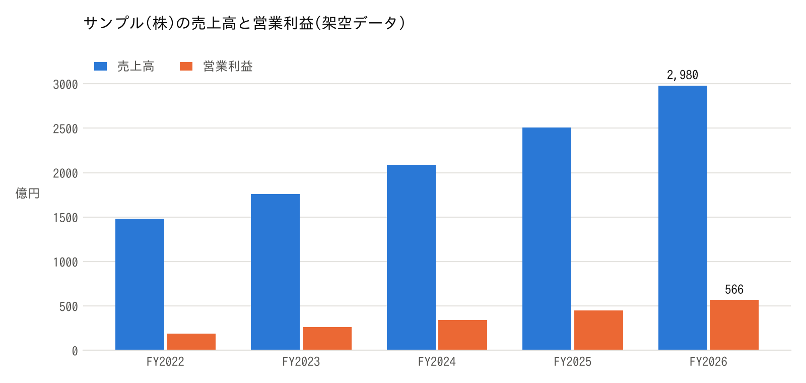

# 組版テスト: サンプル株式会社 分析メモ

本書は **組版パイプラインの動作確認用** のサンプルです。数値・社名はすべて架空であり、実在の企業・
株価とは関係ありません。日本語の長文がハードラップされていても、不要な空白が入らず自然に
連結されること、`pandoc` の記法が崩れないことを確認します。

## 1. 要旨

サンプル株式会社は、仮想のクラウドセキュリティ企業である。売上高は直近20年間で年平均13%成長し、
営業利益率は8%台から30%近くまで改善した(架空)。株価は$150~$200のレンジで推移し、PERは
18~46倍の幅で評価されてきた。10~20%の成長を維持できるかが最大の論点である。

結論は次の三点に集約される。
- **増収の源泉**は、既存顧客あたり売上の拡大(アップセル)と新規顧客の獲得の二本立てである
- *利益率の改善*は、粗利率の上昇と販管費の規模の経済で説明できる
- 資本配分は自社株買いが中心で、配当は行っていない

### 1.1 主要論点

1. 成長の持続性
   - 既存顧客の純増減率(NRR)が110%を維持できるか
   - 新製品の寄与が逓減していないか
     - 第1世代製品: 成熟期に入り、成長率は一桁
     - 第2世代製品: 売上の35%を占め、前年比+28%
2. 収益性の天井
   - 粗利率は78%が実質的な上限と見られる
3. 資本配分と株主還元

#### 1.1.1 補足(見出し4)

見出し4の見た目を確認するための段落です。見出し1から4までの階層が、色・大きさ・罫線で
はっきり区別できることを確認します。

## 2. 財務データ(12列×20行の表)

次の表は、20期分の主要指標である。8列以上の表は 7pt で組まれ、ヘッダー行は濃紺背景・白文字となり、
ページをまたぐ場合は各ページ先頭でヘッダー行が繰り返される。数値列は右寄せ、備考列は左寄せになる。

| 期 | 売上高(億円) | 前年比 | 粗利率 | 営業利益(億円) | 営業利益率 | 純利益(億円) | EPS($) | FCF(億円) | 株価($) | PER(倍) | 備考 |
|---|---|---|---|---|---|---|---|---|---|---|---|
| FY2007 | 820 | - | 66.5% | 94 | 11.5% | 72 | $0.75 | 81 | $21.12 | 28.2 | 創業期 |
| FY2008 | 886 | +8.0% | 69.6% | 79 | 8.9% | 57 | $0.58 | 48 | $17.46 | 29.9 |  |
| FY2009 | 1,080 | +21.9% | 63.1% | 142 | 13.1% | 108 | $0.91 | 124 | $26.58 | 29.1 |  |
| FY2010 | 1,345 | +24.6% | 61.8% | 373 | 27.7% | 256 | $2.60 | 223 | $69.22 | 26.6 |  |
| FY2011 | 1,637 | +21.7% | 64.1% | 350 | 21.4% | 268 | $2.57 | 303 | $50.84 | 19.8 | 新製品投入 |
| FY2012 | 1,769 | +8.1% | 64.5% | 418 | 23.6% | 301 | $2.92 | 346 | $89.67 | 30.7 |  |
| FY2013 | 1,988 | -3.2% | 74.5% | 479 | 24.1% | 324 | $2.96 | 361 | $125.81 | 42.5 |  |
| FY2014 | 2,389 | +20.1% | 65.9% | 730 | 30.5% | 472 | $4.48 | 592 | $99.65 | 22.3 |  |
| FY2015 | 2,766 | +15.8% | 61.7% | 646 | 23.4% | 514 | $4.71 | 682 | $126.04 | 26.8 | 海外拡大 |
| FY2016 | 3,306 | +19.5% | 71.1% | 705 | 21.3% | 511 | $4.41 | 699 | $137.87 | 31.3 |  |
| FY2017 | 3,933 | +19.0% | 62.0% | 949 | 24.1% | 730 | $6.09 | 944 | $158.14 | 26.0 |  |
| FY2018 | 4,481 | +13.9% | 72.4% | 382 | 8.5% | 277 | $2.79 | 241 | $54.91 | 19.7 | 大型買収 |
| FY2019 | 5,414 | +20.8% | 63.2% | 741 | 13.7% | 526 | $4.51 | 447 | $137.82 | 30.6 |  |
| FY2020 | 6,329 | +16.9% | 76.0% | 1,699 | 26.8% | 1,391 | $13.64 | 1,459 | $382.57 | 28.0 |  |
| FY2021 | 7,779 | +22.9% | 77.3% | 892 | 11.5% | 589 | $5.85 | 554 | $184.65 | 31.6 |  |
| FY2022 | 9,148 | +17.6% | 65.5% | 740 | 8.1% | 530 | $5.09 | 605 | $227.42 | 44.7 | クラウド移行 |
| FY2023 | 10,926 | +19.4% | 69.8% | 2,426 | 22.2% | 1,881 | $19.53 | 2,521 | $777.95 | 39.8 |  |
| FY2024 | 13,410 | +22.7% | 74.6% | 2,283 | 17.0% | 1,625 | $16.65 | 1,918 | $328.75 | 19.7 |  |
| FY2025 | 14,512 | +8.2% | 64.5% | 1,703 | 11.7% | 1,189 | $12.34 | 951 | $274.45 | 22.2 |  |
| FY2026 | 15,793 | +8.8% | 67.2% | 1,356 | 8.6% | 1,113 | $10.09 | 990 | $252.88 | 25.1 | 最新期 |

: 主要財務指標(架空データ、単位は列見出しのとおり)

表の直後の段落が詰まらず、適度な余白で続くことを確認する。

## 3. グラフ



グラフはページ幅に収まるよう縮小され、中央揃えで、下に「図: ...」のキャプションが付く。

## 4. 引用・コード・罫線

> **注意**: 本書の数値は組版テスト用の架空データであり、投資判断の根拠にはならない。
> 引用ブロックは左罫線つきの灰色背景で組まれる。
>
> 二つ目の段落も同じブロックとして連結される。

妥当株価の算定式(コードブロック):

```
妥当PER = 妥当PEG × 予想EPS成長率(%)
妥当株価 = 事業実態EPS × 妥当PER
        = $4.80 × (1.2 × 15)
        = $86.40
```

インラインコードは `PEG = PER ÷ EPS成長率` のように等幅で表示される。

---

水平線の後の段落。ここまでで主要な要素(見出し・段落・太字・斜体・箇条書き・表・図・引用・コード)が
一通り登場した。[外部リンクの例](https://example.com/) と脚注の例[^1]も含める。

[^1]: 脚注は本文末ではなくページ下部に組まれる。
